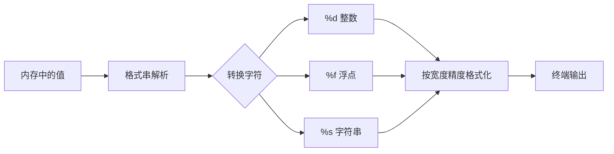

# printf函数的格式控制与使用

## 为什么需要格式控制

`printf` 的任务是把内存中的二进制数据变成人能读懂的字符。但"变成什么样"必须由程序员说清楚：整数要不要前导零？小数保留几位？一共占多宽？**格式控制字符串**就是这份"说明书"。

## 格式控制串的结构

格式串由两类字符组成：

| 成分 | 形式 | 作用 |
|------|------|------|
| 普通字符 | 空格、逗号、汉字等 | 原样输出 |
| 格式说明 | `%[标志][宽度][.精度]转换字符` | 指定对应输出项的格式 |

常用转换字符：

| 转换字符 | 含义 | 示例输出 |
|----------|------|----------|
| `%d` | 十进制整数 | `123` |
| `%f` | 浮点数（默认 6 位小数） | `12.345678` |
| `%c` | 单个字符 | `A` |
| `%s` | 字符串 | `hello` |
| `%o` / `%x` | 八进制 / 十六进制 | `173` / `7B` |

> [!IMPORTANT]
> **宽度**是"输出总宽度"（含小数点、符号），**精度**对小数而言是"小数位数"。二者由 `.` 分隔，如 `%10.3f` 表示总宽 10、小数 3 位。

## 一道典型题的完整推导

题目：`float v = 1234.5678;`，要求总宽度 10、精度 3。

先问自己：v 的值是多少？`float` 只能保证约 6~7 位有效数字，实际存储值约为 `1234.567749`。按精度 3 四舍五入后得到 `1234.568`，这部分共 **8 个字符**（4 位整数 + 小数点 + 3 位小数）。

再算宽度：总宽 10，内容 8 字符，左侧补 **2 个空格**：

```
  1234.568
```

因此应填：

```c
printf("%10.3f", v);
```

> [!TIP]
> 推导口诀：**先精度后宽度**。先按精度算出实际内容长度，再看总宽缺多少空格。`%m.nf` 中 $n$ 决定内容，$m$ 决定整体占位。

## 常见坑

> [!WARNING]
> `%f` 默认输出 6 位小数，不要误以为"原样输出"。`printf("%f", 1.5)` 得到 `1.500000`。

> [!CAUTION]
> 格式说明与输出项必须**个数相等、类型匹配**。`printf("%d %d", a)` 会读到随机值；`float` 用 `%f`、`double` 用 `%lf`（`printf` 中 `%f` 即可，`scanf` 中 `double` 必须 `%lf`）。

> [!NOTE]
> 输出项计算顺序在多数编译器下**从右到左**，因此 `printf("%d %d", a, a++)` 的结果依赖编译器，属于未定义行为，考试和工程中都要避免。

## 与 `scanf` 的对比

| 项目 | `printf` | `scanf` |
|------|----------|---------|
| 普通字符 | 原样输出 | 必须原样输入（建议只用空格） |
| 浮点格式 | `%f` / `%lf` 均可 | `float` 用 `%f`，`double` 必须用 `%lf` |
| 数组名 | 直接写数组名 | 数组名本身就是地址，**不加 `&`** |



掌握 `%m.nf` 的推导方法，配合"先精度后宽度"的口诀，这类填空题就能稳拿分。
