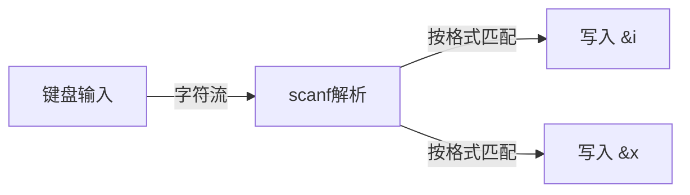

# scanf函数的格式控制与使用

---
title: scanf函数的格式控制与使用
requires: [高级语言程序设计/基本数据类型, 高级语言程序设计/变量与常量]
---

C 语言中，程序如何从键盘获取数据？这就必须依赖 `scanf` 函数。它是标准输入函数，负责按你指定的“格式”，将键盘输入的字符流解析并存储到内存中的变量里。

> [!IMPORTANT]
> C 语言规定变量必须==先定义、后使用==。`scanf` 的作用正是为已定义的变量在运行时赋予初始值。

## 格式控制串怎么写

`scanf` 的调用形式为：`scanf("格式控制串", 地址列表);`。

为什么第二个参数要传地址（如 `&x`）而不是变量名 `x`？因为函数只能通过 `return` 返回一个值，若要修改外部变量的值，就必须把变量的内存地址告诉 `scanf`，让它直接去那个位置写入数据。

常用的格式控制符需与基本数据类型严格对应：

| 数据类型 | 格式符 | 示例 |
| :--- | :--- | :--- |
| 整型 (`int`) | `%d` | `scanf("%d", &i);` |
| 单精度浮点 (`float`) | `%f` | `scanf("%f", &x);` |
| 双精度浮点 (`double`) | `%lf` | `scanf("%lf", &y);` |
| 字符 (`char`) | `%c` | `scanf("%c", &ch);` |
| 字符串 (字符数组) | `%s` | `scanf("%s", str);` |

> [!NOTE]
> 整型常量支持十进制、八进制（如 `012`）、十六进制（如 `0xA3`）。但 `scanf` 读入时，默认 `%d` 只认十进制，需用 `%o` 或 `%x` 才能正确读取八进制或十六进制输入。

## 分隔符的隐藏规则

如果格式控制串里只有 `%d%d`，输入时用什么隔开两个数？答案是空格、Tab 或回车均可，`scanf` 会自动跳过这些空白字符。

但如果格式控制串里写了普通字符呢？

> [!WARNING]
> ==格式控制串中的普通字符，输入时必须原样键入！==

看这道经典考题：已有 `int i, j; float x;`，若执行语句 `scanf("%d,%d,%f", &i, &j, &x);`，要将 -20 赋给 `i`，12 赋给 `j`，416.34 赋给 `x`，应该怎么输入？

因为格式串里有逗号 `,`，所以键盘输入必须严格包含逗号：
`-20,12,416.34`

如果你习惯性地敲成 `-20 12 416.34`，`scanf` 读完 `-20` 后期待遇到逗号，却碰到了空格，解析就会直接中断，导致后续变量赋值失败。

## 常见易错坑

> [!CAUTION]
> **漏写取地址符 `&`**：这是初学者最高频的错误。写成 `scanf("%d", i);` 会导致程序崩溃或行为未定义。注意：一维字符数组用 `%s` 读字符串时，数组名本身就是地址，不需要加 `&`。

> [!TIP]
> **`%c` 会吃掉回车符**：如果在读整数后紧接着读字符（`scanf("%d", &n); scanf("%c", &ch);`），`%c` 会把前一次输入留在缓冲区里的换行符 `\n` 读走。解决办法是在 `%c` 前加个空格：`scanf(" %c", &ch);`。

> [!WARNING]
> **`%s` 遇空格即停**：正如课件所指出的，使用 `scanf("%s", name)` 输入字符串时不能包含空格。如果需要读入带空格的整行文本，应改用 `gets()` 或 `fgets()`。

最后提醒，`scanf` 负责按格式“精准读入”，而按一定格式输出通常使用 `printf`（例如要求输出总宽度为 10、精度为 3 的浮点数，应写 `printf("%10.3f", v);`）。两者格式控制思想相似，但方向相反，切勿混淆。
