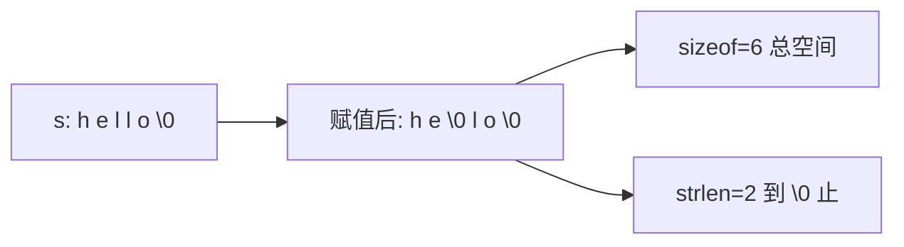

# sizeof运算符与strlen函数计算长度的区别

## 它是什么

在 C 语言字符串处理里，经常要问“这块东西占多大”和“字符串有多长”。==`sizeof` 是运算符，算数据类型/变量占的内存字节数；`strlen` 是 string.h 里的函数，算“遇到 `\0` 前的有效字符个数”==。

看课件里的例子：

```c
char s[] = "hello";   // 用字符串初始化，s 有 6 个元素
s[2] = '\0';          // 把第 3 个字符改成结束标志
printf("%d\n", sizeof(s));  // 输出 6
printf("%d\n", strlen(s));  // 输出 2
```

为什么 `sizeof(s)` 是 6？`"hello"` 有 5 个字母，系统自动补结尾标记 `\0`，数组一共 6 个 `char`，每个 `char` 占 1 字节，所以是 6。为什么 `strlen(s)` 是 2？改完后内存里前三个字符是 `'h'`、`'e'`、`'\0'`，`strlen` 从首地址数到 `\0` 就停，因此长度是 2。



## 为什么需要两个东西

数组开了多大，和字符串“看起来有多长”，不是一回事。比如 `char str[20]="ABCDE"`，数组空间是 20 字节，但有效字符串长度只有 5。输入输出 `%s`、比较 `strcmp`、求长度 `strlen` 都按 `\0` 判断结尾；而分配空间、数组名做 `sizeof` 要看真实容量。只记一个就会在越界和长度题上丢分。

## 怎么做：算 sizeof 和 strlen

| 对比项 | `sizeof` | `strlen` |
|---|---|---|
| 身份 | 运算符，编译期求值 | `<string.h>` 函数，运行扫描 |
| 问的问题 | 占几字节 | 到 `\0` 前有几个字符 |
| 对 `char s[]="hello"` | $6$（含 `\0`） | $5$（不含 `\0`） |
| 对指针 `p`（见选择 22） | 指针本身大小，如 $4/8$ | 须指向字符串才可用 |
| 结束标志 `\0` | 计入 | 不计入 |

选择 22 里 `int m[10], *p=m;`：`sizeof(m)` 是整个数组 $10\times4=40$，$sizeof(*m)$ 和 `sizeof(*p)` 都是首元素 `int` 即 $4$，而 `sizeof(p)` 是指针变量大小 $4$ 或 $8$——在常见 32 位环境它和 `sizeof(*p)` 不同，故选 A。

## 常见的坑

> [!WARNING]
> `strlen` 只认 `\0`，不认转义字符的“显示效果”。例如 `strlen("a\012b\xab\0cd\n")`：先 `'a'`、再 `\012`（一个八进制字符）、`'b'`、`\xab`（一个十六进制字符），然后遇到显式 `\0` 停止，长度是 4，选 A。

> [!CAUTION]
> `sizeof("AB\bCDEF\rGH\123")` 里 `\b`、`\r`、`\123` 各是 ==一个==转义字符，再加结尾 `\0`：字母 A B C D E F G H 共 8 个 + 3 个转义 + 1 个 `\0` = $12$，不是数表面字母个数。

> [!TIP]
> 做题先画内存：画格子写字符，标出所有 `\0`，`sizeof` 数全部格子，`strlen` 数第一个 `\0` 之前的格子。

一个算对了的例子就来自上面：

```c
char s[] = "hello";
s[2] = '\0';
// sizeof(s) = 6 ：定义时 6 个 char 空间
// strlen(s) = 2 ：'h','e' 后是 \0
```

记住 ==`sizeof` 看容量含 `\0`，`strlen` 看有效长度到 `\0` 止==，这两类题就不会混。
