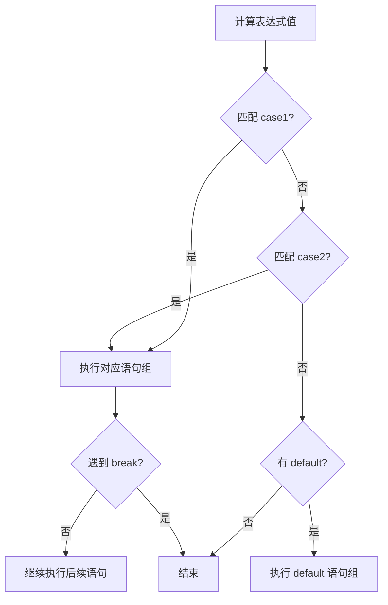

# switch多分支选择语句及其说明

## switch 多分支选择语句

当程序需要根据一个变量的取值，在多个互斥分支中选择一个执行时，用一堆 `if...else if` 虽然也能写，但层次深、可读性差。C 语言提供了 `switch` 语句，专门用来做“按值分支”。

### 基本语法与执行流程

```c
switch (表达式) {
    case 常量1:  语句组1
    case 常量2:  语句组2
    ...
    default:     语句组n
}
```

执行时先计算 `switch` 后面表达式的值，然后**从上到下**依次与每个 `case` 后面的常量比较。一旦匹配到某个 `case`，就从该位置开始**顺序执行**后面的所有语句，直到遇到 `break` 或整个 `switch` 结束；如果没有任何 `case` 匹配，则执行 `default` 分支（如果有的话）。



> [!IMPORTANT]
> `switch` 后面的表达式必须是**整型、字符型或枚举类型**（字符型本质是整型）。不能是浮点型、字符串或其他复合类型。`case` 后面的常量值必须是**编译期确定的整型常量表达式**，且各 `case` 常量值必须**互不相同**。

### break 与“穿透”现象

`break` 在 `switch` 中并不是语法强制要求的。如果某个 `case` 分支末尾没有写 `break`，执行完该分支后会**继续进入下一个 `case` 分支**，这称为“穿透”或“fall-through”。

```c
int x = 5;
switch (x) {
    case 5: x++;
    case 6: x++;
    case 7: x++; break;
    default: x++;
}
```

执行过程：

| 步骤 | 位置 | 操作 | x 的值 |
|:---:|:---:|:---:|:---:|
| 初始 | — | — | 5 |
| 1 | 匹配 `case 5` | `x++` | 6 |
| 2 | 穿透到 `case 6` | `x++` | 7 |
| 3 | 穿透到 `case 7` | `x++` | 8 |
| 4 | 遇到 `break` | 退出 `switch` | 8 |

==最终结果是 8，而不是 6。== 注意：初始值 5 匹配的是 `case 5`，此后**不会**再检查 `case 6` 或 `case 7` 的条件，而是直接顺序执行。

> [!WARNING]
> 穿透现象是初学者最容易踩的坑。即使你“只想执行一个分支”，一旦漏写 `break`，后续所有分支都会被执行。有时人们会**故意利用穿透**——比如多个 `case` 共享同一段处理代码时可以连续写：

```c
case 'a':
case 'A':
    printf("按下了 A 键\n");
    break;
```

### 常见误区与选择

`default` 不是必需的，可以省略；当所有 `case` 都不匹配且没有 `default` 时，`switch` 什么都不做。`default` 也可以放在任意位置（不一定是最后），但通常建议放在最后。

`case` 后面不能写变量或范围表达式，比如 `case x:`、`case 1..5:` 都是非法的。每个 `case` 的常量值在同一条 `switch` 中必须唯一，否则编译报错。

> [!TIP]
> 判断对错的口诀：**“case 可不带 break，default 可不写，表达式要整型，常量要唯一。”** 选项里出现“必须”“一定”之类的绝对化表述时，要格外警惕——C 语法中真正“必须”的东西并不多。

### 与 if-else 的对比

| 维度 | switch | if-else |
|:---|:---|:---|
| 适用场景 | 单个变量的**离散值**判断 | 任意条件（区间、逻辑组合、比较运算） |
| 可读性 | 分支多时更清晰 | 分支多时嵌套深、难读 |
| 表达式类型 | 仅整型/字符型/枚举 | 任意可判断真假的表达式 |
| 分支匹配 | 精确等值比较 | 任意关系或逻辑运算 |

简言之：==离散等值判断优先用 `switch`，区间或复合条件用 `if-else`。==
