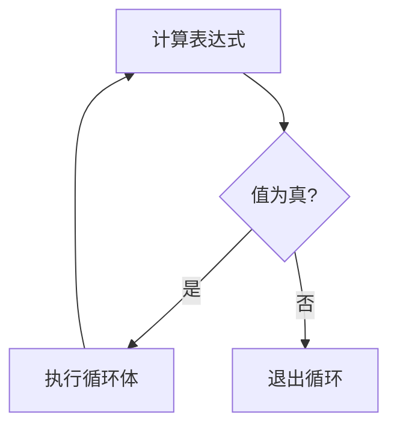

# while当型循环语句（含赋值与比较陷阱）

`while` 语句是 C 语言中典型的**当型循环**结构。它的核心逻辑很简单：==先判断条件，再决定是否执行循环体==。如果一开始条件就不成立，循环体一次也不会执行。

为什么需要它？当你无法提前确定循环要跑多少次（比如“一直读取输入直到遇到回车”），或者循环的终止依赖于运行时的动态计算时，`while` 比 `for` 更直观。

## 语法与执行流程

基本格式如下：
```c
while (表达式) {
    循环体;
}
```

> [!IMPORTANT]
> 核心机制：**先判断，后执行**。只要 `表达式` 的值非零（即为真），就反复执行循环体；一旦为零（假），立即跳出。



## 与相近概念的区别

| 特性 | `while`（当型） | `do...while`（直到型） | `for` |
| :--- | :--- | :--- | :--- |
| **判断时机** | 先判断，后执行 | 先执行，后判断 | 先判断，后执行 |
| **最少执行次数** | 0 次 | 1 次 | 0 次 |
| **适用场景** | 次数未知、条件驱动 | 至少需执行一次的场景 | 次数已知或步长固定 |

## 常见陷阱：赋值与比较

在写 `while` 的条件表达式时，最容易踩进两个坑。

### 误用赋值号 `=` 代替 `==`

想问自己一个问题：如果在条件里写了 `i = 2`，程序会怎么跑？

```c
int i = 0;
while (i = 2) { // 致命错误！
    i++;
}
```

> [!CAUTION]
> `i = 2` 是**赋值表达式**，其结果就是被赋的值 `2`。因为 $2 \neq 0$，条件永远为真，直接导致**死循环**！必须写成 `i == 2` 才是比较。

### 连续关系运算符的结合性

再看一个考试真题中的经典陷阱：`a < b < c` 真的表示“b 在 a 和 c 之间”吗？

```c
a=3; b=4; c=5;
while(a<b<c) { ... }
```

> [!WARNING]
> C 语言中 `<` 是**左结合**的。`a < b < c` 会被编译器解析为 `(a < b) < c`。
> 第一步：算 `3 < 4`，结果为真，即整型值 `1`。
> 第二步：算 `1 < 5`，结果仍为真（`1`）。
> 无论 `a` 和 `b` 怎么变，`(a < b)` 的结果只能是 `0` 或 `1`，而 `c` 在不断自增，所以 `0 < c` 或 `1 < c` 永远成立，形成死循环。若要表达数学上的连不等式，必须写成 `a < b && b < c`。

## 完整推演示例

以一道南邮期末选择题为例，看看如何一步步推算执行次数：

```c
int i = 0;
while(i != 2)
    i++;
```

不要靠直觉猜，跟着流程图手动推演变量状态：

| 轮次 | 进入前 `i` 的值 | 条件 `i != 2` | 是否执行 | 执行后 `i` 的值 |
| :---: | :---: | :---: | :---: | :---: |
| 1 | 0 | $0 \neq 2$ (真) | 是 | 1 |
| 2 | 1 | $1 \neq 2$ (真) | 是 | 2 |
| 3 | 2 | $2 \neq 2$ (假) | 否，跳出 | - |

> [!TIP]
> 结论：循环体共执行了 ==2 次==。做这类题的口诀是：**“带入初值看条件，执行完毕更新量，下次判断用新值”**。

另外，如果循环体内包含 `continue` 语句（如阅读题中 `if (i == 2) continue;`），要注意 `continue` 只是跳过本次循环体剩余的代码，直接去执行下一次**条件判断**，而不是终止整个循环。确保 `continue` 之前已经更新了控制变量，否则极易引发死循环。
