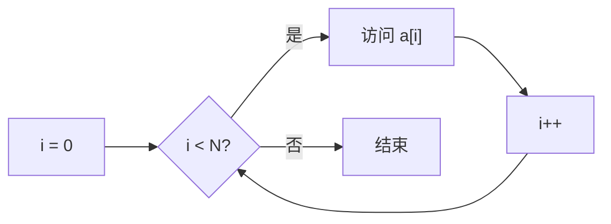
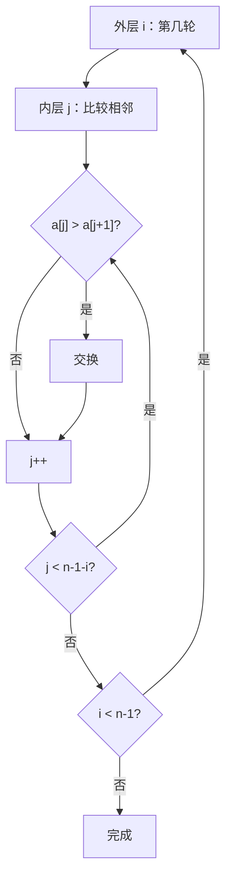

# 利用循环实现对一维数组元素的访问

## 从哪里开始

一维数组 `int a[10];` 声明之后，计算机在内存里划出连续 10 个 `int` 大小的空间。要处理这 10 个元素，逐个写 `a[0]`、`a[1]`、……、`a[9]` 不仅冗长，而且数组大小一变代码就作废。循环的价值在于：==用一个整型下标变量 `i`，让同一段代码在 `i = 0, 1, …, N-1` 时各执行一次==。

数组下标从 `0` 开始，所以 N 个元素的有效下标是 `0` 到 `N-1`。循环头也因此几乎总是：

```c
for (i = 0; i < N; i++)
```

这里没有 `<=`，因为 `a[N]` 已经越界。



## 顺序访问：输入与输出

从键盘读入 10 个元素，标准写法是：

```c
for (i = 0; i < 10; i++)
    scanf("%d", &a[i]);
```

输出同理：

```c
for (i = 0; i < 10; i++)
    printf("%d ", a[i]);
```

> [!WARNING]
> `scanf` 里必须写 `&a[i]` 而不是 `a[i]`。`a[i]` 是元素的值，`&a[i]` 才是这个元素的地址。漏掉 `&` 是考试里最常见的错误之一。

## 不只是“过一遍”：遍历中的累计与查找

很多问题在遍历的同时维护一个或几个“状态量”。以“求最大值”为例，循环每轮只做一件事：把当前元素和目前的最大值比较，必要时更新。

```c
int max = a[0];
for (i = 1; i < 10; i++)
    if (a[i] > max)
        max = a[i];
```

> [!TIP]
> 求最大值时 `max` 的初值取 `a[0]`，循环从 `i = 1` 开始，这样保证数组非空时逻辑正确。若初值取 0，遇到全负数数组会出错。

同样的模板套到求和：

```c
int sum = 0;
for (i = 0; i < 20; i++)
    sum += a[i];
```

再进一步，“去掉最大值和最小值后求平均值”其实是三种遍历的组合：先求总和，同时记录最大值和最小值——这可以在同一个循环里完成：

```c
int sum = 0, max = a[0], min = a[0];
for (i = 0; i < 20; i++) {
    sum += a[i];
    if (a[i] > max) max = a[i];
    if (a[i] < min) min = a[i];
}
double avg = (sum - max - min) / 18.0;
```

## 比较型遍历：冒泡排序

排序的本质是两两比较。每一轮把当前范围内最大（或最小）的元素“沉”到最后，下一轮范围缩小 1。



```c
void sort(int a[], int n) {
    int i, j, temp;
    for (i = 0; i < n - 1; i++)                // n-1 轮
        for (j = 0; j < n - 1 - i; j++)        // 每轮比较范围缩小 1
            if (a[j] > a[j + 1]) {             // 相邻比较
                temp = a[j];
                a[j] = a[j + 1];
                a[j + 1] = temp;
            }
}
```

> [!IMPORTANT]
> 两个边界必须记清：外层循环到 `n - 1` 为止（n 个数最多需要 n-1 轮），内层循环到 `n - 1 - i` 为止（每轮结束后最后 i 个元素已就位）。

## 数组名作函数参数

调用 `sort(a, 10)` 时，实参写成 `a`，不带方括号。函数首部写 `int a[]`，本质上接收到的是数组首元素的地址。

> [!NOTE]
> `void sort(int a[], int n)` 中的 `int a[]` 等价于 `int *a`。数组名作实参传的是地址，所以函数内部对 `a[j]` 的修改会直接改变主调函数里数组的内容——这是“传地址”的结果，不是“传值”。

这一特性解释了为什么 `sort` 函数可以通过参数把排序结果“带回来”，而不需要 `return` 数组。它也引出一个常见的混淆：

| 写法 | 含义 |
|------|------|
| `a[i]` | 第 i 个元素的值 |
| `&a[i]` | 第 i 个元素的地址 |
| `a + i` | 等价于 `&a[i]` |
| `*(a + i)` | 等价于 `a[i]` |

## 常见的坑

- **下标越界**：`int a[10];` 引用了 `a[10]`。这不会在编译时报错，但访问了不属于数组的内存，结果不可预期。选择题中 `a[10]` 是错误引用，`a[10-10]` 即 `a[0]` 才是合法的。
- **下标为浮点数**：`a[3.5]` 语法错误，下标必须是整型表达式。
- **括号形式**：`a(5)` 是把数组名当函数调用，完全错误。
- **循环边界写 `<=`**：`for (i = 0; i <= 10; i++)` 会越界访问 `a[10]`。
- **嵌套循环用错下标变量的边界**：冒泡排序内层循环如果写成 `j < n - 1`，不会出错但多做无意义的比较；如果写成 `j < n`，`a[j+1]` 就会越界。

## 一个算对了的例子

以填空 5 为例：`int m[10] = {9,4,12,8,2};`

数组按从左到右赋初值：

| 下标 | 0 | 1 | 2 | 3 | 4 | 5~9 |
|------|---|---|---|---|---|-----|
| 元素 | 9 | 4 | 12 | 8 | 2 | 0 |

要求 `m[m[1] + m[4]]`。先算内层下标：`m[1] = 4`，`m[4] = 2`，和为 `6`。再取 `m[6]`，由于下标 5~9 未显式初始化，默认是 0，所以 `m[6] = 0`，所以结果为 ==0==。这个例子说明两点：内层表达式先求值，未赋初值的数组元素自动补 0。
