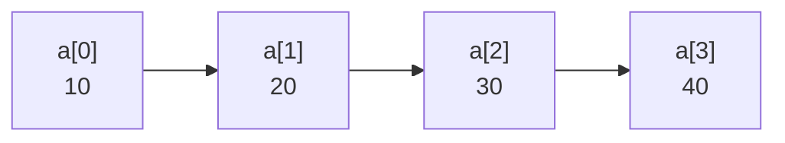

# 一维数组的定义格式与内存存储方式

## 为什么要用一维数组

如果程序要保存 10 个学生的成绩，难道要定义 `score1`、`score2`……`score10` 十个变量吗？这样不仅书写麻烦，也无法方便地用循环统一处理。

一维数组用于保存**一组类型相同的数据**，并通过下标区分各个元素。例如：

```c
int a[10];
```

它表示定义了一个名为 `a` 的整型数组，可以存放 10 个 `int` 型元素。

## 一维数组的定义格式

一般格式为：

```c
类型说明符 数组名[常量表达式];
```

例如：

```c
int a[10];       // 10 个 int 型元素
double b[5];     // 5 个 double 型元素
char c[20];      // 20 个 char 型元素
```

其中：

- **类型说明符**：规定所有元素的数据类型；
- **数组名**：遵循标识符命名规则；
- **常量表达式**：决定数组长度，即元素个数。

> [!IMPORTANT]
> 数组长度为 $N$ 时，合法下标是 $0\sim N-1$，==不存在下标为 $N$ 的元素==。例如 `int a[10];` 的元素是 `a[0]` 到 `a[9]`。

定义数组后，可以通过下标访问元素：

```c
a[0] = 85;
scanf("%d", &a[1]);
printf("%d", a[0]);
```

下标可以是变量或表达式，因此数组特别适合与循环配合：

```c
int a[10], i;

for (i = 0; i < 10; i++) {
    scanf("%d", &a[i]);
}
```

## 数组在内存中的存储方式

一维数组的元素在内存中==按下标递增的顺序连续存放==，每个元素占用的字节数由元素类型决定。

假设：

```c
int a[4] = {10, 20, 30, 40};
```

若一个 `int` 占 4 字节，则可示意如下：

| 数组元素 | `a[0]` | `a[1]` | `a[2]` | `a[3]` |
|---|---:|---:|---:|---:|
| 元素值 | 10 | 20 | 30 | 40 |
| 相对首地址的偏移 | 0 | 4 | 8 | 12 |

若数组首地址为 $\text{base}$，每个元素占 $s$ 字节，则 `a[i]` 的地址为：

$$
\&a[i]=\text{base}+i\times s
$$

因此，下标从 0 开始并非随意规定：`a[0]` 的偏移量就是 0。



整个数组所占空间通常为：

$$
\text{数组总字节数}=\text{元素个数}\times\text{单个元素字节数}
$$

所以上述 `a` 数组通常占 $4\times4=16$ 字节，可用 `sizeof(a)` 求得。

## 数组名与指针、变量的区别

数组名在多数表达式中会转换为指向首元素的指针，因此：

```c
int a[10];
int *p;
p = a;          // 等价于 p = &a[0]
```

此时 `p`、`a` 都能用于访问首元素，但二者并不完全相同：

| 比较内容 | 数组名 `a` | 指针变量 `p` |
|---|---|---|
| 本质 | 数组的标识 | 保存地址的变量 |
| 能否重新赋值 | 不能，如 `a = p;` 错误 | 可以，如 `p = a;` |
| `sizeof` 结果 | 通常为整个数组的字节数 | 指针本身的字节数 |
| 首元素 | `a[0]` 或 `*a` | `p[0]` 或 `*p` |

> [!WARNING]
> `a` 与 `&a[0]` 的值通常相同，但 `a` 不是可以被随意修改的普通指针变量。尤其不能写 `a = "abcdef";` 给整个数组重新赋值。

## 常见的坑

- **长度不是最大下标**：`int a[10];` 有 10 个元素，最后一个为 `a[9]`。
- **越界访问**：`a[10]` 不属于该数组，程序可能输出异常结果，甚至崩溃。
- **只定义未初始化**：局部数组元素的值通常是不确定的，不能直接使用。
- **把数组名当变量赋值**：数组之间不能直接用 `=` 整体赋值。
- **混淆元素和地址**：`a` 常可表示首地址，`*a` 等价于 `a[0]`，二者类型不同。

## 例题

若有定义：

```c
int m[10] = {9,4,12,8,2,10,7,5,1,3}, *p = m;
```

则 `sizeof(m)` 求的是整个数组的大小。若 `int` 占 4 字节，结果为：

$$
10\times4=40
$$

而 `sizeof(p)` 是指针大小，`sizeof(*m)` 与 `sizeof(*p)` 都是一个 `int` 元素的大小。因此，==`sizeof(m)` 的结果与其他三个不同==。
