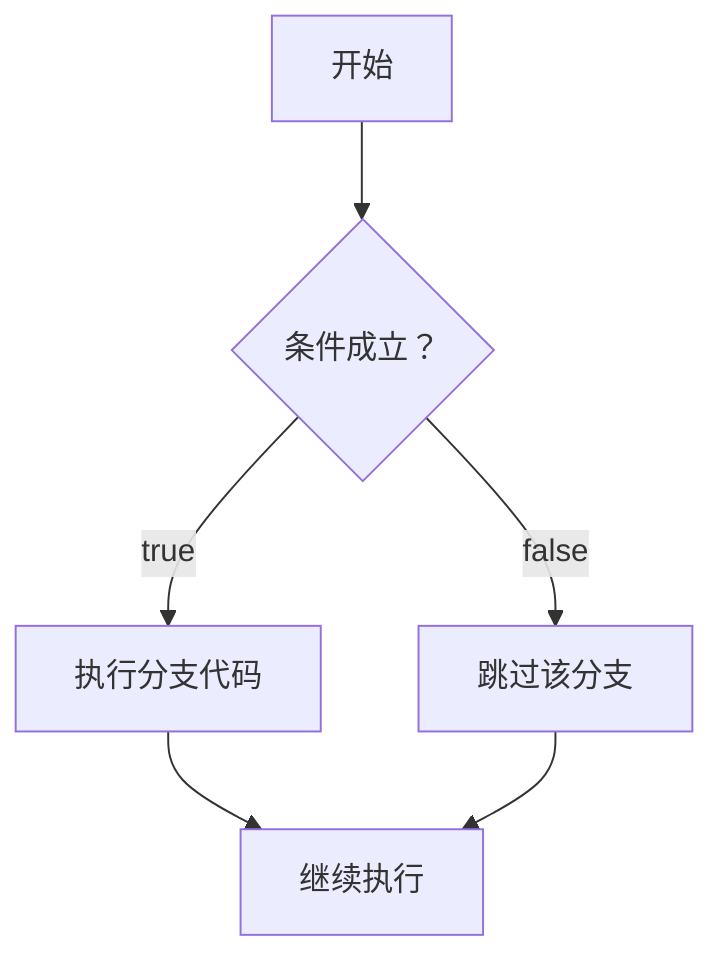
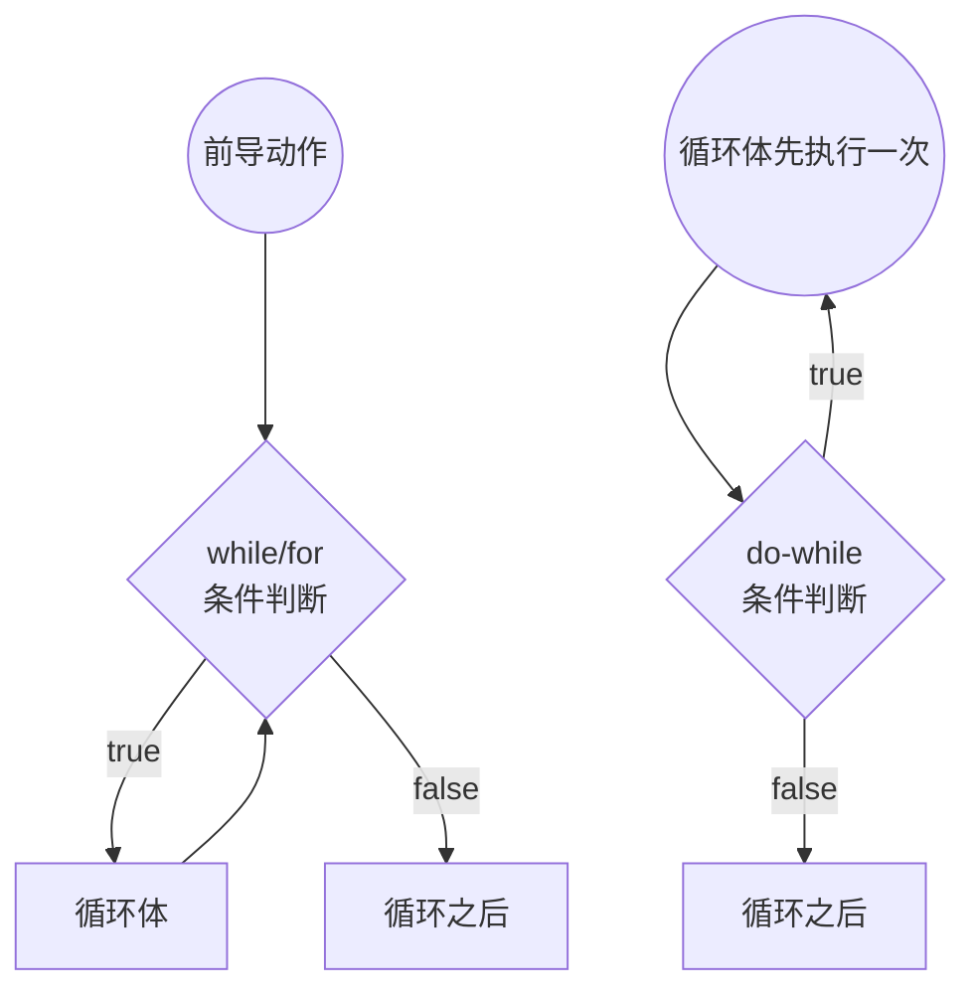

# 顺序、选择、循环三种基本控制结构

在 C 语言里，程序的执行路径由三种基本结构决定：**顺序结构**、**选择结构** 和 **循环结构**。我们可以把程序想象成一条流水线——有时需要笔直前行，有时要分岔，有时又要折返。

## 顺序结构

这是最基础的结构。如果没有特别说明，程序总是从上到下，==一条语句执行完才执行下一条语句==。就像看一本没有跳转的小说。

```c
int a = 10;
int b = a + 5;
printf("%d", b);
```

你不需要额外控制，编译器默认就是按顺序翻译、按顺序执行。

## 选择结构

现实里总要“看情况办事”。选择结构能让程序在某个条件成立时走一条路，不成立时走另一条（或者干脆不走）。



### if 语句

`if` 会计算括号里的表达式，结果非零就执行后面的语句。复合语句必须用 `{ }` 包起来。

```c
if (x > 0)
    printf("正数");   // 只有一句时可以省略花括号
else if (x == 0)
    printf("零");
else
    printf("负数");
```

`else` 总会和离它最近的、尚未匹配的 `if` 配对——==不要被缩进骗了==。下面这段代码缩进看起来像是 `else` 属于外层 `if`，但实际上它属于内层。

```c
if (a > 0)
    if (b > 0)
        printf("a 和 b 都为正");
else
    printf("a ≤ 0");   // 与内层 if 配对，实际只在 b≤0 时执行
```

> [!WARNING]
> **经典陷阱**：缩进只对人眼友好，但不代表程序逻辑。想修正上述代码，必须加 `{ }`：
> ```c
> if (a > 0) {
>     if (b > 0)
>         printf("a 和 b 都为正");
> } else
>     printf("a ≤ 0");
> ```

### switch 语句

当条件是同一个变量与多个常量比较时，`switch` 比层层嵌套的 `if` 更清晰。它先计算 `switch` 后面的表达式（必须是整型或字符型），然后跳转到匹配的 `case` 标签，==接着顺序执行直到遇到 `break` 或 `switch` 末尾==。

```c
switch (grade) {
    case 'A': printf("优秀\n"); break;
    case 'B': printf("良好\n"); break;
    case 'C': printf("及格\n"); break;
    default:  printf("未知等级\n");
}
```

| 结构   | 特点                                 |
|--------|--------------------------------------|
| if-else| 灵活，适合范围判断、复杂条件         |
| switch | 结构清晰，只适合整型/字符型的相等比较 |

> [!IMPORTANT]
> **穿透现象**：如果某个 `case` 后面没写 `break`，程序会继续执行下一个 `case` 的代码，语法上完全允许。`default` 可以不写。真题常见误区是“case 必须以 break 结束”——正确的说法是：==`case` 不是一定要用 `break` 结束，但通常情况下你需要它来阻断穿透。==

## 循环结构

当一段代码需要重复执行时，我们用循环。三种循环各有适用场景：



- **while**：先判断，再执行。可能一次都不执行。
- **do-while**：先执行，再判断。==至少执行一次==。
- **for**：把初始化、条件、步进放在一起，适合已知次数的循环。

> [!TIP]
> 写 `for` 循环的分号别漏，三个表达式都可以省略，但两个分号一个都不能少。

---

**算对一个例子**（来自真题改编）

```c
int i = 0;
while(i != 2)
    i++;
printf("i = %d", i);
```

一步步执行：

1. `i=0`，`0 != 2` 为真，进入循环，`i` 变为 1。
2. `i=1`，`1 != 2` 为真，再次进入，`i` 变为 2。
3. `i=2`，`2 != 2` 为假，==跳出循环==。

循环体被执行了 2 次，最终输出 `i = 2`。

> [!CAUTION]
> 看到 `while(i != 2)` 这种写法别下意识就填“无限次”。要认真检查循环内的步进方向和初始值——本例就是正常结束，并非死循环。只有像 `while(i != 2) i--;` 且 `i` 初值小于 2 时，才会陷入永不终止的窘境。

这三种结构可以互相嵌套，任意复杂的程序都由它们组合而成。掌握它们，你就掌握了阅读与编写 C 代码的最核心能力。
