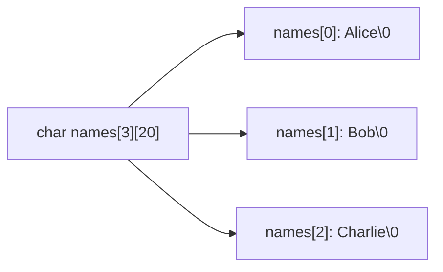

# 利用二维字符数组读入、输出多个字符串

## 二维字符数组处理多个字符串

### 问题引入

C 语言里，一个字符串本身就是一维的字符数组。现在要处理多个字符串，比如一份名单，该怎么办？

一个直觉的想法：用多个独立的一维数组。

```c
char s1[20], s2[20], s3[20];
```

但若名字有 100 个呢？显然不可行。  
于是引出 —— 用一个**二维数组**，每一行存放一个字符串。

### 它是什么



在 `names[3][20]` 中：

- **第一维 `3`**：最多存放 3 个字符串（行数）。
- **第二维 `20`**：每个字符串最多 19 个有效字符，最后留 1 个给 `'\0'`。

这里每一行本身就看作一个合法的字符串 `names[i]`，可以直接传给 `scanf` 或 `printf` 的 `%s` 格式。

> [!IMPORTANT]
> `==names[i]` 是第 i 个字符串的起始地址==，类型是 `char *`，这就是为什么能用 `%s` 直接处理整行。

### 为什么需要

- 批量处理多行文本：学生姓名、单词表、菜单选项。
- 程序结构更精简，避免为每个字符串单独声明变量。
- 配合循环统一输入/输出，提升可读性。

### 怎么做

**① 输入多个字符串**

```c
char strs[5][30];          // 5行，每行最长 29 个字符
for (int i = 0; i < 5; i++) {
    scanf("%s", strs[i]);  // 读取一个单词，遇空格结束
}
```

> [!WARNING]
> `scanf("%s", strs[i])` 读入时遇到**空格、Tab 或回车**就停止一次。  
> 若想让一行内带空格的完整句子存入，需改用 `gets(strs[i])` 或 `fgets(strs[i], 30, stdin)`。

**② 输出多个字符串**

```c
for (int i = 0; i < 5; i++) {
    printf("%s\n", strs[i]);
}
```

### 与指针数组的对比辨析

| 方案 | 代表形式 | 内存特点 | 字符串长短不同时 |
|------|---------|---------|------------------|
| 二维字符数组 | `char a[3][20]` | 编译时分配固定矩形空间 | 浪费内存，长度被统一限制 |
| 指针数组 | `char *p[3]` | 动态分配或指向字面量 | 灵活，每个字符串长度独立 |

二维字符数组更静态、简单；指针数组更灵活，但内存管理略复杂。  
初学阶段，把二维字符数组当成 `==“定长字符串表格”==` 来理解最直观。

### 常见易错点

> [!CAUTION]  
> 1. 第二维大小不够：`char names[3][5]` 无法放下 `"Alice"`（含 `'\0'` 需 6 字节），程序会**越界而不报错**，造成不可预测的行为。  
> 2. 忘记 `'\0'` 的空间：长度为 20 只能容纳 19 个有效字符。  
> 3. `scanf("%s", names[i][0])` 是错的，应写 `names[i]`，而非取具体字符地址。  
> 4. 混淆行与列：`names[i][j]` 是单个字符，`names[i]` 才是一个字符串。

### 完整的正确示例

需求：输入 4 个姓名，每个最长 15 个字母，然后打印。

```c
#include <stdio.h>
int main() {
    char name[4][16];         // 第二维 +1 存 '\0'
    printf("输入4个姓名：\n");
    for (int i = 0; i < 4; i++) {
        scanf("%15s", name[i]); // 限制读入长度避免越界
    }
    printf("你输入的是：\n");
    for (int i = 0; i < 4; i++) {
        printf("%s\n", name[i]);
    }
    return 0;
}
```

> [!TIP]
> `scanf("%15s", name[i])` 中的 `15` 是**最大域宽**，可防止读入过长字符串导致溢出，这是更安全、更推荐的做法。
