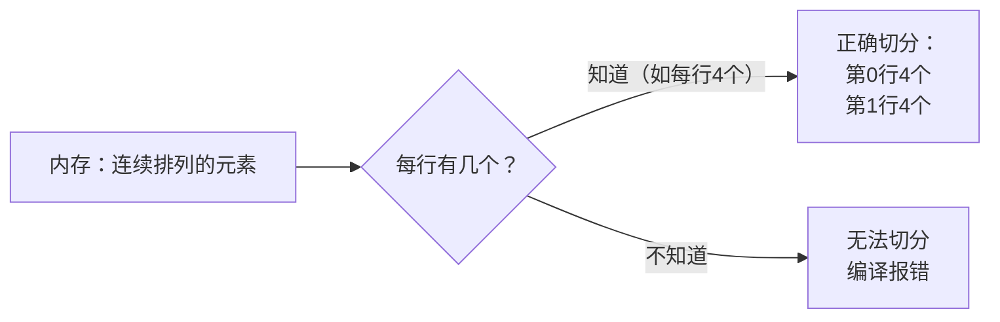

# 二维数组按行赋值的初始化方法

## 二维数组：按行赋值的初始化

假想你要存储三个学生的四门课成绩，自然会想画一个 3 行 4 列的表格。在 C 语言里，这个表格就是二维数组。定义二维数组时，编译器必须知道每一行有多长，才能把一长串数据准确地切成一段一段，放进对应的行里。

### 为什么第二维必须写清楚

试想一个装箱问题：你有一排连续的长条形盒子，要在里面放苹果，要求每排放 4 个。如果我不知道每排能放几个，我怎么知道第一排放到哪儿结束、第二排从哪儿开始？



这就是==二维数组初始化时，第一维（行数）可以省略，但第二维（列数）必须显式给出==的根本原因。

[!IMPORTANT]
> 核心规则：`int a[][列数] = {...};` 合法；`int a[行数][] = {...};` 非法。

编译器看到列数之后，会按“填满一行再填下一行”的规则，把初始化列表中的值依次填入。如果数据填不满最后一行，剩余位置自动补 0。

### 常见哪些写法正确

| 写法 | 是否合法 | 解释 |
| :--- | :--- | :--- |
| `int a[2][3] = {1,2,3,4,5,6};` | 合法 | 显式指定 2 行 3 列，完全填充 |
| `int a[][3] = {1,2,3,4,5,6};` | 合法 | 省略行数，编译器算出 6 个元素需要 $6/3=2$ 行 |
| `int a[][3] = {1,2,3,4};` | 合法 | 4 个元素，每行 3 个，需要至少 2 行。第 1 行：1,2,3；第 2 行：4,0,0 |
| `int a[3][] = {1,2,3,4,5,6};` | 非法 | 第二维缺失，编译器无法切分 |
| `int a[2][3] = {1,2,3,4,5,6,7};` | 非法 | 提供了 7 个元素，但数组总共只有 $2 \times 3 = 6$ 个位置 |

[!WARNING]
> 若初始化列表的元素个数**超过**数组总容量，编译器会直接报错，并不会“截断”多余部分。

### 一个算对了的例子

课本习题中这道题问“能正确定义二维数组的是”，正确答案是 `int x[][2] = {2*2};`。

我们把 `2*2` 拆开看：它是一个常量表达式，值为 4。初始化列表相当于 `{4}`。数组第二维是 2，所以：
- 第 0 行：4, 0
- 编译器根据元素个数 1，算出需要 $1/2=0.5$ 即至少 1 行。

所以最终定义了一个 1 行 2 列的二维数组，完全合法。

### 按行赋值的展开技巧

如果初始化时用了花括号分组，如：
```c
int a[][3] = {{1,2}, {3}};
```
这相当于明确告诉编译器：第 0 行给 1 和 2，缺的补 0；第 1 行只给 3，后面两个补 0。最终数组为 2 行 3 列，内容：

```
第 0 行: 1  2  0
第 1 行: 3  0  0
```

这种分组方式可以让你不按顺序补齐，但每组内部的元素依然从左到右填入，==每组末尾若元素不足，照样补 0==。

[!TIP]
> 记一个口诀：**“列数不能省，行数自己算；元素不够补零，元素超了报错。”**

掌握了这个规则，二维数组初始化的题目就基本不会踩坑了。
