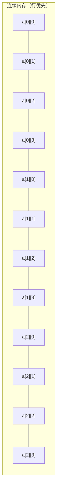

# 二维数组的定义格式与行优先存储原则

## 二维数组的定义

把数据想象成一张表格：有若干行、若干列。程序里需要存放学生的多门课成绩、图像的像素点，或者矩阵运算的数据时，==二维数组==就是最直接的选择。

定义二维数组时，需要给出**行数**和**列数**：

```c
数据类型 数组名[行数][列数];
```

例如 `int a[3][4];` 定义了一个 3 行 4 列的整型数组，共有 $3 \times 4 = 12$ 个元素。

> [!IMPORTANT]
> 二维数组本质上是“数组的数组”——`a[3][4]` 可以理解为有 3 个元素的一维数组，其中每个元素又是一个有 4 个整数的一维数组。

## 行优先存储：内存里如何摆放

C 语言中，二维数组在内存里是**按行连续存放**的。第 0 行的所有元素先存完，紧接着第 1 行、第 2 行……就像写文章，一行写完再换行。



这个顺序直接决定了一个常考结论：
> 对于 `int a[m][n]`，元素 `a[i][j]` 前面共有 ==$i \times n + j$== 个元素。

为什么？前面有完整的 $i$ 行（第 0 行到第 $i-1$ 行），每行 $n$ 个元素，共 $i \times n$ 个；再加上当前行中排在它前面的 $j$ 个元素（列下标 $0$ 到 $j-1$），总数就是 $i \times n + j$。

> [!WARNING]
> 行优先意味着**行下标变化慢，列下标变化快**。计算偏移量时乘的是**列数** $n$，不是行数。这是学期考试中极高频率的坑。

## 初始化：哪些写法合法

定义数组时可以同时赋初值：

```c
// 全部初始化
int a[2][3] = {1, 2, 3, 4, 5, 6};

// 分行初始化，更直观
int b[2][3] = {{1, 2, 3}, {4, 5, 6}};

// 允许只部分赋值，剩余元素自动补 0
int c[2][3] = {1, 2};       // a[0][0]=1, a[0][1]=2, 其余为 0

int d[2][3] = {{1}, {4}};   // 每行第一个指定，其余补 0
```

> [!IMPORTANT]
> 定义并初始化二维数组时，**第一维（行数）可以省略**，编译器会根据初值自动推算；**第二维（列数）不能省略**，否则无法确定每行有多少个元素。

```c
int a[][3] = {1, 2, 3, 4, 5, 6};   // 正确，推算出行数为 2
int a[][3] = {1, 2, 3, 4};         // 正确，推算出行数为 2，最后一行补 0
int a[][3] = {{1,2},{3,5},{6,7},{0}};  // 正确，4 个花括号对应 4 行
int a[2][];                         // 错误！第二维不能省略
```

> [!CAUTION]
> 初值个数不能超过数组总容量。`int a[2][3] = {1,2,3,4,5,6,7};` 会编译报错，因为 6 个位置塞不下 7 个值。

## 元素引用与下标范围

引用某个元素用 `a[行下标][列下标]`，**下标都从 0 开始**。

若有 `int a[2][3];`，合法的行下标是 0 和 1，列下标是 0、1、2。`a[2][3]` 越界了——这是另一个高频考点。

> [!TIP]
> 做题时遇到下标是表达式的情况，先算出表达式的值再判断是否越界。比如 `a[1>2][!1]` 中 `1>2` 为假（0），`!1` 为假（0），所以引用的是 `a[0][0]`，合法。

## 算对了的例子

**题目**：若有定义 `int a[][4] = {{1,2},{3,5},{6,7},{0}};`，求数组 a 的第一维大小、数组元素总数及 `sizeof(a)` 的值（假设 `sizeof(int)` 为 4）。

**分析**：
初始化列表中有 `{1,2}`、`{3,5}`、`{6,7}`、`{0}` 共 4 个内层花括号 → 第一维大小为 4。  
列数为 4 → 数组元素总数 $= 4 \times 4 = 16$。  
`sizeof(a)` = 元素个数 × 每个元素大小 = $16 \times 4 = 64$ 字节。

**答案**：第一维大小为 4，16 个元素，`sizeof(a)` 为 64。  
（注意 `{0}` 只显式初始化了该行第一个元素，其余 3 个自动补 0，但整行仍然占据 4 个元素的空间。）
