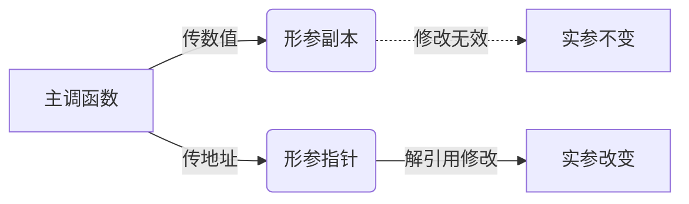

# 函数参数中传值与传地址的区别及应用

---
title: 函数参数中传值与传地址的区别及应用
requires: [高级语言程序设计/指针类型, 高级语言程序设计/数组类型]
---

调用函数时，如果想在函数内部修改主调函数的变量，直接写 `swap(a, b)` 为什么改不了？因为 C 语言的参数传递机制决定了：你必须明确告诉编译器，你要传的是“值”还是“地址”。

## 传值与传地址是什么

- **传数值（Pass by Value）**：将实参的==值复制==一份给形参。形参是实参的副本，在函数内修改形参，**不会**影响实参。
- **传地址（Pass by Reference/Pointer）**：将实参的==内存地址==传递给形参（形参为指针）。通过解引用操作，函数内修改指针所指的内容，**会**改变实参的值。



> [!IMPORTANT]
> 核心区别在于：==传值单向传递，传地址双向通信==。需要函数返回多个结果时，必须用传地址。

## 为什么要用传地址

C 语言的 `return` 只能返回一个值。若要求一个函数既计算数组元素之和，又找出最大值，仅靠返回值不够用。此时利用指针形式参数，就能实现“多值返回”的效果。

以课件中的代码为例：

```c
int f(int a[], int n, int *max); // 声明
// ...
int sum = f(a, 10, &max);
printf("%d %d\n", max, sum);
```

这里 `sum` 通过 `return` 获得；而 `&max` 把主函数中 `max` 的地址传给形参 `*max`，函数内部执行 `*max = ...` 时，直接修改了主函数里 `max` 变量的值。

## 怎么做：数组名作实参的特殊性

> [!NOTE]
> 一维数组名作为实在参数时，实际上传递给形参的是什么？不是第一个元素的值，也不是整个数组，而是==数组的首地址==。

数组名本质上退化为指向首元素的指针。因此，形参写成 `int a[]` 或 `int *a` 完全等价，接收的都是地址。

## 对比与辨析

| 特性 | 值形式参数 | 指针形式参数 |
| :--- | :--- | :--- |
| 定义方式 | `int x` | `int *x` |
| 传递内容 | 实参的值 | 实参的地址 |
| 能否改变实参 | 否 | 能（需解引用 `*x`） |
| 典型应用 | 仅需读取数据 | 需修改数据或多值返回 |

如何实现交换两个变量的值？
- **正确**：`void swap(int *x, int *y)`，调用 `swap(&a, &b)`。
- **错误**：`void swap(int *x, int y)`，调用 `swap(&a, b)`。这只能修改 `a`，无法完成互换。

## 常见陷阱

> [!WARNING]
> 调用函数时，实参的类型必须与函数原型严格匹配！

看这道经典考题：函数原型为 `void f(int, int *);`，主函数中有 `int a, *p=&a;`，判断下列调用哪些正确。

分析原型可知：第 1 个参数要 `int` 值，第 2 个参数要 `int` 地址。
- `a` 是 `int` 值，`*p` 也是 `int` 值（解引用）。
- `&a` 是地址，`p` 也是地址（它存的就是 `a` 的地址）。

因此，只要满足“第 1 个传值、第 2 个传地址”的组合均正确：
`f(a, p)`、`f(*p, &a)`、`f(a, &a)`、`f(*p, p)` 都是合法的。而像 `f(p, p)` 或 `f(a, a)` 则因类型不匹配而报错。

> [!TIP]
> 解题口诀：==见星号取值，见取址传址==。对照原型逐个检查实参类型，切忌想当然。
