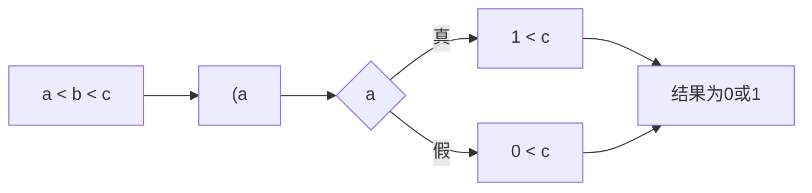

# 关系运算符与关系表达式

## 关系运算符与表达式

在 C 语言中，如何判断两个量的大小或相等关系？这就需要用到==关系运算符==。它用于比较两个操作数，运算结果只有两种：`1`（真）或 `0`（假）。注意，这里的“真”在 C 语言中严格对应整数值 `1`，而非任意非零值；“假”则严格对应 `0`。

### 运算符分类与优先级

关系运算符共 6 种，分为两个优先级层次：

| 优先级 | 运算符 | 含义     | 结合性   |
| ------ | ------ | -------- | -------- |
| 高     | `<` `<=` `>` `>=` | 大小比较 | 左结合   |
| 低     | `==` `!=`         | 相等比较 | 左结合   |

> [!IMPORTANT]
> 关系运算符优先级 ==低于算术运算符==，但 ==高于赋值和逻辑运算符==。例如 `a + b > c` 等价于 `(a + b) > c`，而 `x = a > b` 等价于 `x = (a > b)`。

### 连续比较的致命陷阱

数学中 $a < b < c$ 表示三者递增，但在 C 语言中能直接这样写吗？

答案是否定的。由于关系运算符是==左结合==的，`a < b < c` 会被解析为 `(a < b) < c`。先计算 `a < b` 得到 `0` 或 `1`，再将该结果与 `c` 比较。这几乎永远无法表达“b 在 a 和 c 之间”的语义。



> [!CAUTION]
> `a < b < c` 是南邮考试高频易错点！只要 `c > 1`，无论 `a`、`b` 取何值，`(a<b)<c` 恒为真，极易导致 ==死循环==。正确写法应为 `a < b && b < c`。

以真题为例：`while(a<b<c)` 中，若初始 `a=3,b=4,c=5`，首轮 `3<4` 得 `1`，`1<5` 为真；循环体内交换 `a,b` 后 `a=4,b=3`，次轮 `4<3` 得 `0`，但 `0<c`（此时 `c=6`）仍为真。由于 `c` 持续递增，条件永远成立，程序陷入死循环。

### 关系表达式作为值的妙用

关系表达式的结果是 `int` 型的 `0` 或 `1`，因此可直接参与赋值或运算。例如：

```c
if (x > y) z = 0; else z = 1;
```

等价于 `z = (x <= y);`。因为当 `x <= y` 成立时表达式值为 `1`，不成立时为 `0`，恰好与原逻辑一致。这种写法简洁且高效，但需确保对关系运算结果的取值有清晰认知。

> [!TIP]
> 判断等价关系式时，优先将 `if-else` 转化为关系表达式赋值形式，再逐项比对选项。避免被三元运算符的分支顺序干扰。

### 与相近概念的区分

| 对比项       | 关系运算符        | 赋值运算符      | 逻辑运算符       |
| ------------ | ----------------- | --------------- | ---------------- |
| 典型符号     | `==` `!=` `<`     | `=`             | `&&` `\|\|` `!`  |
| 运算结果     | `0` 或 `1`        | 左操作数的值    | `0` 或 `1`       |
| 常见混淆     | `==` 误写为 `=`   | `=` 误用作判断  | 短路特性不同     |

> [!WARNING]
> `if (a = b)` 是赋值而非比较！编译器通常不报错，但逻辑完全错误。务必养成写 `if ((a == b))` 加双括号的习惯，或在常量在前时写 `if (b == a)` 以触发编译警告。
