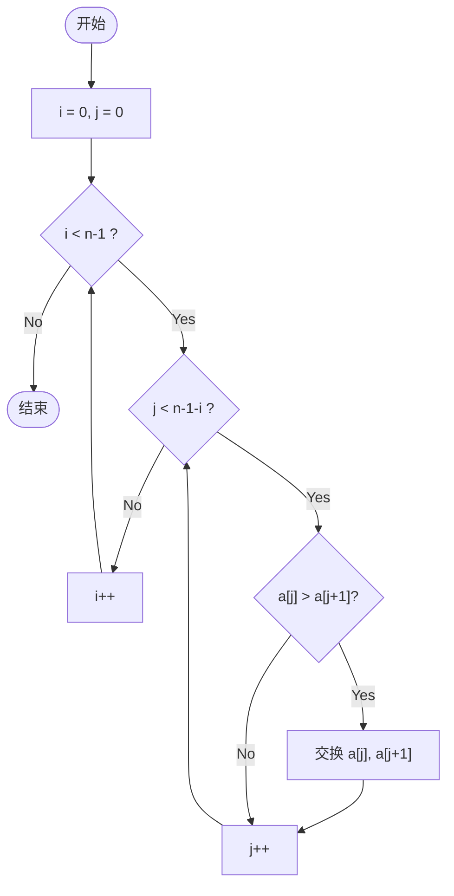

# 冒泡排序算法的实现与分析

## 算法原理与核心思想

冒泡排序（Bubble Sort）是一种基础的交换排序算法。其核心逻辑是：通过重复遍历待排序数组，依次比较**相邻**的两个元素，如果它们的顺序错误（如要求升序时前大后小），就交换它们。每一轮遍历会将当前未排序部分的最大值“浮”到末尾，像气泡一样上浮，故得名。

> [!IMPORTANT]
> ==核心结论==：对于长度为 $n$ 的数组，需要进行 $n-1$ 轮排序。第 $i$ 轮（$i$ 从 0 开始）只需比较前 $n-1-i$ 对相邻元素。



## C语言实现关键点

在《高级语言程序设计》中，通常使用双重循环实现。外层控制轮数，内层控制每轮的比较次数。

```c
void sort(int a[], int n) {
    int i, j, temp;
    // 外层：控制排序轮数，共 n-1 轮
    for (i = 0; i < n - 1; i++) {
        // 内层：控制每轮比较次数，逐次递减
        for (j = 0; j < n - 1 - i; j++) {
            // 若前一个比后一个大，则交换（升序）
            if (a[j] > a[j + 1]) {
                temp = a[j];
                a[j] = a[j + 1];
                a[j + 1] = temp;
            }
        }
    }
}
```

> [!TIP]
> **记忆口诀**：外圈 $n-1$，内圈 $n-1-i$；相邻比大小，逆序就交换。

## 数组名作函数参数

注意 `sort(int a[], int n)` 中的 `a[]`。在 C 语言中，数组名作为实参传递时，退化为首元素地址。因此：
1. 形参 `int a[]` 等价于 `int *a`。
2. 函数内部对 `a` 的修改会直接影响主调函数中的原数组（==传址调用==）。
3. 必须额外传递长度 `n`，因为指针本身不包含长度信息。

## 常见变体与易错点

| 特性 | 升序排序 (从小到大) | 降序排序 (从大到小) |
| :--- | :--- | :--- |
| **判断条件** | `if (a[j] > a[j+1])` | `if (a[j] < a[j+1])` |
| **最终状态** | 最大值在末尾 | 最小值在末尾 |

> [!WARNING]
> **下标越界陷阱**：内层循环条件必须是 `j < n - 1 - i`。若写成 `j <= n - 1 - i` 或访问 `a[j+1]` 时 $j$ 取到 $n-1$，会导致数组越界访问，引发运行时错误或数据混乱。

## 典型例题解析

参考南邮真题填空：若要实现**从大到小**排序，且代码结构为相邻比较。
假设片段为：
```c
if (________) { // 空1
    temp = a[j];
    ________ ;  // 空2
    a[j-1] = temp; // 注意此处原题可能索引有变体，需对应调整
}
```
若题目逻辑是基于 `a[j]` 与 `a[j-1]` 比较（即从后往前或索引偏移），要实现降序（大的在前），当后面的元素 `a[j]` 大于前面的 `a[j-1]` 时需交换。
故空1填 `a[j] > a[j-1]`，空2填 `a[j] = a[j-1]`（或根据具体交换逻辑填写中间赋值）。

> [!NOTE]
> 考试中务必看清题目要求的**排序方向**（升序/降序）以及**比较的下标基准**（是 `j` 与 `j+1` 还是 `j` 与 `j-1`），这直接决定判断符号的方向。
