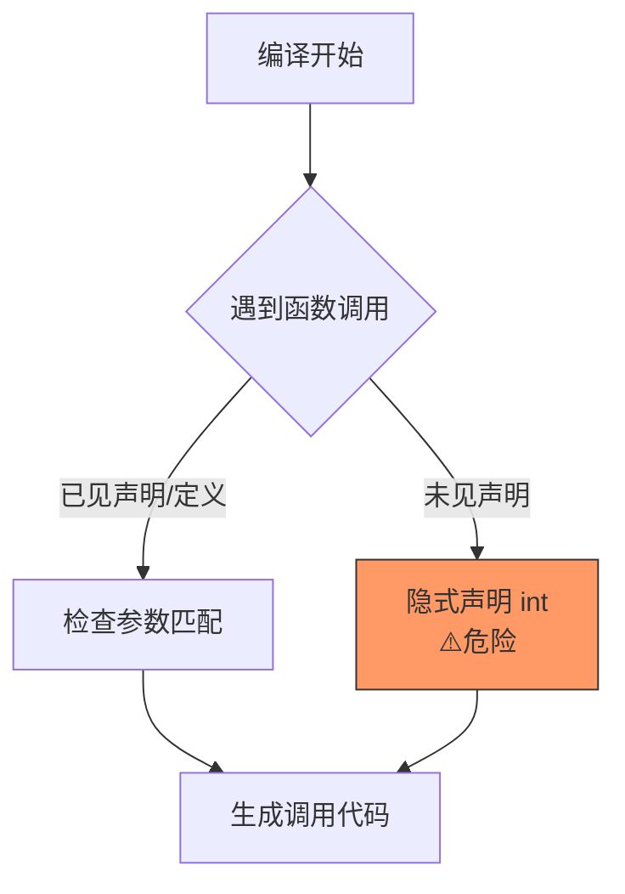

# 函数的原型声明及其位置

## 函数原型声明的本质

在 C 语言中，编译器是自上而下扫描代码的。当 `main` 函数调用一个尚未定义的函数时，编译器如何知道该函数的返回值类型和参数个数？这就引入了**函数原型声明**（Function Prototype）。

==函数原型声明==是告诉编译器：“有一个函数叫这个名字，它接收这些类型的参数，并返回这种类型的值”。其标准格式为：
`返回类型 函数名(参数类型列表);`



## 声明的位置与作用域

声明的位置决定了函数的**可见范围**，这与变量的作用域规则一致。

| 声明位置 | 作用域范围 | 典型场景 |
| :--- | :--- | :--- |
| **所有函数之外** | 全局有效，后续所有函数均可调用 | 头文件 `.h` 或源文件顶部 |
| **函数内部** | 仅在该函数体内有效 | 局部模块化解耦 |

> [!TIP]
> 若在全局声明，通常放在 `#include` 之后、`main` 函数之前。这是南邮考试中最常见的规范写法。

如果在 `main` 函数内部再次声明同名函数（如选择题 11），这属于**局部重声明**。只要签名一致，编译器不会报错，但该声明仅在 `main` 内有效。选项 C 称“提示重复说明出错”是不正确的，因为 C 语言允许在同一作用域或嵌套作用域中对同一函数进行多次兼容声明。

## 核心考点：类型一致性陷阱

考试中最大的坑在于**声明与调用的逻辑矛盾**。请看真题 19 的分析：

```c
void prt_char(); // 声明：无返回值
main(){
    int k;
    k = prt_char(5); // 错误：试图接收 void 返回值
}
```

> [!WARNING]
> **致命错误**：声明为 `void` 的函数**没有返回值**。
> 任何尝试将 `void` 函数结果赋值给变量的行为（如 `k = func()`）都会导致编译错误或语义矛盾。

这里并非语法格式错误（A 错），也非命名规范问题（B、D 错），而是==声明与调用不匹配==（C 对）。编译器依据原型声明检查调用语句，发现类型冲突。

## 避坑指南

1.  **分号不可少**：原型声明是语句，末尾必须有 `;`，而函数定义不需要。
2.  **参数名可省略**：`int add(int, int);` 是合法的，编译器只关心类型。
3.  **默认类型风险**：在旧标准（C89）中，未声明的函数默认返回 `int`。若实际返回 `double` 或 `void`，会导致严重运行时错误。因此，==始终先声明后使用==是铁律。

> [!IMPORTANT]
> 解题关键：看到函数调用，立即回溯查找其**原型声明**。对比三点：
> 1. 返回类型是否被非法赋值？
> 2. 实参个数与类型是否匹配？
> 3. 声明是否在调用前可见？
