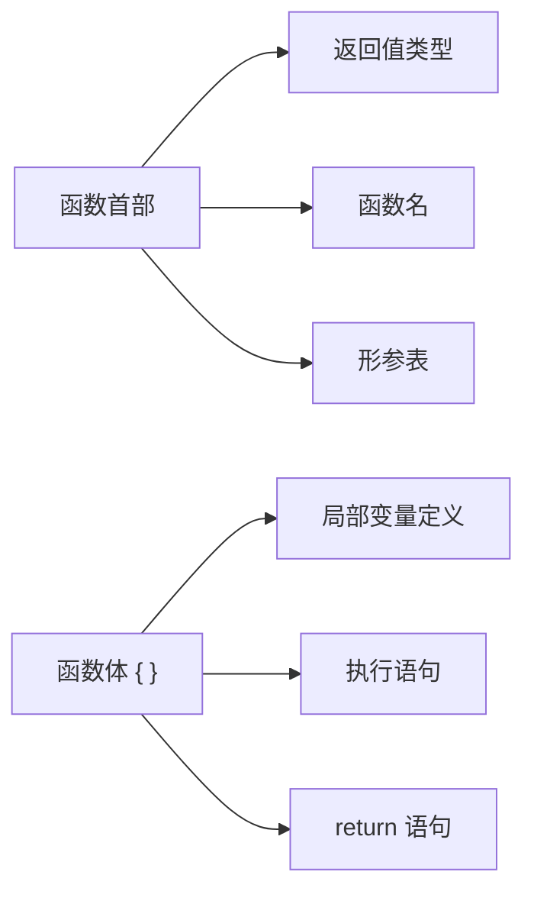
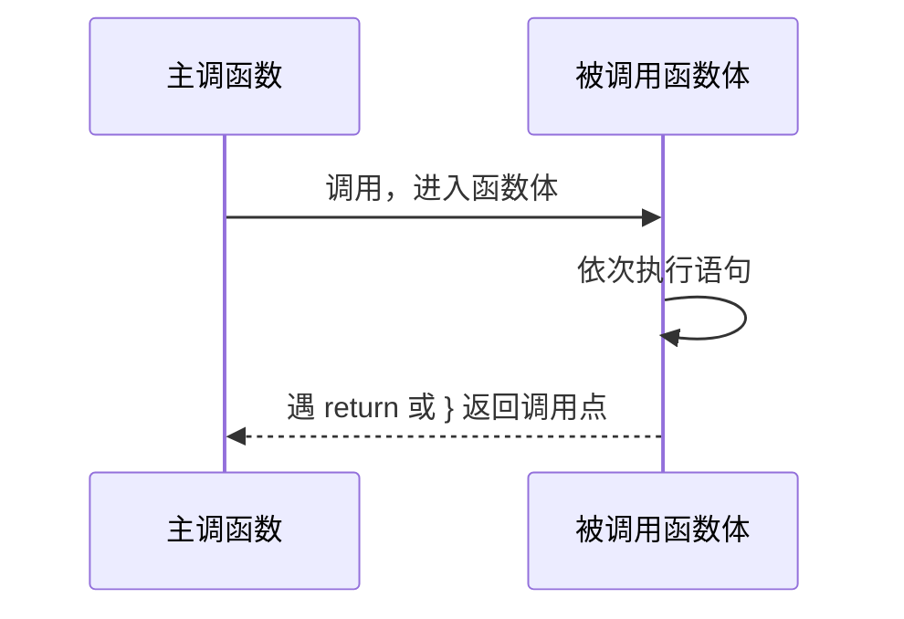

# 函数的定义格式与函数体

## 它是什么

在 C 语言里，一个完整的**函数定义格式**由两部分拼起来：

> [!IMPORTANT]
> **函数首部 + 函数体 = 函数定义**

函数首部就是 `返回值类型 函数名(形式参数表)`，例如 `double fun(int x,int y)`；函数体就是紧跟其后的一对 `{}` 里的内容——**函数体就是函数代码**。



课件里还强调：==函数可以有空体==，也就是 `{}` 里一条语句都没有，这也是合法的函数定义。

## 为什么需要函数体

我们写函数，是为了把一段“能反复用的逻辑”装进一个盒子里。盒子的入口参数写在首部，盒子真正干活的部分写在函数体里。没有函数体，就只有接口而没有实现；没有首部，编译器也不知道怎么调用它。

## 怎么做：函数体怎么写

函数体以 `{` 开始、以 `}` 结束，里面可以有三样东西：

1. 注释 `/* … */`（不参与执行）
2. 局部变量定义（如 `int z;`）
3. 执行语句 + `return`

关于 `return`，规则很明确：

> [!WARNING]
> 若返回值类型**不是** `void`，函数体内**必须**配合 `return 表达式;`
> 若为 `void`，需要返回的点写 `return;`；也可以没有 `return`，则执行到右大括号 `}` 自然结束

执行流程是这样的：



## 函数体里能看见谁：作用域

函数体的一对 `{}` 就像一道边界。在函数体内定义的变量叫**局部自动变量**，作用范围只在本函数体内（或某个更内层的语句块内）。

比如形参 `n`、函数体开头定义的 `sum`、`i`，以及 `for` 块里的 `b`：

| 变量名 | 定义位置 | 作用域 |
|---|---|---|
| `count` | 所有函数之外 | 全局，程序结束才释放 |
| `n` | `sumDigit` 形参表 | 整个 `sumDigit` 函数体 |
| `sum` | 函数体开头 | 本函数体内 |
| `b` | `for` 块内 | 只在 `for` 语句块内 |

> [!NOTE]
> `main` 里的 `sum` 和 `sumDigit` 里的 `sum` 同名，但作用域不同，**互不冲突**。
> 如果在 `sumDigit` 里写 `printf("a=%d",a);` 就会出错，因为 `a` 是 `main` 的局部变量，在别的函数体里看不见。

## 常见坑

看这道考过的选择题就明白了：

```c
double fun(int x,int y) { int z; z=x+y; return z; }   // 正确
double fun(int x,int y) { z=x+y; return z; }          // 错：z 没定义
fun(x,y) { double z; z=x+y; return z; }               // 旧式 K&R，现代不推荐
double fun(int x,int y) { int x,y; double z; ... }    // 错：形参重复定义
```

> [!TIP]
> 标准写法就是：==首部有返回类型和参数类型，函数体内先定义变量再使用，非 void 一定要 return 表达式==。

另外一个坑：声明成 `void prt_char();` 却写 `k=prt_char(G);`，因为 `void` 没有返回值，不能赋给 `k`，这叫“说明和调用矛盾”。

## 一个算对了的例子

```c
double fun(int x, int y) {
    int z;              // 函数体内局部变量
    z = x + y;          // 函数体代码
    return z;           // 非 void，必须 return 表达式
}
```

这里 `double fun(int x,int y)` 是函数首部，`{ }` 内就是函数体：定义了局部变量 `z`、执行加法、并用 `return z;` 把结果带回主调函数——这就是南邮《高级语言程序设计》要求的标准函数定义格式。
