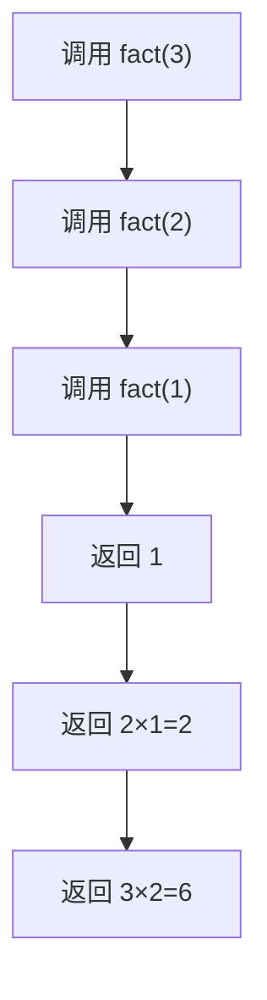

# 递归函数的定义与调用过程

## 什么是递归函数

**递归函数**是指在函数体内直接或间接调用自身的函数。C 语言中，任何函数都可以调用其他函数，当然也可以调用自己。递归不是语法上的特殊机制，而是**函数调用机制的自然延伸**——每次调用都会创建新的栈帧，保存各自的形参和局部变量，互不干扰。

## 为什么需要递归

有些问题的定义本身就是递归的，用递归写最自然：
- 阶乘：$n! = n \times (n-1)!$，且 $0! = 1$
- 最大公约数：$\gcd(a,b) = \gcd(b, a \bmod b)$，直到 $b=0$
- Fibonacci 数列：$F(n) = F(n-1) + F(n-2)$，$F(1)=F(2)=1$

> [!IMPORTANT]
> 递归函数必须包含**递归终止条件**（基例），否则将无限递归导致栈溢出。每次递归调用必须让问题规模**向终止条件靠近**。

## 调用过程与执行机制

以阶乘为例：

```c
int fact(int n){
    if(n <= 1) return 1;      // 终止条件
    else return n * fact(n-1); // 递归调用
}
```

执行 `fact(3)` 时，内存栈的变化如下：



关键机制：
1. **递推阶段**：不断调用自身，参数逐层变化，直到满足终止条件
2. **回归阶段**：从最深层的调用开始逐层返回，每层返回后恢复该层的执行环境

> [!TIP]
> 画调用树是数调用次数的可靠方法。每个节点代表一次调用，从根到叶子是一条调用链。

## 与循环的对比

| 特性 | 递归 | 循环 |
|------|------|------|
| 实现方式 | 函数自身调用 | 重复执行代码块 |
| 空间开销 | 每次调用占栈空间 | 通常只需常数空间 |
| 代码简洁度 | 对递归定义的问题更简洁 | 需手动维护状态变量 |
| 可读性 | 符合数学定义，逻辑清晰 | 有时需要更多辅助变量 |

## 常见坑与易错点

> [!WARNING]
> 忘记写终止条件，或递归参数没有向终止条件收敛，会导致**栈溢出**（Stack Overflow）。

> [!CAUTION]
> 数调用次数时，**初始调用也算一次**。例如 `fun(4)` 本身是第 1 次调用，不是从 `fun(3)` 开始数。

## 典型例题解析

**题目**：函数定义如下，执行 `n = fun(4);` 后，`fun` 总共被调用多少次？

```c
int fun(int k){
    if(k<1) return 0;
    else if(k==1) return 1;
    else return fun(k-1)+1;
}
```

**解答**：

调用链为：
1. `fun(4)` —— 第 1 次调用，进入 `else` 分支
2. `fun(3)` —— 第 2 次调用
3. `fun(2)` —— 第 3 次调用
4. `fun(1)` —— 第 4 次调用，满足 `k==1`，返回 1

随后逐层返回：`fun(2)` 返回 2，`fun(3)` 返回 3，`fun(4)` 返回 4。

**总共调用 4 次**，答案选 **B**。

> [!NOTE]
> 该函数实际功能等价于 `return k;`，即返回参数本身。识别递归函数的实际功能有助于验证答案。
