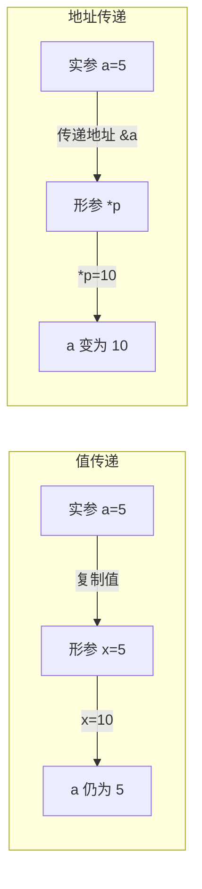

# 值传递与地址传递（传址）的区别

## 实参与形参的“通信”方式

想象一个场景：你有一份笔记，同学想借去看。你有两种方式给他：

- **复印一份给他**——他在复印件上涂抹修改，你的原件毫发无损。
- **告诉他笔记本在书架的哪个位置**——他直接找到你的原件，修改就真的生效了。

函数调用时，实参和形参之间的数据传递，恰好就对应这两种方式：**值传递**和**地址传递**。



## 值传递：只给一份副本

定义函数时，如果形参是普通变量（如 `int x`），调用时会发生什么？

```c
void addOne(int x) {
    x = x + 1;          // 修改的是形参 x
}

int main() {
    int a = 5;
    addOne(a);          // 把 a 的值 5 复制给 x
    printf("%d", a);    // 输出：5
    return 0;
}
```

==值传递的核心规则：形参是实参的“副本”，函数内部对形参的任何修改，都不会影响实参。==

> [!IMPORTANT]
> 实参与形参分别占用不同的存储单元。无论它们是否同名，都互不相干。

`a` 和 `x` 是两块独立的内存空间。函数调用时，仅仅把 `a` 里的数值 `5` 抄到了 `x` 里。之后 `x` 变成 `6`，跟 `a` 毫无关系。

## 地址传递：给你房间钥匙

如果想让函数真正“动到”外面的变量，该怎么办？思路很简单：==别给副本，给地址。==

```c
void swap(int *x, int *y) {  // 形参是指针变量
    int temp = *x;           // 通过 * 解引用，访问实参
    *x = *y;
    *y = temp;
}

int main() {
    int a = 3, b = 7;
    swap(&a, &b);            // 传递 a 和 b 的地址
    printf("a=%d, b=%d", a, b);  // 输出：a=7, b=3
    return 0;
}
```

> [!TIP]
> **三步记忆法**：定义时形参加 `*`，调用时实参加 `&`，函数体内用 `*` 解引用。

这里的形参 `x` 和 `y` 不再存放数值，而是存放地址。`*x` 的意思是“通过这个地址，找到原变量”。所以 `*x = *y` 真正修改了 `main` 里 `a` 的存储单元。

## 对比——一个表看清两种传递

| 比较维度 | 值传递 | 地址传递 |
|:---|:---|:---|
| 形参形式 | 普通变量（`int x`） | 指针变量（`int *p`） |
| 传递内容 | 实参的**值** | 实参的**地址** |
| 是否修改实参 | ==不能== | ==可以== |
| 调用方式 | `f(a)` | `f(&a)` |
| 典型应用 | 只需读数据、不修改原值 | 需要把修改结果带回、返回多个值 |

## 最经典的坑：交换函数为什么失效？

很多初学者会写出这样的“交换函数”：

```c
// 错误示范
void wrongSwap(int x, int y) {
    int temp = x;
    x = y;
    y = temp;
}
```

调用 `wrongSwap(a, b)` 后，`a` 和 `b` 纹丝不动。因为函数只交换了副本，原件根本不受影响。==想交换两个变量的值，必须用指针形式参数，传地址。==

## 真题解析——动手算一遍

来看一道经典选择题：

> 若函数调用时参数为基本数据类型的变量，以下叙述正确的是 **C. 实参与其对应的形参分别占用不同的存储单元**。

无论值传递还是地址传递，实参和形参都是独立的内存空间。区别仅在于：
- 值传递时，形参存的是“数值的副本”；
- 地址传递时，形参存的是“地址的副本”——但通过这个地址，形参有能力访问并修改实参所在的存储单元。

> [!WARNING]
> 指针变量若未赋值，就对其解引用（`*p`）是未定义行为；若赋值为 `NULL`，同样不能对 `*p` 操作。指针必须先指向合法的变量，才能通过 `*` 访问。
