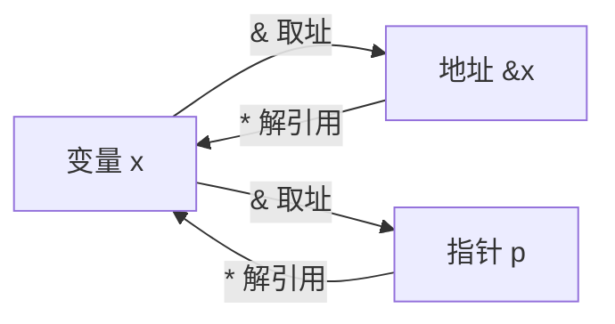

# 取址运算符&与间接引用运算符*的使用

## 它是什么：两个配对的运算符

`&` 和 `*` 是 C 语言里一对"互逆"的运算符，专门用来在**变量**和**地址**之间来回转换：

| 运算符 | 名称 | 作用 | 结果类型 |
|--------|------|------|----------|
| `&` | 取址运算符 | 取出变量的内存地址 | 指针（如 `int*`） |
| `*` | 间接引用（解引用）运算符 | 通过地址访问所指对象 | 所指对象的类型（如 `int`） |



> [!IMPORTANT]
> `&` 和 `*` 互为逆运算：对同一个指针先 `*` 再 `&`（或先 `&` 再 `*`），结果等于什么都没做。即 `&*p == p`，`*&x == x`。

## 为什么需要它们

普通变量只能直接操作自己的值，而有了这对运算符，程序就能：
- 通过指针**间接修改**其他变量的值（函数传参的核心）
- 用指针遍历数组、操作字符串，比下标更灵活
- 实现动态内存分配、链表等复杂数据结构

## 怎么用：一个完整例子

```c
int x = 10;        // 普通整型变量
int *p = &x;       // p 存的是 x 的地址
printf("%d", *p);  // 输出 10，通过地址"间接"读到 x
*p = 20;           // 通过地址修改 x，现在 x 变成 20
```

> [!TIP]
> 读声明时从右往左：`int *p` 读作"p 是一个指针，指向 int"。`p` 本身是地址，`*p` 才是那个 int 值。

## 和相近概念的区别

| 写法 | 含义 | 能否赋值给 `int` |
|------|------|------------------|
| `p` | 指针变量，存地址 | ❌ 类型不匹配 |
| `*p` | 解引用，得到所指变量的值 | ✅ 就是 `int` |
| `&x` | 变量 x 的地址 | ❌ 是指针类型 |
| `&*p` | 等价于 `p` | ❌ 仍是指针 |
| `*&x` | 等价于 `x` | ✅ 就是 `int` |

## 常见的坑

> [!WARNING]
> 指针必须先指向有效内存，才能用 `*` 解引用。未初始化或为 `NULL` 的指针直接解引用会导致程序崩溃。

```c
int *p;        // 野指针，指向随机地址
*p = 10;       // 危险！可能修改了未知内存

int *q = NULL;
*q = 10;       // 同样错误，NULL 不能解引用
```

> [!CAUTION]
> `&` 只能作用于**变量**（有内存地址的对象），不能作用于常量或表达式。`&10`、`&(a+b)` 都是非法的。

## 一道经典考题解析

题目：`int *point, i=10; point=&i;` 下面全部代表地址的一组是？

逐项分析：
- `i`：整型值，不是地址 ❌
- `point`：指针变量，存的就是地址 ✅
- `&i`：i 的地址 ✅
- `*point`：解引用得到 i 的值 10，不是地址 ❌
- `&*point`：先解引用得 i，再取址得 i 的地址，等价于 `point` ✅

因此答案是 **D（`&i`, `&*point`, `point`）**。

> [!IMPORTANT]
> 判断技巧：看到 `&` 开头，结果一定是指针（地址）；看到 `*` 开头，结果是所指对象的值。唯一例外是 `&*p`，两个逆运算抵消，仍等于 `p`。
