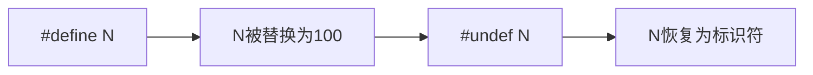

# #undef取消宏定义指令

---
title: "#undef取消宏定义指令"
requires: [高级语言程序设计/#define宏定义]
---

我们已经学过用 `#define` 来定义宏，但你想过没有：如果一个宏只在程序的某一段有用，过了这段还想继续用这个标识符做变量名，该怎么办？这就需要一个“撤销”机制。

## 什么是指令与基本语法

`#undef` 是 C 语言的编译预处理指令，作用是==取消之前已定义的宏==，使该宏名恢复为普通标识符。

语法格式非常简洁：

```c
#undef 宏名
```

> [!IMPORTANT]
> `#undef` 后面只跟宏名，**绝对不能带参数或替换文本**。例如 `#undef MAX(a,b)` 是错误的，只能写 `#undef MAX`。

## 为什么需要它

假设你用 `#define N 100` 定义了数组大小，但在同一个文件的后半部分，你又想把 `N` 当作普通循环变量使用。如果不取消宏定义，预处理器会把所有的 `N` 都替换成 `100`，导致编译报错。



常见使用场景包括：

- **限制宏的作用范围**：防止宏在不该起作用的地方引发意外替换。
- **重定义宏**：C 语言规定，对已定义的宏重新 `#define` 时，若替换文本不同会报警告或错误。必须先 `#undef`，再重新 `#define`。
- **条件编译配合**：在调试结束后取消某些调试宏。

## 怎么做：一个算对了的例子

来看下面这段代码，写出运行结果：

```c
#include <stdio.h>
#define PI 3.14

int main() {
    printf("%.2f\n", PI);
    
    #undef PI
    // 此时 PI 已经不再是宏
    
    int PI = 10; 
    printf("%d\n", PI);
    
    return 0;
}
```

**执行过程分析：**

1. 预处理器扫描到 `#define PI 3.14`，记录宏定义。
2. 第一个 `printf` 中的 `PI` 被替换为 `3.14`，输出 `3.14`。
3. 遇到 `#undef PI`，==取消宏定义==。
4. 此后的 `PI` 不再被预处理器替换，因此 `int PI = 10;` 是合法的变量定义。
5. 第二个 `printf` 输出整型变量 `PI` 的值 `10`。

最终输出：
$$3.14$$
$$10$$

> [!TIP]
> 记忆口诀：“先撤后建”。要重定义一个宏，必须先用 `#undef` 撤销旧的，再用 `#define` 建立新的。

## 与相近概念的区别

初学者常把 `#undef` 和其他操作混淆，请看下表对比：

| 对比项 | `#undef` | `#define` 为空 | 变量赋新值 |
| :--- | :--- | :--- | :--- |
| **本质** | 预处理指令，彻底删除宏 | 预处理指令，宏仍存在 | 运行时操作 |
| **效果** | 标识符恢复未定义状态 | 替换为空字符串（直接消失） | 改变内存中的值 |
| **作用阶段** | 编译前（预处理阶段） | 编译前（预处理阶段） | 程序运行阶段 |

> [!NOTE]
> `#define PI`（不带替换文本）和 `#undef PI` 完全不同！前者让 `PI` 被替换成“什么都没有”，后者让 `PI` 变回普通名字。

## 常见的坑

> [!WARNING]
> **作用域误区**：`#undef` 不是按 `{}` 块作用域生效的！它是==按源文件物理行顺序==起作用的。一旦 `#undef`，从该行往下直到文件结束（或再次 `#define`），该宏都不存在。

> [!CAUTION]
> **取消未定义的宏**：对一个本来就没有 `#define` 过的标识符使用 `#undef`，C 标准规定这是**合法且无害**的，编译器不会报错。但这通常暗示代码逻辑有冗余，应尽量避免。
