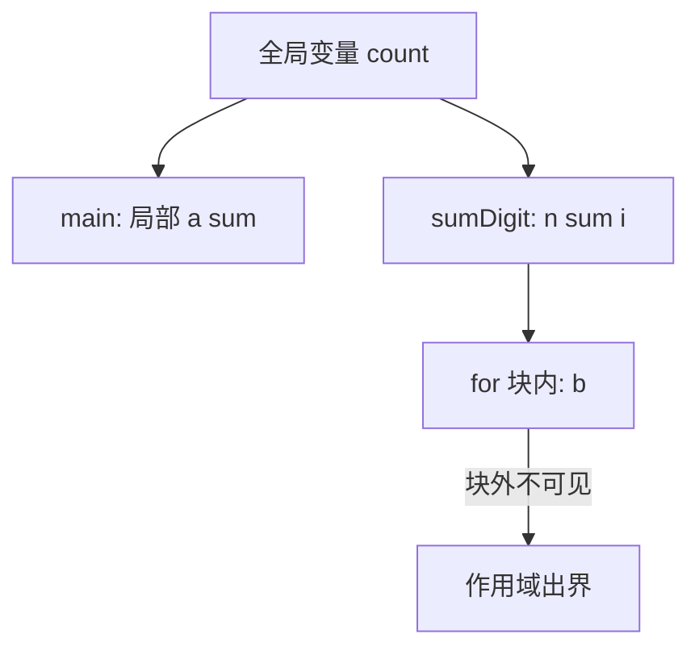

# 局部变量与全局变量的作用域范围

## 它是什么

变量按**定义位置**分为两类：在所有函数之外定义的是==全局变量（外部变量）==，在函数内部定义（含形式参数、语句块内）的是==局部变量==。一个变量到底在哪里能被访问？关键看它的**作用域**——从定义点开始、到某个边界结束的那段代码范围。

## 为什么需要区分

同一份代码里，`main` 和 `sumDigit` 可以各自有叫 `sum` 的变量而不冲突，靠的就是作用域隔离；而 `count` 想在两个函数之间传递信息，靠的是全局作用域。==作用域决定"能不能访问"，存储属性决定"值是否保留"==，这是两个独立的维度。

## 变量分类速查

| 变量类型 | 定义位置 | 作用域 | 生命周期 | 未指定初值 |
|---|---|---|---|---|
| 全局变量 | 所有函数之外 | 定义点→程序结束（被同名局部量遮蔽处除外） | 整个程序运行期间 | 自动为 0 |
| 局部自动变量 | 函数/形参/语句块内（默认 `auto`） | 所在函数或语句块内 | 调用时分配，返回即释放 | 随机值 |
| ==静态局部变量== | 函数内（加 `static`） | ==仅本函数内== | 整个程序运行期间（休眠保留） | 自动为 0，==只初始化一次== |

## 静态局部变量的四条铁律

以例 5.10 求 1～5 的阶乘为例，`f` 定义为 `static int f = 1;`：

1. 编译阶段就在静态存储区分配空间，==一直占到程序结束==。
2. 作用域仍只限于本函数——是"局部"变量，不是全局。
3. ==只在第一次进入函数时初始化==；未给初值则初始化为 0。
4. 第二次及以后进入函数，不再初始化，而是从"休眠"中"苏醒"，在原有基础上继续变化。

> [!WARNING]
> 把例题的循环改成 `for (i = 3; i <= 5; i++)`，`f` 仍是 static，输出**不是** 3～5 的正确阶乘。因为 `f` 只在第一次进入时被置为 1，第 3 次调用起 `f` 携带前两次累积的 $2! = 2$，结果是 $3!\times 2,\;4!\times 2,\;5!\times 2$ 量级的错值。做读程序题时，==一定要按"首次初始化 + 后续保留"逐步跟踪==。

## 和相近概念的区别

- **同名不同域**：`main` 里的 `sum` 与 `sumDigit` 里的 `sum` 是两个独立变量，各占各的内存，互不干扰。
- **遮蔽**：若函数内定义了与全局同名的局部变量，函数体内访问到的是局部那个，全局那个在此函数内被"遮蔽"。
- **register**：把频繁使用的自动局部变量放 CPU 寄存器，==访问速度与指令执行同步==，但不能取地址、作用域不变。
- **指针变量**：普通变量存值，指针变量存==地址==；通过指针形参可在被调函数中反向修改实参。

> [!TIP]
> 记忆口诀：**"全局看定义点到尾，局部看花括号里；static 见一次守一辈子，值留人不留作用域。"**

## 一个算对了的例子

选择题："下列哪一种变量一定不是局部变量？"——静态变量、形式参数、自动局部变量都可能定义在函数内，只有==外部变量（全局变量）一定定义在函数外==，故选 C。

对例 5.10 用 `static int f = 1;` 且循环 `i = 1..5`：第 $k$ 次进入时 $f_{\text{in}} = (k-1)!$，函数内 `f = f * k`，返回 $k!$；下一次带着 $k!$ 进入，恰是下一轮的初值，因此依次输出 $1!,2!,3!,4!,5!$，全部正确。
