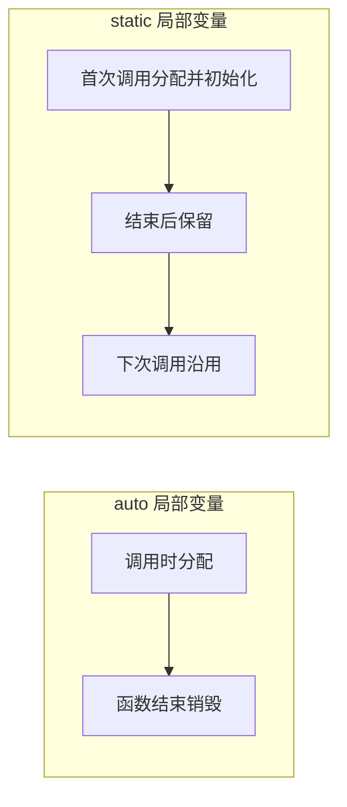

# auto、static、extern、register存储类型及生存期

存储类型说明符决定变量==存放在哪里、何时分配、何时释放==。C 语言中局部变量（含形式参数）默认是 `auto`，另外常用的还有 `static`、`extern`、`register`。

## 四种存储类型

| 关键字 | 用途 | 存储区 | 生存期 | 未初始化初值 |
|---|---|---|---|---|
| `auto` | 定义自动局部变量（**缺省**） | 动态存储区（栈） | 函数调用期间 | 随机值 |
| `static` | 定义静态局部变量 | 静态存储区 | 整个程序运行期间 | ==自动为 0== |
| `extern` | **声明**外部变量（不定义） | —— | —— | —— |
| `register` | 建议编译器把变量放寄存器 | 寄存器/栈 | 函数调用期间 | 随机值 |

> [!IMPORTANT]
> `auto`、`static`、`register` 用于变量的**定义**；`extern` 只用于变量的**声明**，告诉编译器“这个全局变量在本文件后面或别的文件里定义”，它不分配存储空间。

## auto 与 static 的本质区别

先想一个问题：函数每次调用结束，局部变量的值还能留住吗？

- **`auto`（默认）**：函数被调用时才分配空间，执行完毕即销毁，==每次调用重新初始化==。
- **`static`**：函数第一次被调用时分配空间，==只初始化一次==；函数结束后变量继续存在，下次调用保留上次的值，但**作用域仍只限本函数**。

```c
void fun(void) {
    static int f = 1;   /* 只执行一次 */
    f = f + 1;
    printf("%d ", f);
}
int main(void) {
    fun(); fun(); fun();   /* 输出 2 3 4 */
    return 0;
}
```

若把 `static int f = 1;` 改成 `int f = 1;`（即 `auto`），每次调用 `f` 都重新分配并初始化为 1，输出变成 `2 2 2`。这就是两类变量生存期差异的直接体现。



> [!WARNING]
> 静态局部变量的==作用域与自动局部变量相同==（仅限本函数），只是生命期延长到整个程序。考题常把“作用域为整个程序”作为错误选项——那是把生命期和作用域混为一谈。

## extern 的用法

当全局变量的定义在使用之后，或定义在另一个源文件中时，用 `extern` 提前声明：

```c
extern int g;   /* 声明：g 在别处定义 */
```

> [!NOTE]
> `static` 还有另一层用法：在全局变量或函数前加 `static`，可将其作用域限定在本文件内。例如“只允许本源文件中所有函数使用的全局变量”就应定义为 `static`。

> [!TIP]
> **记忆要点**：默认是 `auto`；想让局部变量“记住上次的值”或“未初始化自动为 0”，就用 `static`；`extern` 只声明不定义。读程序题看到 `static` 局部变量，务必留意它只初始化一次。
