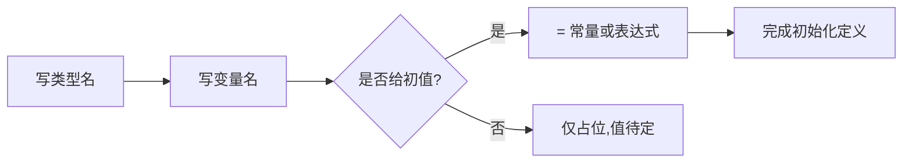

# 变量的定义及初始化方法

## 它是什么：从“盒子”说起

在 C 语言里，==变量==就是一块有名字的内存存储单元。写程序时我们说的“定义一个变量”，干了两件事：

1. 向编译系统**申请**对应大小的存储单元；
2. 告诉系统这个单元叫什么名字、放什么类型的数据。

而==初始化==，就是在**定义的同时**给这个单元塞进一个确定的初始值。

```c
int a;        // 定义，但没初始化，值不确定
int b = 10;   // 定义并初始化，b 一开始就是 10
```

为什么必须强调“定义后使用”？看这道南邮考题的 A 选项：

```c
double fun(int x,int y) { z=x+y ; return z; }
```

函数体里直接用了 `z`，却从来没写过 `int z;` 或 `double z;`——标准 C 要求==先定义后使用==，所以 A 错误。正确的 C 选项里写了 `{double z ; z=x+y ; return z ;}`，正是先把 `z` 定义出来再赋值的过程。

## 为什么需要初始化

来看局部变量的两种命运。函数里的普通局部变量默认是 `auto` 存储类别，存在动态存储区：函数被调用时才临时分配，**没写初值就是随机 garbage 值**。而如果加上 `static`，就存在静态存储区：

```c
static int n;   // 未初始化，系统自动给 0
```

这正是填空题⑤的答案：==保证局部整型变量未初始化自动为 0，关键字是 `static`==。

## 怎么做：定义与初始化的写法



- 基本格式：`类型 变量名 = 初值;`
- 多个同类型：`int x = 1, y = 2;`
- 局部变量不加 `static` 也不赋值：值随机，==不可假设为 0==。

## 和相近概念的区别

| 对比项 | 普通局部变量(auto) | 静态局部变量(static) | 全局变量 |
|---|---|---|---|
| 存储区 | 动态存储区 | 静态存储区 | 静态存储区 |
| 未赋初值 | ==随机值== | 自动为 0 | 自动为 0 |
| 生命周期 | 函数调用期间 | 整个程序运行期 | 整个程序运行期 |
| 作用域 | 所在函数/块 | 所在函数/块 | 定义点至文件尾 |

再看简答里的点：全局变量在所有函数之外定义，一直在；`static` 局部变量只初始化一次，下次调用还保留上次的值。而普通变量和指针变量也不同——普通变量放数据值，指针变量放的是==内存地址==。

## 常见的坑

> [!WARNING]
> 在函数体内重复定义形参。例如 `double fun(int x,int y){ int x,y; ... }`——参数列表已有 `x,y`，体内再写 `int x,y;` 属于重复定义，编译报错（对应考题 D 选项）。

> [!CAUTION]
> 别把“未初始化的 auto 局部变量”当 0 用。它可能是一个残留在栈里的旧数据，每次运行结果都可能不一样。

> [!TIP]
> 做函数定义题先三看：一看返回类型写没写，二看参数有没有类型，三看函数体内变量是否`先定义后使用`——A 错在缺定义、D 错在重定义，C 因 `double z` 定义在前而成立。

## 算对了的一个例子

课件里那道“实参形参”选择也顺带说明变量存储：参数为简单变量时，==实参与形参分别占用不同的存储单元==（选 C）。形参只是得到了实参的**值拷贝**，所以形参在函数里怎么改，都动不了外边的实参——这恰恰建立在“形参本身是一个被定义并初始化好了的变量”的前提上。
