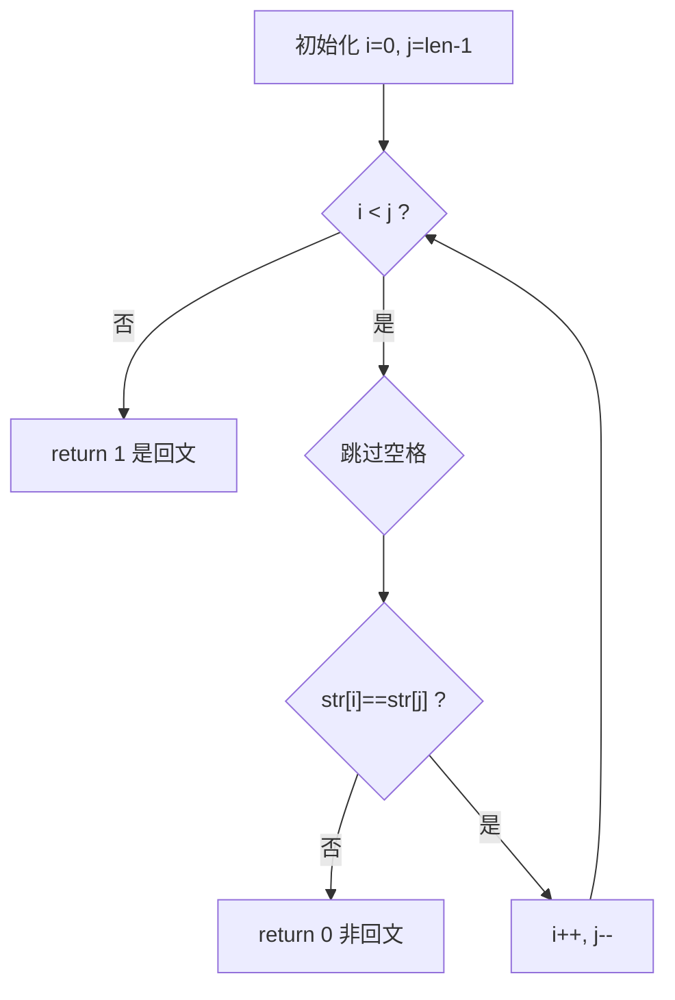

# 判断任意字符串是否为回文的算法实现

## 什么是回文字符串

回文（Palindrome）指正读与反读完全相同的字符串，例如 `level`、`radar`、`上海自来水来自海上`。在《高级语言程序设计》第 8 章字符串处理中，判断回文是一个把==字符串下标操作、循环控制、函数返回值==串起来的经典算法题，也是期末填空题的高频考点。

> [!IMPORTANT]
> 核心思路：用 ==双指针== 分别指向字符串首尾，向中间靠拢，逐字符比较；只要有一对不相等就不是回文。

## 为什么用双指针

朴素做法是把字符串反转再与原串比较，需要额外数组和一次拷贝，空间复杂度 $O(n)$。双指针法只需要两个下标变量 `i`、`j`，空间复杂度 $O(1)$，时间复杂度 $O(n)$，是教科书与参考答案推荐的实现。

想一想：判断 `abcba` 时，我们到底比较了几对字符？答案是 2 对（`a/a`、`b/b`），中间的 `c` 与自己比无需处理——所以循环条件应让左右指针相遇时停止。

## 算法流程



## 参考实现

```c
int Palindrome(char *str) {
    int i = 0, j = strlen(str) - 1;
    while (i < j) {
        /* 只考虑非空格字符 */
        while (i < j && str[i] == ' ') i++;
        while (i < j && str[j] == ' ') j--;
        if (str[i] != str[j])      /* 空格 4 的核心比较 */
            return 0;              /* 空格 5 */
        i++;
        j--;                       /* 空格 3 */
    }
    return 1;
}
```

> [!TIP]
> 记忆口诀：==相等就靠拢，不等就返回==。靠拢 = `i++` 与 `j--` 成对出现，缺一个都会死循环或越界。

## 易错点与边界

- ==空格 3 写成 `i--`==：方向反了，右指针往回走会越界或死循环。正确是 `j--`。
- ==空格 4 只写 `str[i]==str[j]`==：题目若限定"只考虑非空格字符"，必须先跳过空格再比较，否则 `"a b a"` 会被误判。
- 空格 5 写成 `return 1`：逻辑颠倒。**不是**回文时返回 `0`，循环正常结束才 `return 1`。
- `strlen(str) - 1` 对空串会得到 `-1`，但此时 `while (i < j)` 不进入，返回 `1`，与"空串视为回文"一致。

> [!WARNING]
> 不要写成 `while (i <= j)`。`i == j` 时字符与自己比恒为真，多做一次无意义比较；对 `strlen` 恰好为偶数的串，`i == j` 的情形还可能取到 `\0` 之外的位置。

## 和相近概念的区别

| 方案 | 空间 | 时间 | 是否破坏原串 | 适用 |
| --- | --- | --- | --- | --- |
| 双指针法 | $O(1)$ | $O(n)$ | 否 | ==首选== |
| 反转再比较 | $O(n)$ | $O(n)$ | 可能 | 需要保留反转结果 |
| 递归法 | $O(n)$ 栈 | $O(n)$ | 否 | 教学演示 |

## 一个算对了的例子

判断 `str = "a b a"`（含两个空格）：

- $i=0, j=4$：跳过空格后 $i$ 仍 $0$，$j$ 左移到 $3$（`'a'`），`str[0]=='a'` == `str[3]=='a'`，成立 → $i=1, j=2$；
- $i=1$（空格）跳到 $i=2$，$j=2$（`'b'`）；此时 $i<j$ 不成立，退出；
- 返回 `1`，判断为回文。

若把空格 3 填成 `i--`，第二次循环 $i$ 变 $0$、$j$ 变 $1$，再次比较 `str[0]` 与 `str[1]`，结果错乱甚至越界。可见 ==空格 3 的 `j--` 是算法收敛的关键==。
