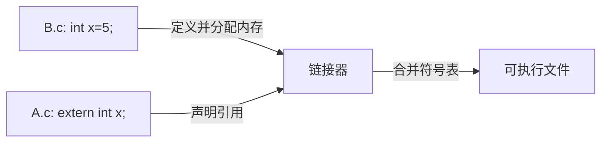

# 多文件工程的组织、外部变量/函数的跨文件使用及static限制

## 为什么需要跨文件共享

当程序规模增大，所有代码挤在一个 `.c` 文件中会导致编译慢、维护难。将功能拆分到多个文件后，必然面临一个问题：==如何让 A 文件访问 B 文件中定义的变量或函数？== C 语言通过 `extern` 关键字与链接器机制解决此问题，但必须严格区分“定义”与“声明”。

## 外部变量与函数的跨文件使用

在多文件工程中，若 A 文件需使用 B 文件中定义的全局变量 `x`，必须在 A 文件中用 `extern` 进行==声明==（而非定义）。

> [!IMPORTANT]
> `extern` 仅告诉编译器“该符号在别处已定义”，==不分配内存==；只有去掉 `extern` 的定义语句才真正分配存储空间。



对于函数，默认即为外部链接，`extern` 可省略；但若希望函数==仅限本文件使用==，则必须加 `static` 修饰。

| 特性 | 全局外部变量/函数 | 静态外部变量/函数 |
| :--- | :--- | :--- |
| 关键字 | `extern`（变量必需） | `static` |
| 链接属性 | 外部链接 | 内部链接 |
| 可见范围 | 整个工程 | 仅当前文件 |
| 同名冲突 | 会引发链接错误 | 不会冲突 |

## 常见误区与思考题解析

> [!WARNING]
> 混淆“声明”与“定义”是最高频错误。在 A 文件中写 `extern int x = 10;` 会被视为==定义==，若 B 文件也定义了 `x`，链接时将报“重复定义”错误。

针对课件思考题：若 B.c 中删除了 `extern int x;`，程序能否正确编译？答案是==能==。因为 `extern` 声明只在使用该变量的文件中必需，定义文件本身无需自我声明。但若 A 文件中缺少 `extern int x;`，则 A 文件编译时报错“未声明标识符”。

> [!TIP]
> 填空题考点速记：跨文件引用全局变量，必用 `extern` 声明；限制作用域于本文件，必用 `static`。

## 正确示例演示

假设工程包含两个文件：

```c
/* B.c */
int g_count = 100;      // 定义全局变量
static void helper() {} // 仅B.c可用
void update() { g_count++; }
```

```c
/* A.c */
extern int g_count;     // 正确：声明外部变量
// extern int g_count = 0; // 错误！变成重复定义
void print_count() {
    printf("%d\n", g_count); // 输出100
}
```

> [!CAUTION]
> 切勿在头文件中定义全局变量（如 `int x;`），当头文件被多个 `.c` 包含时，必然导致多重定义链接错误。==头文件中只应放 `extern` 声明==，定义放在且仅放在一个 `.c` 文件中。
