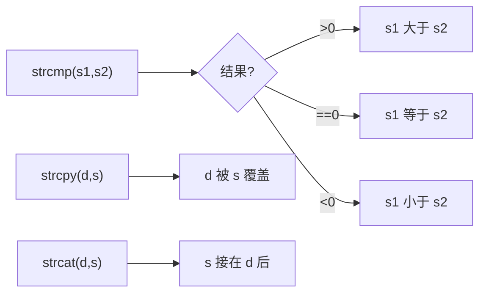

# <string.h>中常用字符串处理函数的使用

# `<string.h>` 中常用字符串处理函数的使用

在 C 语言中，字符串本质上是**以 `\0` 结尾的字符数组**。由于数组名代表地址，直接使用 `==`、`>`、`=` 等运算符操作的是**内存地址**而非**字符串内容**。因此，必须借助 `<string.h>` 库函数进行逻辑处理。

## 为什么不能直接用运算符？

试想：若定义 `char s1[] = "abc"; char s2[] = "abd";`，执行 `s1 > s2` 比较的是什么？
答案是：**首元素地址的大小**。这与字符串内容的字典序无关。
==核心结论==：字符串的比较、赋值、连接必须使用专用函数，严禁使用关系运算符或赋值运算符直接操作数组名。

## 常用函数详解

以下函数均需包含头文件 `#include <string.h>`。

| 函数原型 | 功能描述 | 返回值/注意 |
| :--- | :--- | :--- |
| `int strcmp(s1, s2)` | **比较**两个字符串 | s1>s2 返回正数；s1<s2 返回负数；相等返回 0 |
| `char* strcpy(dest, src)` | **复制** src 到 dest | 返回 dest 指针；dest 空间需足够 |
| `char* strcat(dest, src)` | **连接** src 到 dest 末尾 | 覆盖 dest 原有的 `\0`；dest 需有剩余空间 |
| `char* strupr(str)` | 小写转**大写** | 非标准库函数，部分编译器支持 |
| `char* strlwr(str)` | 大写转**小写** | 非标准库函数，部分编译器支持 |

> [!IMPORTANT]
> `strcmp` 的返回值判断是考试高频考点。
> - 判断相等：`strcmp(s1, s2) == 0`
> - 判断 s1 > s2：`strcmp(s1, s2) > 0`

> [!WARNING]
> **缓冲区溢出风险**：使用 `strcpy` 和 `strcat` 时，目标数组 `dest` 必须有足够的空间容纳源字符串及结尾的 `\0`。否则会导致内存越界，程序崩溃。

## 典型例题解析

**题目**：下面判断字符串 `str1` 是否大于 `str2`，正确的表达式是？
A. `if (str1 > str2)`
B. `if (strcmp (str1, str2))`
C. `if (strcmp (str1, str2) > 0)`
D. `if (strcmp (str2, str1) > 0)`

**解析**：
1.  **排除 A**：`str1 > str2` 比较的是地址，错误。
2.  **分析 B**：`strcmp` 返回非零值时条件为真。若 `str1 < str2`，返回负数（非零），`if` 也为真，但这表示“不相等”而非“大于”，逻辑不严谨。
3.  **分析 C**：`strcmp(str1, str2) > 0` 明确表示 `str1` 字典序大于 `str2`，**正确**。
4.  **分析 D**：`strcmp(str2, str1) > 0` 等价于 `str2 > str1`，即 `str1 < str2`，与题意相反。

==正确答案：C==

## 常见坑与技巧

-   **`\0` 的处理**：`strlen` 计算长度时不包含 `\0`，但 `strcpy` 和 `strcat` 会自动处理 `\0`。手动遍历字符串时切勿遗漏结尾判断。
-   **大小写转换**：`strupr` 和 `strlwr` 并非 ANSI C 标准函数，在某些严格环境（如 Linux GCC）下可能不可用，建议掌握通过 ASCII 码差值（`'a'-'A'=32`）手动转换的方法。
-   **二维字符数组**：若定义为 `char str[10][20]`，则 `str[i]` 可视为第 `i` 个字符串的首地址，可直接传入上述函数，如 `strcpy(str[0], "Hello");`。
