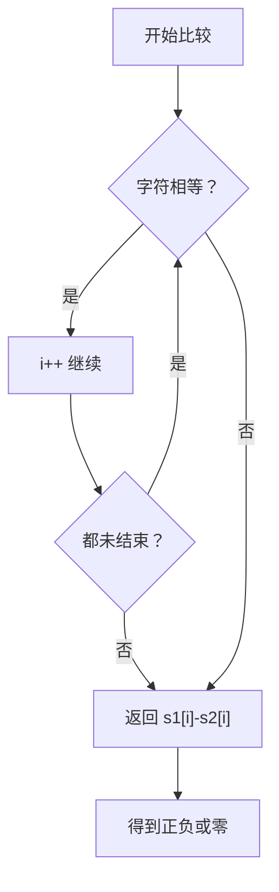

# 手写实现字符串复制、比较、连接及求长度函数

## 为什么不能用 `=` 和 `>`

字符串在 C 语言里本质上是**字符数组**，数组名是一个地址常量。如果写 `str1 = str2`，编译器会报错——你不能把一块内存的地址"改绑"到另一块内存上；如果写 `str1 > str2`，比较的是两个地址的先后，而不是字典序的先后。因此，**赋值、比较、连接都必须借助函数**，要么调用 `<string.h>` 库函数，要么手写实现。

## 手写四大函数

### 求长度 `mystrlen`

不需要数组成员变量，只需找到第一个 `'\0'`：

```c
int mystrlen(const char *s) {
    int i = 0;
    while (s[i] != '\0')  // 循环条件：未遇到结束符
        i++;
    return i;
}
```

### 复制 `mystrcpy`

核心问题：先找到目标串的末尾，还是边找边拷？正确做法是**逐个字符搬运，直到把 `'\0'` 一起拷过去**：

```c
void mystrcpy(char *dest, const char *src) {
    int i = 0;
    while (src[i] != '\0') {
        dest[i] = src[i];
        i++;
    }
    dest[i] = '\0';  // 关键：补上结束符
}
```

> [!WARNING]
> 常见错误是漏写 `dest[i] = '\0'`。没有结束符的字符数组不是字符串，后续 `printf("%s")` 或 `strcmp` 会越界读到内存垃圾，甚至导致段错误。

### 连接 `mystrcat`

先遍历到目标串末尾，再把源串逐个拷上去：

```c
void mystrcat(char *dest, const char *src) {
    int i = 0, j = 0;
    while (dest[i] != '\0')  // 步骤1：找到 dest 末尾
        i++;
    while (src[j] != '\0') { // 步骤2：追加 src
        dest[i] = src[j];
        i++; j++;
    }
    dest[i] = '\0';          // 步骤3：补结束符
}
```

### 比较 `mystrcmp`

这是考试重点。规则是**逐字符比较 ASCII 码**，遇到第一对不相等的字符就返回差值；如果同时遇到 `'\0'`，则两串相等：

```c
int mystrcmp(const char *s1, const char *s2) {
    int i = 0;
    while (s1[i] != '\0' && s2[i] != '\0') { // 两串都未结束
        if (s1[i] != s2[i])
            return s1[i] - s2[i];  // 立即返回差值
        i++;
    }
    return s1[i] - s2[i];  // 处理长度不同：如 "abc" vs "abcd"
}
```

> [!IMPORTANT]
> 返回值约定：返回 `0` 表示相等；返回**正数**表示 `s1 > s2`；返回**负数**表示 `s1 < s2`。判断串 `s1` 是否大于 `s2`，必须写 `mystrcmp(s1, s2) > 0`，绝不能写 `s1 > s2`。

## 执行流程图解

以 `mystrcmp("apple", "apply")` 为例：



## 典型考题：回文判断

课件中提到的"忽略空格判断对称"就是 `mystrcmp` 思想的变形——用双指针 `i`、`j` 从两端向中间扫描，跳过空格后比较字符：

```c
int isPalindrome(char str[]) {
    int i = 0, j = mystrlen(str) - 1;
    while (i < j) {
        while (str[i] == ' ') i++;   // 跳过左空格
        while (str[j] == ' ') j--;   // 跳过右空格
        if (str[i] != str[j]) return 0;  // 不对称
        i++; j--;
    }
    return 1;
}
```

> [!TIP]
> 记忆口诀：**"复制连接补'\0'，比较返回差值"**。所有字符串操作的本质都是对 `'\0'` 位置的精准控制，写完后问自己：结束符补了吗？循环条件判断的是字符还是地址？
