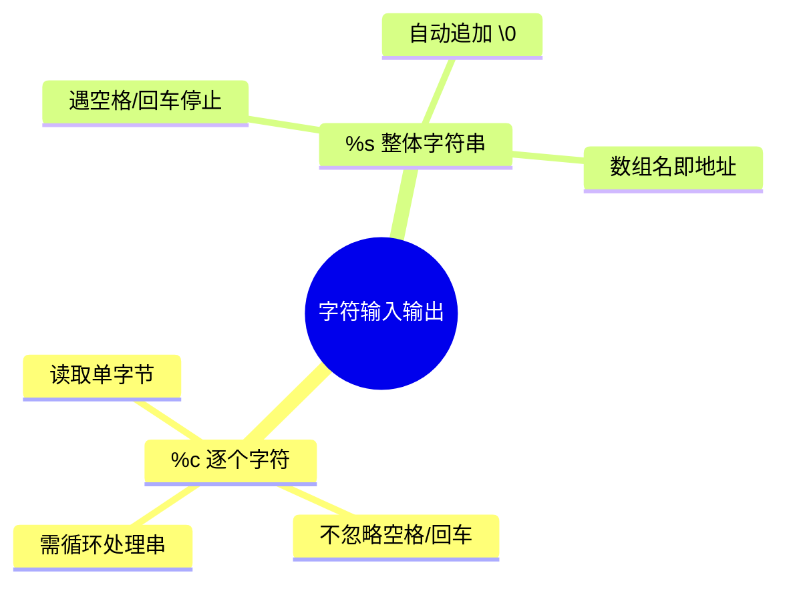

# %s整体输入输出与%c逐个字符输入输出

## %s 整体与 %c 逐个字符输入输出

在 C 语言字符串处理中，`%s` 和 `%c` 是两种截然不同的 I/O 方式。理解它们的差异，是掌握字符串操作的基础。

### 核心区别：整体 vs 个体

`%s` 用于**字符串整体**读写，而 `%c` 仅针对**单个字符**。这种差异决定了它们在内存访问和终止条件上的不同行为。



> [!IMPORTANT]
> **核心结论**：`%s` 以空白符（空格、Tab、回车）为分隔符，且**自动**在末尾添加 `\0`；`%c` 忠实读取每一个字符，包括空白符，**不自动**添加 `\0`。

### 为什么需要区分？

试想，若要用 `scanf` 读入 "Hello World"：
- 使用 `%s`：只能读到 "Hello"，因为空格截断了输入。
- 使用 `%c` 循环：可以完整读取，但需手动管理数组下标和结束标志。

对于整型数组，C 语言**不支持**整体输入输出（如练习 7 所示），这是字符数组特有的便利，源于字符串以 `\0` 结尾的约定。

### 常见陷阱与辨析

| 特性 | `%s` (scanf/printf) | `%c` (scanf/printf) |
| :--- | :--- | :--- |
| **读取对象** | 字符串 (char 数组) | 单个字符 (char) |
| **空白符处理** | **跳过**前导空白，遇空白停止 | **读取**所有字符，含空白 |
| **结束标记** | 自动添加 `\0` | 无，需手动处理 |
| **参数类型** | 数组名 (地址) | 变量地址 (`&ch`) |

> [!WARNING]
> **高危误区**：混合使用时，`%s` 留下的回车符可能被后续的 `%c` 读取，导致“跳过输入”的假象。例如先 `scanf("%s", str)` 再 `scanf("%c", &ch)`，`ch` 往往会读到换行符。

### 指针与偏移量的应用

当使用 `%s` 输出时，传入的是起始地址。若指针移动，输出将从新位置开始，直到遇到 `\0`。

参考填空 2：
```c
char *s = "student";
printf("%s\n", s+3);
```
`s` 指向 `'s'`，`s+3` 指向 `'d'`。`%s` 从 `'d'` 开始输出，直至字符串末尾的 `\0`。因此结果为 `dent`。

> [!TIP]
> **解题技巧**：看到 `%s` 找 `\0`，看到 `%c` 数个数。若题目涉及含空格的字符串输入（如选择 15），`scanf("%s")` 失效，应选用 `gets()` 或 `fgets()`，因为它们以换行符为结束标志，能保留中间的空格。

==核心高亮==：字符数组可整体 I/O，整型数组不可；`%s` 认空格为界，`%c` 来者不拒。
