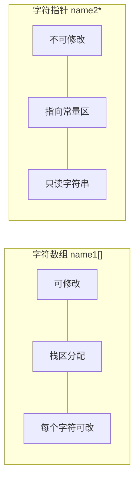

# 字符指针指向字符串及操作

## 字符指针与字符串

先做一个小实验，看看你对指针的理解有多扎实：

```c
int a = 10, *p = &a;
// *p 和 p 分别代表什么？
```

如果你能脱口而出——`*p` 是 `a` 的值（10），`p` 是 `a` 的地址——那恭喜你，指针的核心你已经抓住了。带着这个认知，我们来看看字符指针如何与字符串打交道。

### 一个问题引出两条路

想让程序记住你的名字 `"Alice"`，C 语言给了你两种方式：

```c
char name1[] = "Alice";    // 方式一：字符数组
char *name2  = "Alice";    // 方式二：字符指针
```

它们都能用 `printf("%s", name1)` 输出，但底层逻辑完全不同。下面这张图能帮你一眼看清差别：



> [!IMPORTANT]
> ==字符指针指向的字符串常量存储在只读数据区，修改其内容会导致段错误。==

```c
char *s = "Hello";
s[0] = 'h';      // ❌ 运行时段错误！试图修改只读内存
```

而字符数组拥有自己的可读写副本，随便改：

```c
char arr[] = "Hello";
arr[0] = 'h';     // ✅ 正确，arr 是栈上的可写数组
```

### 为什么需要字符指针操作字符串

字符指针的真正威力在于 **灵活指向**。数组名是地址常量，不能改变指向；字符指针是变量，可以随时切换目标，还不额外分配大块内存。

```c
char *s;
s = "morning";    // ✅ 指向常量区字符串
char arr[20];
s = arr;          // ✅ 指向可写的数组空间
```

但灵活不等于随意。下面这张表把合法与非法的界限画得很清楚：

| 操作 | 合法性 | 原因 |
|------|--------|------|
| `char *s = "ABC";` | ✅ | 指针指向常量区字符串 |
| `char *s; s = "ABC";` | ✅ | 同上，先声明再赋值 |
| `char p[4] = "ABC";` | ✅ | 数组初始化，拷贝字符 |
| `char p[4]; p = "ABC";` | ❌ | 数组名是常量，不能赋值 |
| `s = p;` | ✅ | 指针可指向数组首地址 |
| `s = *p;` | ❌ | `*p` 是字符 `'A'`，不是地址 |
| `*s = "AB";` | ❌ | `*s` 是字符变量，不能存地址 |

### 三名主义：考试重中之重

C 语言里有三种特殊名字，它们都代表**地址**：

> [!IMPORTANT]
> 1. **数组名** — 首元素地址，==地址常量，不可自加或赋值==。
> 2. **函数名** — 函数入口地址。
> 3. **字符串常量名** — 常量区首字符地址。

看这道真题：

> `char b[] = "nupter"; *a = b;` 则 `printf("%s", a + 3);` 输出____。

逐步分析：
- `b` 是字符数组，数组名即首地址；
- `a = b` 让指针 `a` 也指向 `'n'`；
- `a + 3` 偏移 3 个字符，指向 `'t'`（`n(0) u(1) p(2) t(3)`）；
- `%s` 从该位置打印直到 `\0` → 输出 `"ter"`。

> [!TIP]
> 遇到指针偏移题，把字符串下标写在下面，一次也不会错：
> `n(0) u(1) p(2) t(3) e(4) r(5) \0(6)`

### 一道经典练习题复盘

> `int a, b = 9, *ap = &a;` 完成 `a = b` 应选哪个？

```c
A. a = *p;      // p 未与 a 关联，错误
B. *ap = *&b;   // *ap 即 a，*&b 即 b → a = b ✅
C. a = &b;      // 类型不匹配，&b 是地址
D. &p = &b;     // &p 是常量，不可赋值
```

每一步都在考察同一个原则：==`*指针` 访问指向的值，`&变量` 取出变量的地址，类型必须匹配。==

> [!WARNING]
> 字符指针未初始化就解引用（`*s`）是未定义行为；赋 `NULL` 后解引用同样崩溃。考试中看到 `int *f = NULL; *f = 10;` 直接判错。
