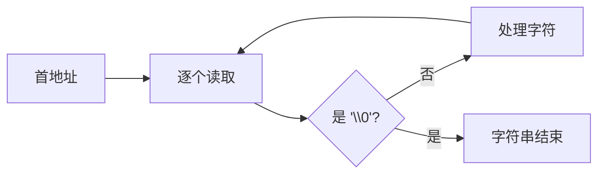

# 字符数组与普通字符串在内存表示上的异同

## 字符数组与字符串：内存中的表示

C 语言中没有专门的字符串变量类型。要存放字符串，通常使用**字符数组**；但要让 C 语言把它当作字符串处理，必须在有效字符后存放结束标志 `'\0'`。

例如：

```c
char a[5] = {'M', 'i', 'k', 'u', '?'};
char b[15] = "Miku";
```

二者都是字符数组，但内存内容不同：

| 数组 | 内存中的字符 | 能否作为字符串整体输出 |
|---|---|---|
| `a` | `M i k u ?` | 不能，未以 `'\0'` 结束 |
| `b` | `M i k u \0 …` | 可以，字符串长度为 4 |

`b` 实际占用 15 个数组元素，但字符串 `"Miku"` 只占前 5 个有效位置：4 个可见字符和 1 个 `'\0'`。因此，==字符串长度不包括 `'\0'`，而存储字符串所需的数组空间必须包括它==。

## 为什么需要 `'\0'`

字符数组只规定了一块连续空间的大小，并不能告诉程序“字符串到哪里结束”。`printf("%s", b)`、`strlen(b)`、`strcpy()` 等操作都从首地址开始，逐个访问字符，直到遇到 `'\0'`。



如果没有结束标志，这些函数会继续访问数组后面的内存，可能输出无关字符，甚至造成越界访问。

> [!IMPORTANT]
> 字符数组是普通的数据容器；字符串是一种存储约定：==字符序列必须以 `'\0'` 结束==。字符数组可以存放字符串，但并非每个字符数组都存放着字符串。

## 初始化与输入输出

用字符串常量初始化时，系统会自动添加 `'\0'`：

```c
char s1[15] = "Miku";
char s2[] = {'M', 'i', 'k', 'u', '\0'};
char s3[] = "Miku";
```

`s3` 的数组长度由系统自动计算为 5，而不是 4。若显式逐个字符初始化，则需要手工添加 `'\0'`。

| 操作 | 普通字符数组 | 存放字符串的字符数组 |
|---|---|---|
| 输入 | 可用 `%c` 逐个输入 | 可用 `scanf("%s", 数组名)` 整体输入 |
| 输出 | 可用循环逐个输出 | 可用 `printf("%s", 数组名)` 整体输出 |
| 结束要求 | 不要求有 `'\0'` | 必须有 `'\0'` |

数组名在这里表示首地址，所以 `scanf`、`printf` 中传入数组名，通常不再加 `&`。

> [!WARNING]
> `scanf("%s", s)` 不会检查数组容量，遇到空白字符还会停止读取。输入过长会越界；若数组没有足够空间保存 `'\0'`，即使可见字符刚好放下，也不能构成合法字符串。

## 一个典型选择题

以下不能正确进行字符串初始化的是：

- A. `char str[] = {"good!"};`
- B. `char *str = "good!";`
- C. `char str[5] = "good!";`
- D. `char str[6] = {'g','o','o','d','!','\0'};`

答案是 **C**。`"good!"` 有 5 个可见字符，还需要 1 个位置存放 `'\0'`，因此至少需要 6 个数组元素。A 会自动分配 6 个元素；D 明确给出了结束标志；B 是让字符指针指向字符串常量，能够正确表示字符串。

> [!NOTE]
> 字符数组与字符指针都能处理字符串，但并不相同：`char a[] = "good!";` 会建立可修改的数组空间；`char *p = "good!";` 通常让 `p` 指向字符串常量，不应通过 `p` 修改其内容。数组名也不能像普通指针变量那样随意重新赋值。

> [!TIP]
> 做初始化题时先数两遍：==可见字符数决定字符串长度，可见字符数加 1 决定最小存储空间==。随后再检查是否越界、是否有 `'\0'`。
