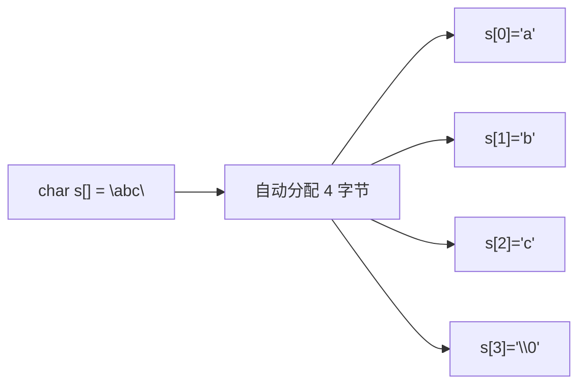

# 字符数组的定义、循环赋值与字符串常量初始化
### 它是什么

字符数组就是元素类型为 `char` 的一维数组。它特殊在：C 语言里没有专门的“字符串”类型，==字符串的存储与操作都靠字符数组来完成==。

一个字符数组可以是一个普通的字符序列，也可以被约定为“字符串”——两者的关键区别在于：

> [!IMPORTANT]
> 字符串必须用空字符 `'\0'` 作为==结束标记==。`char s[3]={'a','b','c'}` 只是三个字符的数组，不是字符串；`"abc"` 在内存中实际占 **4 个字节**：`'a' 'b' 'c' '\0'`。

这引出了第一个考点：用字符串常量初始化时，数组长度需要多留一位。

---

### 用字符串常量初始化

```c
char s[] = "abc";       // 正确，系统自动开 4 个字节
char s[] = {"abc"};     // 正确，等价于上一行
char s[3] = {'a','b','c'}; // 正确，单纯字符数组，不含 '\0'
char s[3] = "abc";      // 错误！4 个字符塞进 3 个字节
```

> [!WARNING]
> `"abc"` 隐含一个 `'\0'`，所以它需要 4 个字节。`char s[3]="abc"` 装不下，编译会报错或警告。



### 循环赋值与整体操作的差别

字符数组可以逐个元素赋值：

```c
char s[4];
s[0] = 'a'; s[1] = 'b'; s[2] = 'c'; s[3] = '\0';
```

也可以循环赋值，比如读取一行输入或逐个处理字符。但每个元素都必须是 `char` 类型，且最后若想当作字符串使用，必须补 `'\0'`。

> [!NOTE]
> 能不能整体赋值？==不能==。数组名是地址常量，不是变量。
> ```c
> char s[4];
> s = "abc";   // 错误！不能对数组名整体赋值
> ```
> 但初始化是可以的：`char s[4]="abc";` —— 初始化和赋值是两回事。

---

### `%s` 与字符数组的配合

`printf` 和 `scanf` 中，`%s` 处理的是字符串：

```c
char name[20];
scanf("%s", name);   // 不用写 &name
printf("%s", name);  // 传数组名，即首地址
```

> [!IMPORTANT]
> `%s` 操作的对象==始终是地址==。在 `scanf` 中因为 `name` 本身就是地址所以不加 `&`；在 `printf` 中同样传 `name` 而不是 `*name` 或 `name[0]`。

对比其他格式符：

| 格式符 | `scanf` 中 | `printf` 中 |
|--------|-----------|-------------|
| `%d`   | `&a`（要地址） | `a`（要值） |
| `%c`   | `&c`（要地址） | `c`（要值） |
| `%s`   | `s`（数组名就是地址） | `s`（也是地址） |

为什么 `%s` 在 `printf` 中也“特殊”？因为它会从传入的首地址开始，逐个输出字符，直到遇到 `'\0'` 为止。如果没有 `'\0'`，就会越界继续打印。

---

### 字符数组与整型数组的对比

> [!TIP]
> 选择常考：==字符数组可以整体输入输出（用 `%s`），整型数组不能==，必须用循环逐个处理 `%d`。

| 操作 | 字符数组 | 整型数组 |
|------|---------|---------|
| 初始化 | `char s[4]="abc"` | `int a[3]={1,2,3}` |
| 整体输入 | `scanf("%s", s)` ✅ | ❌ 不能 |
| 整体输出 | `printf("%s", s)` ✅ | ❌ 不能 |
| 整体赋值 | ❌ `s="abc"` 错误 | ❌ `a={1,2}` 错误 |

---

### 一个算对了的例子

结合前面的考点，判断这道题：

> 下列字符数组定义与初始化不正确的是  
> A. `char s[]="abc";`  
> B. `char s[]={"abc"};`  
> C. `char s[3]={'a','b','c'};`  
> D. `char s[3]="abc";`

**分析过程**：

- A：`s[]` 让系统数长度，`"abc"` 含 `'\0'` 共 4 个，正确。
- B：`{"abc"}` 和 `"abc"` 等价，正确。
- C：`{'a','b','c'}` 是 3 个字符，放进 `s[3]` 刚好，正确（只是它不是字符串）。
- D：`"abc"` 需要 4 个字节，但 `s[3]` 只有 3 个，==装不下 `'\0'`==，错误。

**答案：D**

> [!CAUTION]
> 不要把“不是字符串”和“定义错误”混为一谈。C 选项合法，但不是字符串；D 选项直接是定义不合法。
