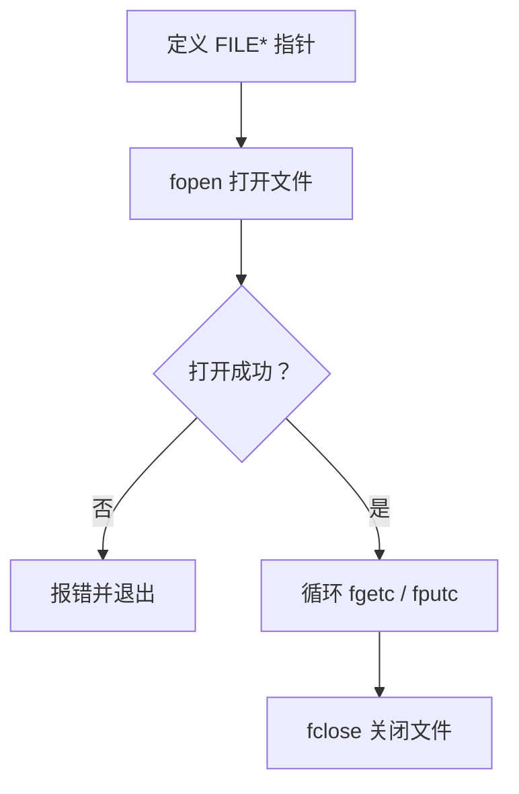

# 文件中单个字符的读写操作函数

## 是什么：fgetc 与 fputc

文件被打开后，数据被看作一个"字符流"。`fgetc` 每次从流中取出**一个字符**，`fputc` 每次向流中写入**一个字符**：

| 函数 | 原型 | 作用 | 返回值 |
|------|------|------|--------|
| `fgetc` | `int fgetc(FILE *fp)` | 从 `fp` 读一个字符 | 成功返回该字符；读到文件末尾返回 `EOF` |
| `fputc` | `int fputc(int c, FILE *fp)` | 把 `c` 写入 `fp` | 成功返回写入的字符；失败返回 `EOF` |

> [!IMPORTANT]
> `fgetc` 的返回值是 `int` 而不是 `char`，因为要能额外表示一个特殊值 `EOF`（通常定义为 `-1`）。用 `char` 接收返回值会丢掉区分"字符 255"和"文件结束"的能力。

## 为什么需要

键盘输入用 `getchar`、屏幕输出用 `putchar`，它们只能和"标准设备"打交道。文件操作必须借助文件指针 `fp`，因此 C 语言提供了一对**带 f 前缀**的平行函数：`fgetc`/`fputc` 对应 `getchar`/`putchar`，参数里多出一个 `FILE *fp` 指明读写哪个文件。

## 标准操作流程



> [!WARNING]
> 三个最常见的坑：
> 1. Windows 路径中的 `\` 是转义符，必须写成 `"D:\\sample.txt"`。
> 2. 忘记判断 `fp == NULL`。
> 3. 循环条件写成 `ch = fgetc(fp) != EOF`（少了括号，赋值优先级出错）。正确写法是 `while ((ch = fgetc(fp)) != EOF)`。

## 实战：大写转小写并显示

这是课件中的经典考题：读取 `D:\sample.txt`，大写字母转小写输出到屏幕，其余字符原样显示。

```c
#include <stdio.h>
#include <ctype.h>

int main() {
    FILE *fp;
    char ch;
    fp = fopen("D:\\sample.txt", "r");
    if (fp == NULL) {
        printf("File open error\n");
        return 1;
    }
    while ((ch = fgetc(fp)) != EOF) {   // 读一个，判断一个
        if (ch >= 'A' && ch <= 'Z') {
            ch = ch + 32;               // 或 ch = tolower(ch);
        }
        putchar(ch);
    }
    fclose(fp);
    return 0;
}
```

> [!TIP]
> 循环条件 `((ch = fgetc(fp)) != EOF)` 把"读"和"判断是否结束"合并成一步，这是处理字符流的标准写法。`ch + 32` 利用了 ASCII 码中大写与小写字母相差 32 的规律。

## 与相近概念的区别

| 判断文件结束的方式 | 写法 | 特点 |
|-------------------|------|------|
| `EOF` 判断 | `(ch = fgetc(fp)) != EOF` | 读完后再判断，简洁常用 |
| `feof` 判断 | `!feof(fp)` | 需先读一次再判断，易多循环一次 |

> [!NOTE]
> `fgetc`/`fputc` 是**单字符**读写，适合逐字符处理（如大小写转换、过滤字母）。若按格式读写数字或字符串，应改用 `fscanf`/`fprintf`；若整块读写结构体，则用 `fread`/`fwrite`。
