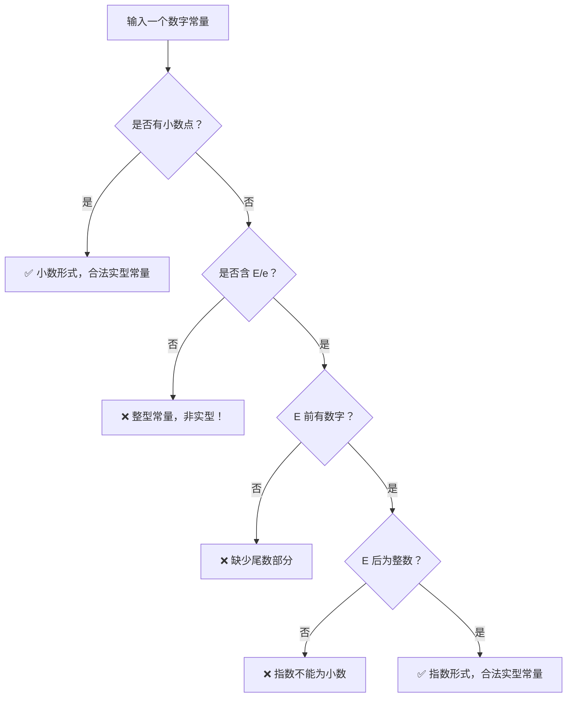

# 实型数据的合法表示形式

## 实型数据的两种合法形式

你是否见过这样的报错：明明写的是小数，编译器却说“非法常量”？问题往往出在==实型常量只有两种合法表示形式==：**小数形式**和**指数形式**。其他写法一概不合法。

> [!IMPORTANT]
> 判断一个常量是否为实型，看**值**，不看**写法**。`5.0` 是实型常量，`5` 是整型常量，即使它们的数值相等。

---

### 小数形式

由整数部分、小数点、小数部分三部分组成。规则很简单：

- **小数点必须有**
- 整数部分和小数部分**可以缺省其一**

```
合法示例：
  234.      // 缺省小数部分，等价于 234.0
  .56       // 缺省整数部分，等价于 0.56
  3.14      // 两部分都有

不合法示例：
  234       // 这是整型，不是实型！
  .         // 至少有一部分数字
```

> [!WARNING]
> 考试高频坑：题目写 `234.` 问是否合法——答案：**合法**。小数点后缺数字是允许的。同理 `.5` 也合法。

### 指数形式（科学计数法）

格式为：`尾数部分 E 指数部分`

- `E` 大小写均可
- **尾数部分必须有**（可以是小数形式或整数，但必须有数字）
- **指数部分必须是整数**

```
合法示例：
  2.5E3     // 等同于 2500.0
  1e-2      // 等同于 0.01
  .5E4      // 等同于 5000.0

不合法示例：
  E3        // 缺少尾数
  234E3.1   // 指数部分是小数，不合法！
```

> [!CAUTION]
> `E` 后面必须是整数。看到 `E3.1` 这种指数含小数的，直接判不合法，没有任何商量余地。

### 两种形式的对比

| 形式 | 关键特征 | 合法示例 | 易错示例 |
|------|----------|----------|----------|
| 小数形式 | ==小数点必须有== | `15.6` ` .5` ` 12.` | `12`（这是整型） |
| 指数形式 | `E` 前后：==前必有尾数，后必为整数== | `2E3` `1.5e-2` | `E3` `2E3.1` |

### 常见考题类型

题目出一道填空题，要求你用实型表示某个值。比如：

> 要求以实型形式输出 15.6，应写什么？

答案：`15.6` 或 `15.6000000`

错解：`15`（值相等，但类型是整型；判错）

> 要求实型输出 5，应写什么？

答案：`5.0` 或 `5.000000`

错解：`5`（整型，判错）

**核心原则**：==题目要求“实型”时，值必须体现实型特征——要么有小数点，要么用指数形式。==

### 判断流程图



### 记忆口诀

> [!TIP]
> **要实型先看"点"和"E"** —— 没有小数点就看有没有 E，两者必有其一，否则就是整型。**有点缺边也合法，E后必整是铁律。**
