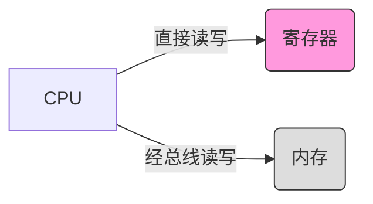

# 用register定义寄存器变量

在函数中，如果某个变量被极其频繁地读写（比如循环计数器），每次都去内存里取会不会太慢？能不能把它放到离 CPU 更近的地方？这就是 `register` 关键字要解决的问题。

## 什么是寄存器变量

用 `register` 关键字声明的局部变量称为==寄存器变量==。它建议编译器将该变量的值存放在 CPU 的寄存器中，而不是内存中。



> [!IMPORTANT]
> 核心目的：减少访存次数，提高程序执行速度。

## 为什么需要它

普通局部变量（`auto`）存在内存的栈区，每次运算都需要“读内存 $\to$ 运算 $\to$ 写内存”。而寄存器的访问速度与 CPU 同频，省去了总线传输时间。在密集循环中，这种差异尤为明显。

## 怎么做

语法格式为：`register 类型名 变量名;`

```c
long sum = 0;
register int i; /* 建议将 i 放入寄存器 */
for (i = 1; i <= 10000; i++) {
    sum += i;
}
```

> [!TIP]
> 记忆口诀：`register` 只修饰**局部变量**和**形参**，且必须是能被塞进寄存器的基本类型（如 `int`、`char`、指针）。

## 与相近概念的区别

| 特性 | `auto` 变量 | `register` 变量 |
| :--- | :--- | :--- |
| 存储位置 | 内存（栈区） | ==CPU 寄存器==（建议） |
| 能否取地址（`&`） | 能 | **不能** |
| 默认情况 | 局部变量默认是 `auto` | 必须显式声明 |
| 作用域与生存期 | 块内 / 函数调用期间 | 块内 / 函数调用期间 |

两者的作用域和生命周期完全相同，唯一的区别在于**物理存放位置**。

## 常见的坑

> [!WARNING]
> 绝对不能对 `register` 变量使用取地址运算符 `&`。因为寄存器没有内存地址，写了会导致编译报错。

> [!CAUTION]
> `register` 只是一个**建议**！如果寄存器不够用，或者编译器优化策略认为没必要，编译器会自动将其降级为普通 `auto` 变量处理，程序依然正确运行，不会报错。

> [!NOTE]
> 不能用 `register` 修饰全局变量或静态局部变量（`static`），因为它们的生命周期贯穿整个程序运行期，而寄存器资源极其有限且需要在函数间切换复用。

## 算对了的例子

下面这段代码计算 $S = \sum_{i=1}^{n} i$，利用 `register` 加速循环控制变量：

```c
#include <stdio.h>

long calc_sum(int n) {
    long s = 0;
    register int i;       /* 将高频使用的循环变量 i 定义为寄存器变量 */
    for (i = 1; i <= n; i++) {
        s += i;
    }
    return s;
}

int main() {
    printf("%ld\n", calc_sum(100)); /* 输出 5050 */
    return 0;
}
```

在这个例子中，`i` 每次自增和判断都要被访问，放在寄存器中避免了反复读写内存栈帧，从而提升了 `calc_sum` 函数的执行效率。注意，这里并没有也不能写出 `&i` 这样的表达式。现代编译器（如 GCC）开启 `-O2` 等优化选项后，通常能自动识别并将高频变量放入寄存器，但在《高级语言程序设计》课程中，掌握 `register` 的语法规则和限制依然是考试重点。
