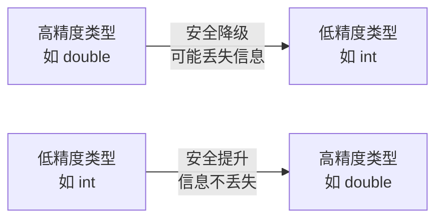

# 强制类型转换的语法与应用

## 强制类型转换：语法与应用

### 为什么需要强制类型转换？

C 语言中，不同数据类型在内存中的存储形式和占用空间各不相同。当不同类型的数据混合运算时，编译器会按照既定规则进行**自动类型转换（隐式转换）**，但这种转换有时不能满足我们的需求。

考虑一个问题：`int` 类型的 5 和 2 相除，结果是多少？是 2，因为整数除法的结果仍为整数。如果我们需要得到 2.5 这个精确值，就必须让至少一个操作数变为浮点数。这时，强制类型转换就派上了用场。

### 语法格式

```c
(目标类型) 表达式
```

例如：
```c
(int)(3.14 + 2.5)    // 结果为 5
(double) 5 / 2        // 结果为 2.5
```

> [!WARNING]
> `(double)(5 / 2)` 和 `(double)5 / 2` 的结果完全不同。前者先做整数除法得 2，再转为 2.0；后者先将 5 转为 5.0，再做浮点除法得 2.5。

### 运算优先级与结合方向

强制类型转换运算符 `(类型)` 的优先级 ==高于算术运算符==，结合方向为**从右向左**。

以表达式 `(int)(a - b)` 为例：
1. 先计算括号内的 `a - b`，得到 5.6
2. 再执行强制类型转换，结果截断为 5

这意味着 `(int)a + b` 和 `(int)(a + b)` 含义不同——前者只对 `a` 取整，后者对求和结果取整。

### 类型转换的本质



- **浮点型转整型**：直接截断小数部分，不进行四舍五入。`(int)13.9` 结果是 13，不是 14。
- **整型转浮点型**：值不变，以浮点形式存储。

> [!IMPORTANT]
> ==强制类型转换只产生一个临时值，不改变原变量本身的类型和值。== `(int)a` 的值是整数，但变量 `a` 本身依然是 `double` 型。

### 在表达式中的实战解析

来看一个典型考题：

**设有变量定义：`double a=13.6; int b=8;`，求 `a + b % 3 * (int)(a - b) / 4` 的值。**

逐步拆解：

| 步骤 | 计算内容 | 中间结果 | 说明 |
|:---:|:---|:---:|:---|
| ① | `a - b` | 5.6 | 13.6 - 8 |
| ② | `(int)(a - b)` | 5 | 强制截断小数 |
| ③ | `b % 3` | 2 | 8 % 3 = 2 |
| ④ | `2 * 5` | 10 | 乘法 |
| ⑤ | `10 / 4` | 2 | ==整数除法==，截断！ |
| ⑥ | `13.6 + 2` | **15.6** | double + int → double |

> [!CAUTION]
> 第⑤步是高频失分点：`10 / 4` 的两个操作数都是 `int`，执行的是整数除法，结果为 2，而不是 2.5。许多同学在这一步想当然地算出 2.5，导致最终答案错误。

### 常见误区辨析

| 写法 | 实际效果 | 常见误解 |
|:---|:---|:---|
| `(int)13.9` | 13（截断） | 误解为四舍五入得 14 |
| `(double)(8/3)` | 2.0 | 先做整数除法 8/3=2，再转 double |
| `(double)8/3` | 2.666... | 先转 8→8.0，再做浮点除法 |

> [!TIP]
> 记忆口诀：**“先看括号在哪里，截断取整不四舍；整数除整还是整，想得小数先转换。”**

### 与自动类型转换的配合

强制转换与自动转换常同时出现。运算时遵循：==“低精度向高精度看齐”==。`int` 遇到 `double`，`int` 自动提升为 `double` 后再运算。

```c
double a = 13.6;
int b = 8;
// a + 2  →  double + int  →  double + double  →  15.6
```

最终一步 `13.6 + 2` 中，`2` 被自动提升为 `2.0`，结果保持 `double` 类型。
