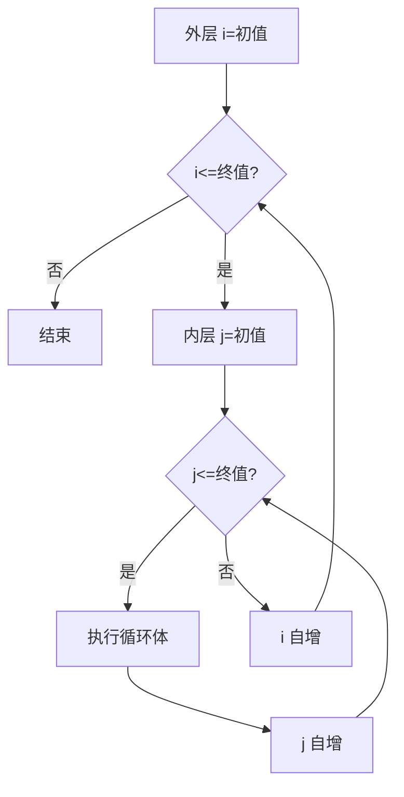

# 多重循环嵌套的执行过程

## 多重循环的执行过程怎么看

多重循环就是循环里面再套循环。外层循环每执行**一轮**，内层循环都会从自己的初值开始**完整跑一遍**，直到内层条件不成立，再回到外层判断是否进入下一轮。



> [!IMPORTANT]
> ==外层循环体每执行一次，内层循环都会完整执行一遍。== 判断输出结果时，不要把所有轮次的结果混在一起，要分清哪些变量在什么时候被重置、哪些是累加保留。

## 一层一层拆开看

遇到嵌套循环不要急着一口算完，像剥洋葱一样，固定外层变量，单看内层。

以这道考试题为例：

```c
int i, j, m;
for(i=1; i<=4; i++) {
    m=0;
    for(j=i; j<=4; j++)
        m = m + i * j;
}
printf("%d\n", m);
```

先问自己一个问题：`m=0` 写在**外层循环体内部**，每次外层进入新一轮会发生什么？

它会把上一轮算出的 m 清掉。所以最终留下的 m 只取决于**最后一轮** i=4 时内层循环的结果。

固定 i=4，内层：

| j  | i*j | m 的变化 |
|----|-----|----------|
| 4  | 16  | m=0+16=16 |

所以程序输出 `16`。

> [!WARNING]
> 如果 `m=0` 写在外层 `for` 之前，m 才代表所有轮次的累计和：10 + 18 + 21 + 16 = 65。==“重置语句放在哪一层”直接决定最终结果，是多重循环最容易看错的地方。==

## 输出图形的执行次数

再看一道题：统计下面程序输出多少个 `#`。

```c
for(i=1; i<5; i++)
    for(j=2; j<=i; j++)
        putchar('#');
```

按照“固定外层、单看内层”的方法：

| i  | 内层 j 范围 | # 输出次数 |
|----|-------------|------------|
| 1  | 2≤1 不成立 | 0          |
| 2  | j=2             | 1          |
| 3  | j=2,3           | 2          |
| 4  | j=2,3,4         | 3          |

总次数 = 0 + 1 + 2 + 3 = **6 次**。

> [!TIP]
> 内层循环的上限或初值常常依赖外层变量（如 `j<=i`、`j=i`）。先固定外层值，再判断内层跑几次，能避免把不执行的轮次也数进去。

## 正确的执行次序

多重循环中任何一条语句的执行次数，等于**各层循环次数逐层相乘后求和**。但内层初值、终值随外层变化时，不能简单用“外层次数 × 内层次数”，而要逐轮累加。

| 情况 | 内层次数是否固定 | 处理方法 |
|------|------------------|----------|
| `j=1; j<=3` | 固定 | 直接相乘 |
| `j=i; j<=4` | 随 i 变化 | 固定 i 后逐轮数 |
| `j=2; j<=i` | 随 i 变化 | 固定 i 后逐轮数 |

## 常见的坑

- **把累加和当最终值**：只要内层或外层有重置语句，之前算出的值就不会保留到最后。
- **忽略内层可能一次都不执行**：比如 `for(j=2; j<=i; j++)`，当 i=1 时内层直接跳过。
- **循环变量写错**：内层循环体里用 `i*j` 时，i 是外层的“慢变量”，j 是内层的“快变量”，别把变化频率搞反。

> [!NOTE]
> 判断嵌套循环输出结果，先把外层变量固定为某一轮的值，再单看内层怎么执行；算完这一轮，再放下一轮。不要同时盯着两个变量一起变，那样最容易乱。
