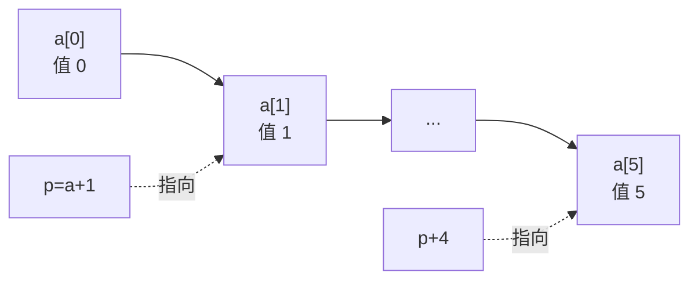

# 数组名的实质及指针访问一维数组的方法

## 数组名的实质

定义 `int a[10] = {0,1,2,3,4,5,6,7,8,9}, *p;` 后，数组 `a` 在内存中占据一段连续空间。数组名 `a` 在大多数表达式中会**转换为指向首元素的指针**，即指向 `a[0]`，其类型可看作 `int *`。

因此有：

$$
a \equiv \&a[0],\qquad a+i \equiv \&a[i],\qquad *(a+i) \equiv a[i]
$$

这里的 $i$ 表示“相差几个元素”，不是相差几个字节。若 `int` 占 4 字节，则 `a+1` 的地址值实际增加 4。

> [!IMPORTANT]
> ==数组名不是可以被随意修改的普通指针变量==。它可以参与地址运算，却不能执行 `a++`、`a=p` 或 `a="abcdef"` 等赋值操作。

可以把数组名理解为“固定指向本数组首元素的地址值”，而 `p` 是可改变指向的指针变量：

```c
p = a;        // 正确：p 指向 a[0]
p = &a[3];    // 正确：p 指向 a[3]
a++;          // 错误：不能改变数组名
```

## 用指针访问一维数组

执行 `p = a` 后，以下四种写法通常等价：

| 访问方式 | 等价形式 | 含义 |
|---|---|---|
| 下标法 | `a[i]` | 数组第 $i+1$ 个元素 |
| 数组名加偏移 | `*(a+i)` | 从首元素起移动 $i$ 个元素 |
| 指针下标法 | `p[i]` | 从 `p` 所指元素起移动 $i$ 个元素 |
| 指针加偏移 | `*(p+i)` | 与 `p[i]` 等价 |



指针还可以移动，但移动后必须重新计算它当前指向的位置：

```c
p = a;
printf("%d", *p);     // 0
p++;                  // p 指向 a[1]
printf("%d", *p);     // 1
printf("%d", p[4]);   // a[5]，值为 5
```

> [!TIP]
> 看到 `p[i]` 或 `*(p+i)`，先问两个问题：**p 当前指向哪里？再向后移动几个元素？** 不要机械地把 `p[i]` 当成 `a[i]`。

## 一个算对了的例子

已知：

```c
int a[10] = {0,1,2,3,4,5,6,7,8,9}, *p;
p = a + 1;
```

此时 `p` 指向 `a[1]`。值为 5 的元素是 `a[5]`，它相对于 `p` 的偏移量为：

$$
5-1=4
$$

所以正确表达式是：

```c
*(p + 4)    // 即 a[5]，值为 5
```

也可以写成 `p[4]`。而 `a[4]` 的值为 4，`a+5` 只是 `a[5]` 的地址，并非元素值。

## 数组名与指针变量的区别

| 比较点 | 数组名 `a` | 指针变量 `p` |
|---|---|---|
| 表达式中的一般含义 | 首元素地址 | 当前保存的地址 |
| 能否赋值、自增 | 不能 `a++`、`a=p` | 可以 `p++`、`p=a` |
| `sizeof` | 整个数组的字节数 | 指针本身的字节数 |
| 元素访问 | `a[i]`、`*(a+i)` | `p[i]`、`*(p+i)` |

例如：

```c
int m[10] = {9,4,12,8,2,10,7,5,1,3}, *p = m;
```

若 `int` 占 4 字节、指针占 8 字节，则：

- `sizeof(m)` 为 $10\times4=40$；
- `sizeof(p)` 为 8；
- `sizeof(*m)` 和 `sizeof(*p)` 都相当于 `sizeof(int)`，为 4。

> [!WARNING]
> `sizeof(a)` 是数组名不完全转换为普通指针的重要例外；另外，`&a` 与 `a` 的地址数值通常相同，但类型和指针运算单位不同。

## 函数参数与字符串中的数组名

一维数组名作为函数实参时，实际传递的是==首元素地址==，不是整个数组的副本。因此形参常写成：

```c
void f(int a[], int n);   // a 实际按指针处理
void f(int *a, int n);    // 与上面的数组形参本质相同
```

函数内可通过 `a[i]` 修改调用者的数组元素，同时应另行传入元素个数 `n`，不能依赖形参中的 `sizeof(a)` 求原数组长度。

对于：

```c
char a[10] = {'h','e','l','l','o'};
puts(a + 2);
```

`a+2` 指向第三个字符 `'l'`，`puts` 从该位置输出到字符串结束符 `'\0'`，所以输出 `llo`。这里利用了字符数组中剩余元素被初始化为 0，而 `'\0'` 的编码正是 0。

> [!CAUTION]
> `*p[5]` 中 `[]` 的优先级高于 `*`，会被理解为 `*(p[5])`，不是“取 `p` 后面第 5 个元素”。表示后者应写 `*(p+5)` 或 `p[5]`，并确保没有越界。
