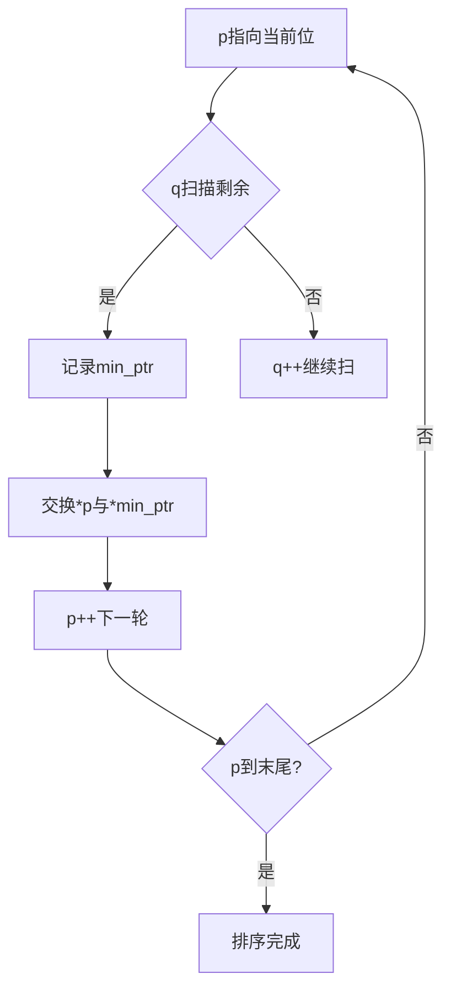

# 使用指针实现选择法等排序算法

## 什么是指针实现选择排序

在《高级语言程序设计》中，使用指针实现选择排序是第7章的核心应用。它不再通过数组下标 `a[i]` 访问元素，而是利用 ==指针的算术运算与解引用== 直接操作内存地址。若已掌握普通选择排序，为何还要用指针重写？因为指针版本能更直观体现“地址传递”本质，且为后续学习动态内存排序、函数参数传递打下基础。

## 算法流程与指针映射

选择排序的核心是“每轮选最小值放到当前位置”。用指针表达时，关键是将“下标遍历”转化为“指针移动”：



[!IMPORTANT]
> 指针版选择排序的本质是：==用指针移动替代下标递增，用解引用替代数组访问==，逻辑不变但操作对象变为地址。

## 代码实现要点

设整型数组首地址为 `int *base`，长度为 `n`，核心片段如下：

```c
for (int *p = base; p < base + n - 1; p++) {
    int *min_ptr = p;
    for (int *q = p + 1; q < base + n; q++)
        if (*q < *min_ptr) min_ptr = q;
    if (min_ptr != p) {
        int temp = *p;
        *p = *min_ptr;
        *min_ptr = temp;
    }
}
```

[!TIP]
> 记忆口诀：==外层定位置，内层找最小，指针比大小，解引换数值==。循环边界用 `base + n` 而非下标，避免越界。

## 与下标版的区别

| 对比维度 | 下标版 | 指针版 |
| :--- | :--- | :--- |
| 访问方式 | `a[i]` | `*(p + i)` 或 `*p` |
| 循环变量 | 整型下标 `i, j` | 指针 `p, q` |
| 最小值记录 | 下标 `min_idx` | 指针 `min_ptr` |
| 参数传递 | 需传数组名+长度 | 仅传首指针+长度 |
| 可读性 | 直观易懂 | 紧凑但需熟悉语法 |

## 常见坑与注意事项

[!WARNING]
> 指针比较必须指向同一数组！`p < base + n` 合法，但不同数组指针比较无意义。

[!CAUTION]
> 交换时必须用临时变量保存 ==解引用后的值==，而非指针本身。错误写法：`temp = p; p = min_ptr;` 这只会改变指针指向，不会交换数据。

[!NOTE]
> `min_ptr != p` 的判断可省略，但保留能避免不必要的自交换，提升效率。

## 正确示例演示

对数组 `{5, 2, 8, 1}` 排序，初始 `base` 指向 `5`：

- 第1轮：`p→5`，`q` 扫描找到 `min_ptr→1`，交换后数组为 `{1, 2, 8, 5}`
- 第2轮：`p→2`，剩余最小即自身，不交换
- 第3轮：`p→8`，`min_ptr→5`，交换得 `{1, 2, 5, 8}`

最终结果正确，全程未使用任何下标，验证了指针操作的等价性与安全性。
