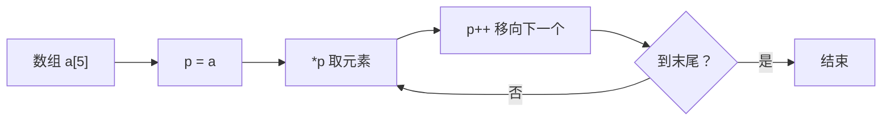

# 使用指针实现数组求平均值、统计及进制转换

## 指针与数组：求平均值、统计与进制转换

### 它是什么

数组名在表达式中（除 `sizeof` 和 `&` 之外）会退化为指向首元素的指针。因此，可以用指针遍历数组，完成求和、求平均值、统计等操作。指针遍历的核心是：`*(p + i)` 等价于 `p[i]`，等价于数组名加下标访问。

对于进制转换，指针常用于**反向输出**：除基取余法得到的余数序列是逆序的，先得到的余数是低位，后得到的是高位。可以用指针从数组末尾开始向前输出，或者用指针指向存储的最后一个有效元素，依次递减输出。



### 为什么需要指针

用下标访问数组完全可行，但指针写法在以下场景更简洁高效：

- 函数参数传递数组时，本质上就是传指针。形参 `int a[]` 等价于 `int *a`。
- 需要反向遍历、同时操作多个数组交错填充时，指针的增减直观表达“当前位置”。
- 考试中明确要求“用指针实现”时，不能用下标或至少要体现指针移动。

> [!NOTE]
> 函数里对指针形参重新赋值（如 `p = p + 1`）不会影响主调函数的实参，因为形参是实参的副本。但对 `*p` 的修改会影响原数组元素。

### 怎么做：典型实现

#### 用指针求平均值

```c
double average(int *p, int n) {
    int sum = 0;
    for (int i = 0; i < n; i++)
        sum += *(p + i);      // 或 sum += *p++;
    return (double)sum / n;
}
```

> [!WARNING]
> 若写成 `sum += *p++;`，`*p++` 的求值顺序是：先取 `*p`，再将 `p` 加一。它是 `(*p)++` 吗？不是——后者是对元素值自增，危险且语义完全不同。此处 `*p++` 没问题，但必须分清 `*p++` 与 `(*p)++`。

#### 用指针统计

统计数组中正数、负数、零的个数，以及最大值：

```c
void count(int *p, int n, int *pos, int *neg, int *zero, int *max) {
    *pos = *neg = *zero = 0;
    *max = *p;                       // 假设第一个元素最大
    for (int i = 0; i < n; i++, p++) {
        if (*p > 0)      (*pos)++;
        else if (*p < 0) (*neg)++;
        else             (*zero)++;
        if (*p > *max)   *max = *p;
    }
}
```

> [!TIP]
> 输出型参数（`pos`、`neg` 等）用指针传地址，让函数能“返回”多个值。这是指针在函数参数中的重要用途。

#### 用指针实现十进制转二进制（或任意进制）

```c
void dec2bin(int n, int *bin, int *len) {
    int *p = bin;
    do {
        *p++ = n % 2;
        n /= 2;
    } while (n > 0);
    *len = p - bin;      // 实际存储的位数
    // 反向输出：从 p-1 递减到 bin
    for (int *q = p - 1; q >= bin; q--)
        printf("%d", *q);
    printf("\n");
}
```

> [!IMPORTANT]
> 反向输出时指针递减的终止条件是 `q >= bin`，即指回数组首元素。注意不能写成 `q > 0`——指针与整数比较没有意义，必须与指针比较。

### 与相近概念的区别

| 写法 | 含义 | 是否移动指针 |
|------|------|--------------|
| `*(p + i)` | 以 `p` 为基准向后第 `i` 个元素 | 否，`p` 不变 |
| `*p++` | 取 `*p`，再让 `p` 指向下一个 | 是 |
| `(*p)++` | 把 `p` 指向的元素值加 1 | 否，元素值变 |
| `p[i]` | 下标访问，等价于 `*(p + i)` | 否 |

> [!CAUTION]
> 指针减法有意义的场景是：两个指针指向**同一数组**。此时 `p - q` 表示它们之间相隔的元素个数；否则是未定义行为。

### 常见的坑

- **越界**：指针移动到数组范围之外再解引用，结果是未定义的。循环条件严格控制 `i < n`。
- **忘记初始化指针**：未初始化的野指针指向随机地址，对其解引用会导致段错误。
- **整数与指针混用**：永远不要把一个整数直接赋给指针变量（`int *p = 10;` 是错的）。
- **循环中重复移动指针后又用下标访问**：若 `for` 里 `p++` 移动了指针，循环体内又写 `p[i]`，基准已经变了，结果混乱。要么只用指针移动，只用 `*p`；要么只用 `p + i` 但不要移动 `p`。

### 一个算对了的例子

题目：用指针实现，输入 10 个整数，求平均值，并统计大于平均值的元素个数。

```c
#include <stdio.h>

int main(void) {
    int a[10], sum = 0, cnt = 0;
    int *p = a;
    double avg;

    for (int i = 0; i < 10; i++, p++)
        scanf("%d", p);        // p 指向当前待输入位置
    p = a;                     // 重新指向数组开头
    for (int i = 0; i < 10; i++)
        sum += *p++;
    avg = (double)sum / 10;
    p = a;                     // 再次重置
    for (int i = 0; i < 10; i++, p++)
        if (*p > avg)
            cnt++;
    printf("avg=%.2f, count=%d\n", avg, cnt);
    return 0;
}
```

> [!TIP]
> 每次用 `p++` 扫描后，若要重新遍历，必须 `p = a;` 让指针回到数组开头。忘记重置指针是高频错误。

输入：`1 2 3 4 5 6 7 8 9 10`
输出：`avg=5.50, count=5`

平均值 $5.50$，大于它的数是 $6,7,8,9,10$，共 $5$ 个。
