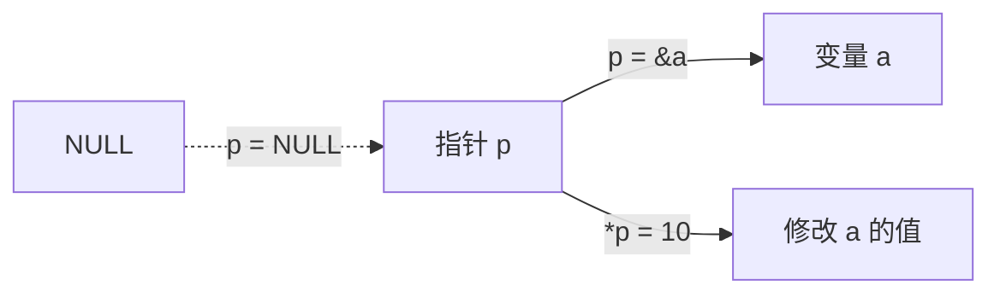

# 指针变量的初始化（含NULL指针）

指针变量存储的是内存地址，但刚定义一个指针时，它里面装的是什么？如果是一块随机的垃圾值，直接用它去访问内存会发生什么？这就引出了指针变量初始化的必要性。

## 为什么需要初始化

未初始化的指针被称为==野指针==，其值是随机的内存地址。若对野指针解引用（`*p = 10;`），轻则程序崩溃，重则破坏操作系统数据。因此，定义指针时必须明确“让它指向谁”。

> [!IMPORTANT]
> 核心原则：指针变量在定义后、使用前，必须被赋予合法的地址或显式置空。

## 怎么赋值与初始化

给指针赋值，本质是把某个变量的地址存进去。取地址用 `&` 运算符。

```c
int x, *pb;
pb = &x; // 正确：将 x 的地址赋给 pb
```

结合真题来看：若有定义 `int x, *pb;`，正确的赋值表达式是哪一个？

- A. `pb=&x` —— `pb` 是指针，`&x` 是地址，类型匹配，正确。
- B. `pb=x` —— 把整型值当地址赋给指针，错误。
- C. `*pb=&x` —— `*pb` 是 `int` 类型，`&x` 是地址，类型不匹配，错误。
- D. `*pb=*x` —— `x` 不是指针，不能用 `*` 解引用，错误。

答案是 **A**。

再看另一道真题：设 `int *p, i;`，以下正确的语句是？

- A. `*p=10;` —— `p` 未初始化就解引用，危险！
- B. `i=p;` —— 地址赋给整型，类型不匹配。
- C. `i=*p;` —— 同样是对未初始化的 `p` 解引用。
- D. `p=&i;` —— 将 `i` 的地址赋给 `p`，合法且安全。

答案是 **D**。

## NULL 指针

如果暂时不知道该让指针指向哪，应该怎么做？把它设为 `NULL`。

`NULL` 是一个预定义的宏，值为 $0$，表示“不指向任何有效内存”。

```c
int *p = NULL; // 定义时初始化为空指针
```

> [!TIP]
> 记忆口诀：指针不用先置空，解引用前查一查。

## 易混概念辨析

初学者常混淆“给指针赋值”和“给指针所指对象赋值”，请看下表：

| 操作 | 含义 | 示例 |
| :--- | :--- | :--- |
| 给指针赋值 | 改变指针的指向 | `p = &a;` |
| 给所指对象赋值 | 改变目标变量的值 | `*p = 10;` |



## 常见的坑

> [!CAUTION]
> 高危误区：认为 `int *p;` 之后 `p` 自动为 `NULL`。C 语言不会自动初始化局部指针变量，它的初值是栈上的随机垃圾。

> [!WARNING]
> 易错点：对 `NULL` 指针解引用。`p = NULL; *p = 5;` 会导致段错误（Segmentation Fault）。使用 `*p` 前务必确保 `p` 已指向合法内存。

## 完整示例

下面这段代码展示了指针从定义、置空到正确赋值的全过程：

```c
#include <stdio.h>

int main() {
    int a = 5, b = 7;
    int *p = NULL; // 步骤1：初始化为 NULL，避免成为野指针
    
    if (p == NULL) {
        p = &a;    // 步骤2：赋予合法地址
    }
    
    printf("%d\n", *p); // 输出 5
    
    p = &b;             // 步骤3：改变指向
    printf("%d\n", *p); // 输出 7
    
    return 0;
}
```

总结来说，处理指针只需记住两步：==要么让它指向确定的变量，要么让它等于 `NULL`==，绝不让它处于悬空状态。
