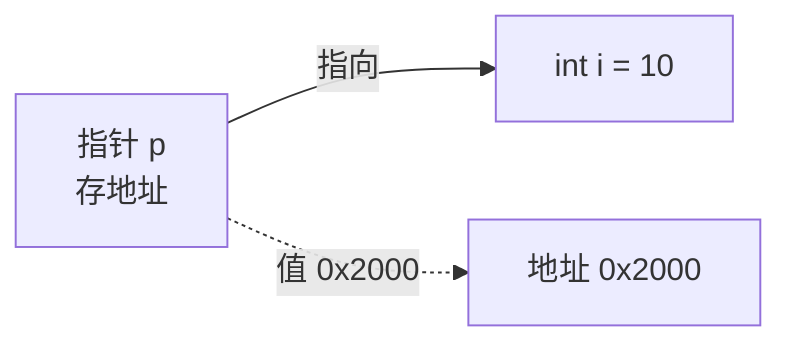

# 指针变量的概念、基类型与定义方法

## 指针变量是什么

内存中的每个字节都有编号，称为**地址**。==指针变量就是专门存放另一个变量的地址的变量==。有了它，我们可以通过"地址"间接访问数据，而不是通过变量名直接访问。



## 基类型：指针的"步长标签"

定义指针时必须写**基类型**（base type），它说明"这个指针指向的是哪一类数据"：

```c
基类型 *指针变量名1, *指针变量名2, …;
int *point;        // 指向 int
char *p;           // 指向 char
```

为什么必须写基类型？因为指针进行加减运算时，==步长由基类型决定==：

$$
\texttt{p} + i \;\Longrightarrow\; \texttt{p} + i \times \texttt{sizeof(基类型)}
$$

例如 `int *p` 做 `p+1` 是地址加 4（`sizeof(int)=4`），而 `char *p` 做 `p+1` 只加 1。数组名可看作"指向首元素的指针常量"，可以赋给基类型相同的指针变量；若基类型不同，步长也不同（一行 vs 一个元素），访问就错位了。

## 定义与取址/解引用运算符

```c
int i = 10;
int *point = &i;   // point 存 i 的地址
*point             // 解引用，等价于 i 的值 10
&i                 // 取 i 的地址
```

> [!IMPORTANT]
> ==`&*p` 等价于 `p`==：`*p` 拿到目标变量，`&` 又取回地址。这是考选择题的高频点（选择 25）。

## 常见坑

| 写法 | 问题 |
|---|---|
| `*p = "abcdef";` | `*p` 是 char，不能赋字符串 |
| `a = "abcdef";` | 数组名是常量地址，不能被赋值 |
| `&*i` | `i` 不是指针，编译报错 |
| `sizeof(p)` vs `sizeof(m)` | 前者是指针大小，后者是整个数组大小 |

> [!TIP]
> 看到 `&*` 先抵消掉（恒为指针本身）；看到 `*` 在前先看基类型是元素还是数组，再判断是否得到地址。

## 算一个例子

选择 19：`char a[7]={'p','r','o','g','r','a','m'}; char *p=a;`，想拿到字符 `'o'`（即 `a[2]`）。

- `*p+2` → `'p'` 对应的 ASCII + 2，得到整数
- `*(p+2)` → ==`p+2` 走两步（2×1=2），解引用得到 `a[2]`='o'== ✅
- `p+2` → 是地址，不是字符
- `p++, ++p` → 指针本身，不是字符

> [!NOTE]
> `p+2` 与 `*(p+2)` 的区别是"地址 vs 该地址里的值"，务必看有没有解引用 `*`。
