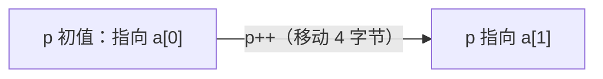
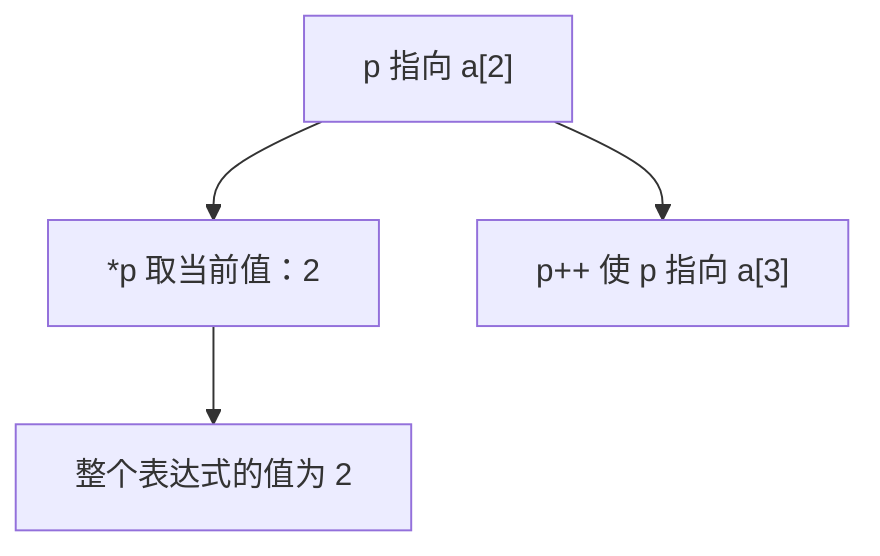

# 指针变量的移动与算术运算规则

## 指针变量的移动与算术运算规则

指针变量保存的是**地址**。既然地址本质上是一个整数编号，那么指针也能参与某些算术运算——但不是简单的整数加减，而是==以“指向类型的大小”为步长进行移动==。这是指针最核心、也最容易出错的地方。

先看一个最基本的问题：假设 `int *p` 指向一个 `int` 数组的某个元素，执行 `p++` 后，`p` 的值（地址）到底加了多少？

```c
int a[5] = {10, 20, 30, 40, 50};
int *p = a;        // p 指向 a[0]
printf("%p\n", p);
p++;
printf("%p\n", p); // 地址比原来大 4（假设 int 占 4 字节）
```

答案不是“加 1”，而是**加 `sizeof(int)` 个字节**。编译器知道 `p` 是指向 `int` 的指针，所以 `p++` 会让 `p` 恰好移动一个 `int` 的距离，从而指向下一个元素 `a[1]`。



> [!IMPORTANT]
> 指针算术的步长由**指针的基类型**决定：`p + n` 表示从 `p` 出发，向后移动 `n` 个“该类型元素”的距离，实际地址增量为 `n * sizeof(基类型)`。

### 指针与整数的加减

指针支持以下运算：

| 运算 | 含义 | 示例（`int *p` 指向 `a[0]`） |
|------|------|------------------------------|
| `p + n` | 向后移 n 个元素 | `p + 2` 指向 `a[2]` |
| `p - n` | 向前移 n 个元素 | 若 `p` 指向 `a[2]`，`p - 1` 指向 `a[1]` |
| `p++` / `++p` | 指向下一个元素 | `p++` 后指向 `a[1]` |
| `p--` / `--p` | 指向上一个元素 | `p--` 后指回 `a[0]` |
| `p - q` | 两指针之间的元素个数 | 若 `p` 指向 `a[3]`、`q` 指向 `a[0]`，则 `p - q == 3` |

可以用索引和指针算术对照理解：

```c
int a[5] = {1, 2, 3, 4, 5};
int *p = a;

a[2]      // 下标法，值为 3
*(p + 2)  // 指针法，值也为 3
*(a + 1)  // 数组名也可参与指针算术，值为 2
```

> [!WARNING]
> 数组名 `a` 是一个**指针常量**，它的值（首地址）不能改变。所以 `a++` 是非法的，但 `a + 1` 是合法的——只是计算一个新地址，并没有试图修改 `a` 本身。

这解释了选择题中的一个关键陷阱：

```c
int a[5] = {1, 2, 3, 4, 5};
// a++;        // ❌ 编译错误：a 是常量，不能自增
// x = *a;
```

### 结合方向与 `*p++` 的坑

`*`（解引用）和 `++` 的优先级相同，结合方向是**从右向左**，所以 `*p++` 等价于 `*(p++)`，而不是 `(*p)++`。

`*(p++)` 的执行过程分两步：

1. 先取出 `p` 当前指向的值（作为整个表达式的值）；
2. 再让 `p` 自增，指向下一个元素。

也就是说，`*p++` 的值是**移动前**的那个元素的值，但执行完后 `p` 已经指向了下一个元素。

```c
int a[5] = {0, 1, 2, 3, 4};
int *p = a;

p += 2;          // p 指向 a[2]，值为 2
int val = *p++;  // val = 2（a[2] 的值），执行后 p 指向 a[3]
```

用一张图梳理这个常见的“一步两用”：



> [!CAUTION]
> `*p++` 改变的是指针 `p`，不是指针指向的内容。如果原意是“把 `p` 指向的值加 1”，应该写 `(*p)++`——括号改变了结合顺序，先解引用再自增。

### 一个完整的例子

下面把指针移动、算术运算和数组遍历放在一起：

```c
#include <stdio.h>
int main() {
    int a[5] = {1, 2, 3, 4, 5};
    int *p = a;

    printf("%d\n", *(p + 1));   // 2，p 本身没变
    p += 2;                      // p 指向 a[2]
    printf("%d\n", *p);          // 3
    printf("%d\n", *p++);        // 先输出 3，然后 p 指向 a[3]
    printf("%d\n", *p);          // 4
    return 0;
}
```

输出：

```text
2
3
3
4
```

> [!TIP]
> 判断表达式的值时，先看运算符的优先级和结合方向，再一步步追踪“指针现在指向哪里”。画一个内存单元格草图，标上元素值和指针位置，是最稳妥的做法。
