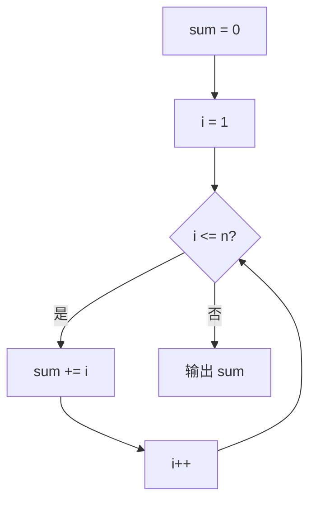
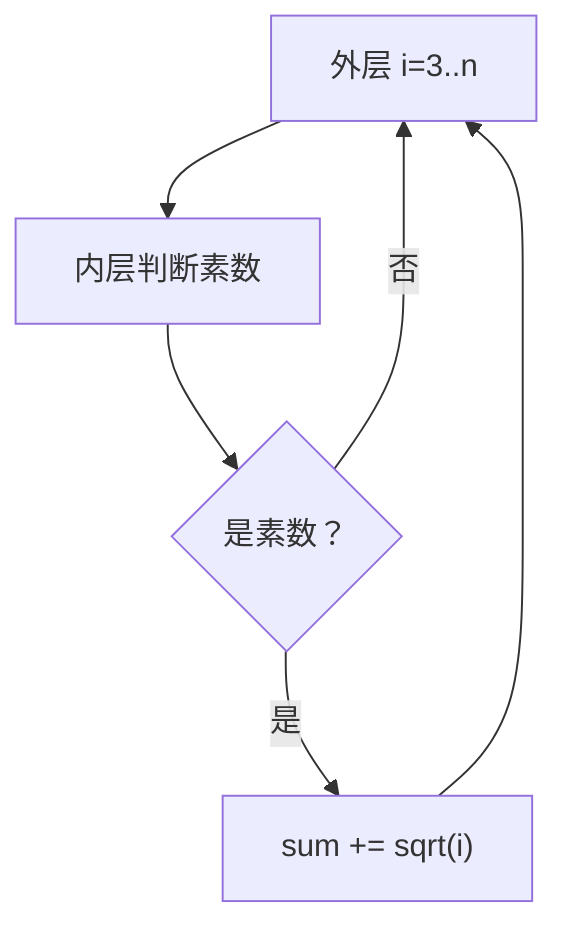

# 累加和与阶乘等数列求和算法

# 累加和与阶乘：一重循环的经典起点

## 从一个问题说起

如果让你求 $1+2+3+\dots+100$，你当然可以硬算，但计算机擅长的是**重复执行同一件事**。问题的关键在于：能不能把“求和”这件事拆成“一次只加一个数，但重复很多次”？

累加和与阶乘就是这类问题的典型代表——它们都只需要**一重循环**，却能帮你建立循环程序的核心思维：**一个变量存结果，一个变量走流程，循环体内不断更新**。

## 累加和的通用框架

求 $\sum_{i=1}^{n} i$ 的程序骨架如下：

```c
int sum = 0;          // 累加器清 0
for (int i = 1; i <= n; i++) {
    sum = sum + i;    // 把当前项加到累加器上
}
```

> [!IMPORTANT]
> 累加器 `sum` 的初值必须是 0；循环变量 `i` 同时扮演两个角色：==控制循环次数==和==提供当前项的值==。

### 一步步拆解

设 $n = 5$，程序执行的轨迹是：

| 循环次数 | i 的值 | sum 更新前 | 执行 `sum += i` 后 |
|:---:|:---:|:---:|:---:|
| 1 | 1 | 0 | 1 |
| 2 | 2 | 1 | 3 |
| 3 | 3 | 3 | 6 |
| 4 | 4 | 6 | 10 |
| 5 | 5 | 10 | 15 |



## 阶乘：同一套骨架，换个“更新方式”

$n! = 1 \times 2 \times \dots \times n$ 与累加和**结构完全相同**，只是把 `+` 改成 `*`，把初值从 0 改成 1：

```c
double fact = 1;      // 乘法器，初值必须为 1
for (int i = 1; i <= n; i++) {
    fact = fact * i;
}
```

> [!WARNING]
> 累加器初值取 **0**，乘法器初值取 **1**——这是“单位元”的体现。如果用 `fact = 0`，所有结果都是 0。此外，阶乘增长极快，$13!$ 就超过 `int` 的 32 位有符号范围，建议用 `double` 或 `long long`。

## 求和的三种常见变体

循环骨架不变，变的是**当前项的表达式**。

| 类型 | 通项 $a_i$ | 循环体内写法 |
|:---|:---|:---|
| 简单累加 | $i$ | `sum += i;` |
| 交错级数 | $(-1)^{i+1}\cdot\frac{1}{i}$ | `sum += sign * (1.0 / i); sign = -sign;` |
| 带筛选条件 | $\sqrt{i}$（$i$ 为素数时） | `if (isPrime(i)) sum += sqrt(i);` |

### 交错级数实例

求 $S = 1 - \frac12 + \frac13 - \frac14 + \dots$ 的前 1000 项：

```c
double sum = 0.0;
int sign = 1;
for (int i = 1; i <= 1000; i++) {
    sum += sign * (1.0 / i);   // 必须写 1.0/i，不能写 1/i
    sign = -sign;               // 下一项变号
}
printf("Sum = %.6f\n", sum);
```

> [!TIP]
> 遇到“一正一负”的数列，设一个 `sign` 变量，每次循环取反，比用 `pow(-1, i)` 更直观、效率也更高。注意除法必须写成 `1.0 / i`，否则整数除整数仍得整数，结果会全部变成 0。

## 什么时候必须用二重循环？

有一些求和问题，当前项本身就需要“算很多次”才能得到。例如求 $\sum_{i=3}^{n} \sqrt{i}$（$i$ 是素数），判断素数需要用内层循环：

```c
double sum = 0.0;
for (int i = 3; i <= n; i++) {
    int is_prime = 1;
    for (int j = 2; j * j <= i; j++) {   // 内层循环：判断 i 是否素数
        if (i % j == 0) {
            is_prime = 0;
            break;
        }
    }
    if (is_prime) {
        sum += sqrt(i);
    }
}
```



这里的**外层循环控制累加**，**内层循环只负责回答“当前项能不能加进去”**。初学者容易把两件事混在一起写，其实只要问自己：累加器 `sum` 每一次加的是什么？加的条件是什么？层层拆开就清楚了。

## 常见的坑

> [!CAUTION]
> **忘清零/置 1**：累加器 `sum` 不初始化就使用，结果不可预测。  
> **整数除法陷阱**：`1/i` 当 `i > 1` 时全是 0。级数求和务必用 `1.0/i` 或强制转换 `(double)1/i`。  
> **累加语句放错位置**：`sum += i` 必须写在循环体内；如果写在 `for` 的括号里（如 `for(i=1; i<=n; sum+=i, i++)`），虽然语法能通过，但可读性差，不建议初学时使用。  
> **阶乘溢出**：一旦 `n` 较大，`int` 早早就装不下了，换成 `double` 或 `long long` 是必须的。

## 一个算对了的例子

问题：计算并输出 3 到 n 之间所有素数的平方根之和，$n = 10$。

手算：3、5、7 是素数，结果为 $\sqrt{3} + \sqrt{5} + \sqrt{7} \approx 1.732 + 2.236 + 2.646 = 6.614$。

程序运行后输出 `6.614`，与手算吻合——累加器、循环条件、内层判断、数学函数调用全部配合正确，这就是“求和类算法”最终要达到的熟练程度。
