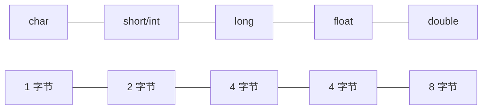

# 各数据类型占用的内存空间大小

## 它是什么，为什么需要

在 VC++6.0 环境下（本课程默认的编译环境），每种数据类型占用的内存空间是**固定**的。程序中的每个变量都要落到内存里，编译器必须事先知道"这个变量要占几个字节"，才能正确分配内存、正确读写数据。所以搞清 ==各类型占用的字节数==，是后面学数组、结构体、指针、`sizeof` 运算的根基。

> [!IMPORTANT]
> 本课程（VC++6.0）中的基础类型字节数：`char`=1，`short`=2，`int`=2，`long`=4，`float`=4，`double`=8。（注意 `int` 在 VC++6.0/16 位环境下是 2 字节，与现代 64 位编译器的 4 字节不同，==以课本和考题为准==。）

## 各类型占用空间一览

| 类型 | 关键字 | 字节数 | 取值范围（约） |
| --- | --- | --- | --- |
| 字符型 | `char` | 1 | $-128 \sim 127$ |
| 短整型 | `short` | 2 | $-2^{15} \sim 2^{15}-1$ |
| 整型 | `int` | 2 | $-2^{15} \sim 2^{15}-1$ |
| 长整型 | `long` | 4 | $-2^{31} \sim 2^{31}-1$ |
| 单精度 | `float` | 4 | 约 $10^{\pm 38}$ |
| 双精度 | `double` | 8 | 约 $10^{\pm 308}$ |

> [!NOTE]
> 存储容量的==基本单位是字节（Byte）==，1 字节 = 8 位（bit）。这也是考试选择题的常见考点（答案选 A）。

## 数组与结构体怎么算

数组的总字节数 = **元素个数 × 每个元素的字节数**；结构体的总字节数 = **各成员字节数之和**（VC++6.0 默认无对齐时直接相加，若有对齐规则需按课本说明处理）。

- `float a[3][5]`：元素个数 $3 \times 5 = 15$；`sizeof(a) = 15 × 4 = 60` 字节。
- `struct stud{long id[2]; double ave;} a;`：`long id[2]` 占 $2 \times 4 = 8$，`double ave` 占 8，合计 $8 + 8 = 16$ 字节。

> [!TIP]
> 记忆口诀：**"数组看乘法，结构看加法，sizeof 是字节数，不是元素数"**。

## 常见的坑

> [!WARNING]
> - 把 `sizeof` 当成"元素个数"。`sizeof(a)` 返回的是**字节数**，不是数组长度。
> - 混淆 `int` 大小。本课程 `int`=2 字节，若按 4 字节做题会算错。
> - 忘记字符型 `char` 是 1 字节，把它当 2 字节算。
> - 多维数组算元素个数时漏乘某一维，如 `a[3][5]` 忘成 5 或 3。

## 一道算对了的例子

**题目**：若有定义 `float a[3][5];`，求元素个数和 `sizeof(a)`。

**解**：元素个数 $= 3 \times 5 = 15$；每个 `float` 4 字节，`sizeof(a) = 15 \times 4 = 60`。

> [!CAUTION]
> 另一题 `struct stud{long id[2]; double ave;} a;` 占 16 字节，不是 8+4=12 或 20，别把 `long id[2]` 当成 2 字节或把 `double` 当 4 字节。
