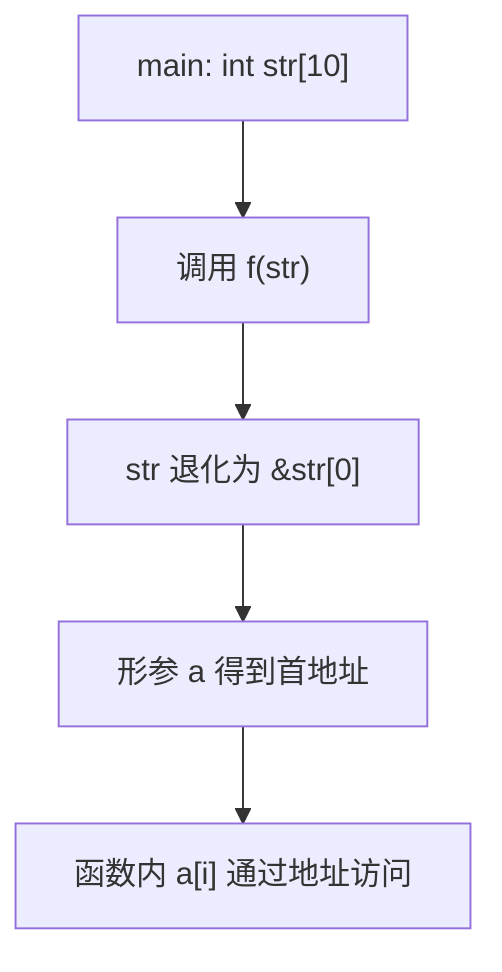

# 一维和二维数组作为函数参数的传递方式

## 数组传参的本质：传地址

C 语言把一维数组名作为实参传给函数时，**实际上传递的是数组首元素的地址**，而不是把整个数组复制一份。也就是说，`void f(int a[])` 里的 `a` 在函数内部已经"退化"成一个指针，等价于 `int *a`。



## 为什么需要这样做

如果每次调用都复制整个数组，开销会很大（比如 500 个 int 就是 2KB）。传地址后，函数直接操作原数组，==函数内修改 `a[i]` 会改变主函数里的 `str[i]`==，这正是排序、逆置等算法能生效的原因。

## 三种等效的形参写法

| 函数原型 | 是否合法 | 说明 |
|---|---|---|
| `void f(int a[]);` | ✅ | 最直观，推荐 |
| `void f(int a[10]);` | ✅ | 长度被忽略，与 `[]` 完全等价 |
| `void f(int *a);` | ✅ | 本质就是指针 |
| `void f(int a);` | ❌ | 只能接收单个 int，不能接受地址 |

> [!IMPORTANT]
> 形参里写的数组长度（如 `int a[5]`）编译器直接忽略，写 5、写 10、写 500 都一样。所以 `int x[20]`、`int x[]`、`int *x` 三者完全等效。

## 二维数组传参

二维数组传参时，**第一维长度可以省略，第二维必须写明**：

```c
void f(int a[][3], int n);   // ✅ 正确，列数 3 不能省
void f(int a[4][3]);         // ✅ 正确
void f(int **a);             // ❌ 错误！不是二级指针
```

因为 `a[i]` 的类型是"含 3 个 int 的一维数组"，编译器必须知道列数才能计算 `a[i][j]` 的偏移。

## 一个算对了的例子

```c
#include <stdio.h>

void findMinMax(int a[], int n, int *minOdd, int *maxEven) {
    int i;
    *minOdd = a[1]; *maxEven = a[0];   // 通过指针"返回"两个结果
    for (i = 0; i < n; i++) {
        if (i % 2 == 1 && a[i] < *minOdd) *minOdd = a[i];
        if (i % 2 == 0 && a[i] > *maxEven) *maxEven = a[i];
    }
}

int main() {
    int a[10] = {3, 8, 1, 6, 9, 2, 7, 4, 5, 10};
    int minOdd, maxEven;
    findMinMax(a, 10, &minOdd, &maxEven);
    printf("奇数下标最小值: %d\n", minOdd);   // 输出 2
    printf("偶数下标最大值: %d\n", maxEven);  // 输出 9
    return 0;
}
```

## 常见的坑

> [!WARNING]
> 函数内 `sizeof(a)` 得到的是指针大小（8 字节或 4 字节），不是数组总字节数。所以数组长度必须作为另一个参数传入，不能在函数内用 `sizeof(a)/sizeof(a[0])` 计算。

> [!CAUTION]
> 字符串比较不能写 `if (s1 > s2)`，必须用 `strcmp(s1, s2) > 0`。数组名传参后是指针，指针比较比的是地址大小，不是字典序。
