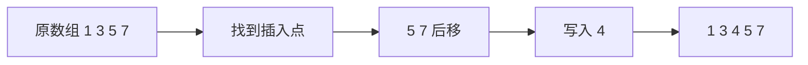

# 在有序数组中插入元素及删除指定元素

## 为什么要有序地插入与删除

有序数组的核心价值是**元素按关键字（如成绩、学号）排列**，查找、输出、统计都方便。插入新元素或删除指定元素后，仍要保持这个顺序；否则后续二分查找、按序输出都会失效。

关键问题：数组在内存中是连续存放的，中间不能“凭空多一格”或“少一格”。怎么办？==靠元素整体移动腾出位置或填补空位==。

## 在有序数组中插入元素

设数组已有 $n$ 个元素，按升序排列，要插入 $x$。

1. **找位置**：从后往前找，直到遇到第一个 $\le x$ 的元素，或找到数组开头。
2. **后移**：把位置之后的元素依次向后挪一格。
3. **放入**：$x$ 写入空出的位置，$n \leftarrow n+1$。

```c
/* a 按升序，n 为当前元素个数，capacity 为数组容量 */
int insert_sorted(int a[], int *n, int capacity, int x)
{
    if (*n >= capacity) return 0;      /* 数组已满，插入失败 */

    int i = *n - 1;
    while (i >= 0 && a[i] > x) {       /* 从后往前，边找边后移 */
        a[i + 1] = a[i];
        i--;
    }
    a[i + 1] = x;
    (*n)++;
    return 1;
}
```

从后往前移动是为了**先搬后面的，避免覆盖还没搬走的元素**。



## 删除指定元素

删除下标为 $pos$ 的元素：把它**后面的元素依次向前移一格**，再 $n \leftarrow n-1$。

```c
int delete_at(int a[], int *n, int pos)
{
    if (pos < 0 || pos >= *n) return 0;   /* 位置非法 */

    for (int i = pos; i < *n - 1; i++)
        a[i] = a[i + 1];                  /* 从前往后覆盖 */
    (*n)--;
    return 1;
}
```

若题目要求“删除值为 $x$ 的元素”，先顺序查找其下标，找不到就提示“不存在”，找到再调用上面的删除逻辑。

## 与相近操作的区别

| 操作 | 是否移动元素 | 移动方向 | 结果 |
|---|---|---|---|
| 有序插入 | 是 | 从后往前 | 长度 $+1$，仍有序 |
| 无序数组尾部插入 | 否 | — | 长度 $+1$，不保证有序 |
| 按下标删除 | 是 | 从前往后 | 长度 $-1$，顺序不变 |
| 用末尾元素覆盖被删项 | 只移 1 个 | — | 长度 $-1$，**破坏原有顺序** |

> [!IMPORTANT]
> 有序数组中插入、删除的本质都是**移动一段元素**，而不是改变数组的实际容量；逻辑长度 $n$ 必须同步更新。

> [!WARNING]
> 常见错误：插入前不检查数组是否已满，导致越界；插入时从前往后挪，造成数据被覆盖；删除后忘记 `n--`，把尾部残留的旧值当成有效元素输出。

## 一个算对的例子

初始 `a = {10, 20, 30, 40}`，$n=4$，容量为 6。

- 插入 `25`：`40`、`30` 先后后移，`25` 落到下标 2，得 `{10, 20, 25, 30, 40}`，$n=5$。
- 删除 `20`（下标 1）：`25, 30, 40` 依次前移，得 `{10, 25, 30, 40}`，$n=4$。数组末尾可能还留着旧的 `40`，但它已在有效范围之外，**遍历只到 `n-1`**。

> [!TIP]
> 口诀：**插入从后挪，删除往前移；先查边界，再改 $n$。** 平均都要移动约一半元素，时间复杂度为 $O(n)$。
