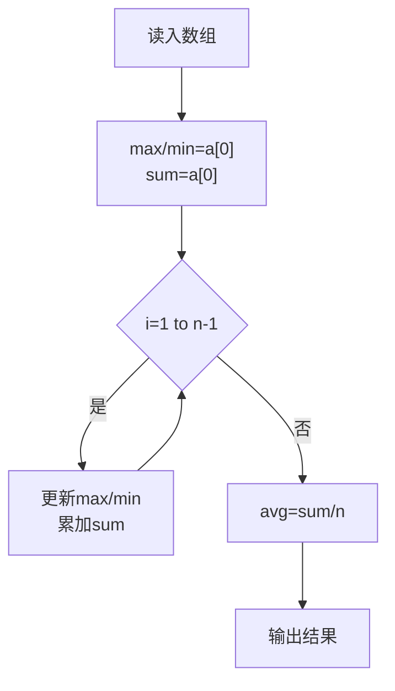

# 求解数组最大值、最小值及平均值的算法

## 算法本质与核心思路

求解数组最大值、最小值及平均值，本质是==线性扫描与状态更新==的过程。试想：如果让你在一排同学中找出最高和最矮的人，你会怎么做？你不可能一眼看全，只能从第一个开始，记住当前“最高”和“最矮”，每看到新同学就与之比较并更新记录。程序正是模拟这一过程，通过一次遍历同时完成三项统计。

> [!IMPORTANT]
> 核心考点：极值变量必须用==数组实际元素初始化==，而非随意赋值（如0或999），否则当数据全为负数或极大时结果错误。

## 算法流程图解



## 标准实现与真题示例

以南邮编程题“输入20个整数，求去掉最大值和最小值后的平均值”为例，该题在基础算法上增加了==条件过滤==逻辑：

```c
int a[20], max, min;
long sum = 0; // 防止累加溢出
scanf("%d", &a[0]);
max = min = a[0];
sum = a[0];
for (int i = 1; i < 20; i++) {
    scanf("%d", &a[i]);
    if (a[i] > max) max = a[i];
    else if (a[i] < min) min = a[i];
    sum += a[i];
}
double avg = (sum - max - min) / 18.0;
printf("%.2f\n", avg);
```

> [!TIP]
> 解题技巧：求“去极值平均”时，先正常累加全部元素，最后再减去 `max` 和 `min`，避免在循环中反复判断是否等于极值，既简洁又不易出错。

## 易错点与辨析

| 对比项 | 正确做法 | 常见错误 |
| :--- | :--- | :--- |
| 极值初值 | `max=min=a[0]` | `max=0; min=9999` |
| 平均值类型 | `(double)sum/n` | `sum/n`（整除丢精度） |
| 累加变量 | `long` 或 `double` | `int`（多元素易溢出） |
| 下标范围 | `0 ~ n-1` | `1 ~ n`（越界访问） |

> [!WARNING]
> 高危误区：若题目要求“去掉所有最大值和最小值”（即多个相同极值均剔除），则不能简单减一次 `max` 和 `min`，需额外计数或二次遍历统计极值个数。

> [!NOTE]
> 延伸辨析：单纯求最大/最小值只需比较操作；而求平均值必须配合累加。三者常合并考查，但“去极值平均”属于变体，务必审题区分“去掉一个”还是“去掉所有”。

掌握此算法的关键在于理解==状态变量的初始化依赖数据本身==，以及==整数除法向浮点转换的时机==。这两个细节是南邮历年填空题与编程题的高频失分点。
