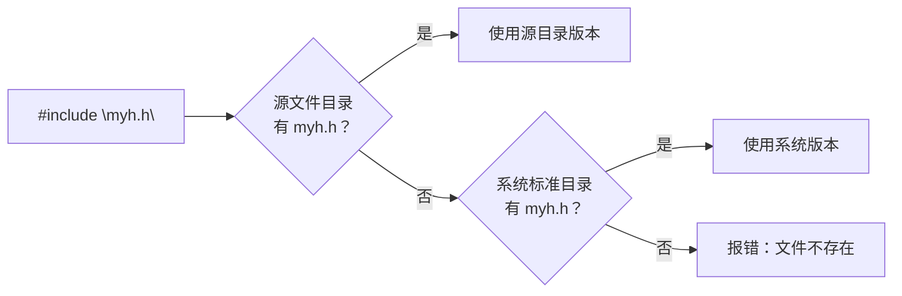

# 头文件包含指令（尖括号与双引号的区别）

## 头文件包含指令：尖括号与双引号

写程序时，我们总免不了要用别人写好的“现成工具”——比如 `printf`、`sqrt`、`strlen`。这些函数的声明放在一个个 **头文件** 里，而 `#include` 就是把这些头文件“贴”进源文件的指令。

### 为什么需要它

C 语言要求“先声明，后使用”。编译时，编译器必须知道 `sqrt` 的返回类型和参数类型才能检查调用是否正确。头文件里就装着这些声明。不包含 `<math.h>` 就直接用 `sqrt`，编译器可能会把它当作返回 `int` 的未知函数，导致结果错误。

### 两种包含形式的区别

回想一下你做过的选择题：双引号形式寻找被包含文件的方式是 **先在源程序所在目录搜索，再按系统设定的标准方式搜索**。尖括号形式则 **直接按系统设定的标准方式搜索目录**。

| 形式 | 搜索顺序 | 适用场景 |
|------|----------|----------|
| `#include <文件名>` | 仅系统标准目录 | 标准库头文件 |
| `#include "文件名"` | 源文件目录 → 系统标准目录 | 自定义头文件、项目内头文件 |

> [!IMPORTANT]
> ==双引号形式会先找源文件所在目录，再找系统目录==。这意味着如果你自己写了一个叫 `myh.h` 的文件放在源文件旁边，`#include "myh.h"` 优先用的是你自己的版本。

### 常见易错点

> [!WARNING]
> 很多同学认为 `#include "stdio.h"` 和 `#include <stdio.h>` 完全一样。功能上确实都能找到标准头文件，但 `"stdio.h"` 会先去源文件目录搜一遍。如果源文件目录下恰好有个叫 `stdio.h` 的文件，它就会被误包含，可能引发难以排查的错误。所以 ==标准库头文件一律用尖括号==，自定义头文件才用双引号。

另一个高频考点是判断哪些属于预处理指令。`#include`、`#define`、`#ifdef` 都以 `#` 开头，属于预处理指令；而 `typedef` 是 C 语言关键字，用于定义类型别名，==不属于预处理指令==。

### 算对了的例子

题目问：C 语言程序中需要用到 `sqrt` 等数学函数时，必须包含的头文件是什么？答案是 `math.h`，写成 `#include <math.h>`。因为 `sqrt` 是标准数学库函数，声明在 `<math.h>` 中，用尖括号直接去系统标准目录查找即可。同理，使用 `printf`、`scanf` 进行输入输出处理时，必须包含 `<stdio.h>`。

> [!TIP]
> 记忆口诀：**系统尖、自己双**。标准库头文件用尖括号，项目里自己写的头文件用双引号。
