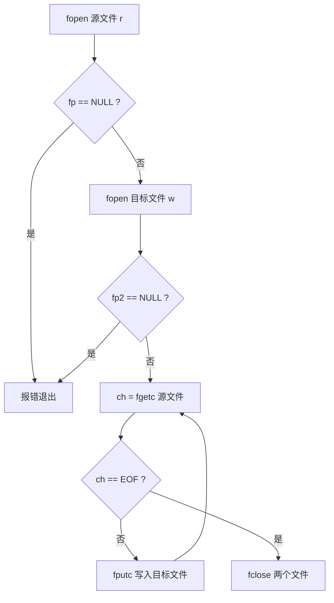

# 文件内容的读取显示与文件复制程序实现

## 文件内容的读取显示与文件复制

### 为什么需要文件读写

程序运行时的变量和数组都保存在内存中，程序一结束，这些数据就全部丢失。如果想把运行结果**长期保存**，或者想**处理大量事先准备好的数据**（比如 25 种手机的销量记录），就必须把数据写到硬盘上的**文件（file）**里，需要时再读回来。C 语言通过标准库 `<stdio.h>` 提供了一组文件操作函数，核心思路是：**用 `fopen` 打开文件 → 用读写函数搬运数据 → 用 `fclose` 关闭文件**。

### 打开与关闭文件

`fopen` 的函数原型为：

```c
FILE *fopen(const char *filename, const char *mode);
```

它返回一个指向 `FILE` 结构体的指针（文件指针）。如果打开失败（如文件不存在且模式不允许创建），返回 `NULL`。因此**必须判空**，否则后续读写会崩溃。

`fclose(fp)` 用于关闭文件，把缓冲区中残留的数据真正写入磁盘，并释放资源。

> [!IMPORTANT]
> 文件打开模式是本章最常考的选择题考点。`r` 表示读，`w` 表示写，`a` 表示追加（append），`+` 表示同时可读可写；`b` 表示二进制（如 `"rb"`、`"wb"`）。

| 模式 | 文件存在时 | 文件不存在时 | 能否读 | 能否写 |
|------|-----------|-------------|--------|--------|
| `"r"`  | 从头读 | ==打开失败== | ✔ | ✘ |
| `"w"`  | ==清空原有内容== | 创建新文件 | ✘ | ✔ |
| `"a"`  | 写到末尾 | 创建新文件 | ✘ | ✔ |
| `"r+"` | 保留原数据，从头读写 | 打开失败 | ✔ | ✔ |
| `"w+"` | ==清空原有内容== | 创建新文件 | ✔ | ✔ |
| `"a+"` | 保留原数据，可读，写到末尾 | 创建新文件 | ✔ | ✔ |

> [!WARNING]
> 想“保留原有数据且可读可写”，应选 `"r+"`；`"w+"` 会**清空**原文件，`"a+"` 虽然保留数据但**只能写到末尾**，不能改写中间内容。

### 按字符读取并显示文件内容

最基础的读取函数是 `fgetc`：

```c
int fgetc(FILE *fp);
```

它从文件中读取**一个字节**，返回值是读到的字符；当读到文件末尾时返回 `EOF`（一个负整数，通常定义为 `-1`）。因此循环读取的标准写法是：

```c
while ((ch = fgetc(fp)) != EOF) {
    putchar(ch);   /* 显示到屏幕 */
}
```

> [!CAUTION]
> 常见错误写法 `while (ch != EOF)` 或 `ch = fgetc(fp) != EOF`。前者在第一次比较时 `ch` 尚未赋值；后者由于 `!=` 优先级高于 `=`，会把比较结果（0 或 1）赋给 `ch`。==必须把赋值写在 while 条件里，并加括号==。

### 文件复制的实现思路

文件复制就是“从源文件一个字符一个字符地读，每读到一个就立刻写入目标文件”，直到遇到 `EOF`：



参考代码：

```c
#include <stdio.h>

int main() {
    FILE *in, *out;
    char ch;

    in  = fopen("D:\\data.txt", "r");
    if (in == NULL) { printf("源文件打开失败\n"); return 1; }
    out = fopen("D:\\copy.txt", "w");
    if (out == NULL) { printf("目标文件打开失败\n"); fclose(in); return 1; }

    while ((ch = fgetc(in)) != EOF) {
        fputc(ch, out);      /* 逐字符写入 */
    }

    fclose(in);
    fclose(out);
    return 0;
}
```

### 其他读写函数速览

| 函数 | 功能 | 典型用途 |
|------|------|---------|
| `fgetc` / `fputc` | 读 / 写一个字符 | 逐字符处理、文件复制 |
| `fgets` / `fputs` | 读 / 写一行字符串 | 按行处理文本 |
| `fscanf` / `fprintf` | 按格式读 / 写 | 读写结构化数据（对标 `scanf`/`printf`） |

> [!TIP]
> 记忆口诀：**“r 只读、w 清空写、a 末尾加、加号读写双”**。做模式选择题时，先看题目是否要求“保留原数据”，再看是否要求“可读可写”，两步即可锁定答案。
