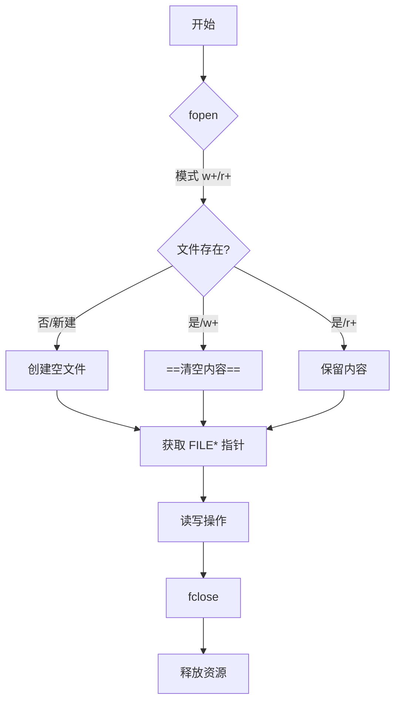

# fopen函数的模式参数与fclose函数的使用

## 文件打开与关闭的核心机制

在 C 语言中，文件操作并非直接对磁盘读写，而是通过 `FILE` 结构体指针作为中介。`fopen` 是建立这种连接的钥匙，而 `fclose` 则是安全断开的保障。理解模式参数（Mode）是掌握文件读写的==核心前提==。

### fopen 模式参数辨析

`fopen` 的原型为 `FILE *fopen(const char *filename, const char *mode)`。模式字符串决定了文件的访问权限及初始状态。南邮考题常考察 `"w+"` 与 `"r+"`、`"a+"` 的区别，尤其是**文件存在时是否清空内容**。

| 模式 | 含义 | 文件不存在 | 文件已存在 | 读写能力 |
| :--- | :--- | :--- | :--- | :--- |
| `"r"` | 只读文本 | 返回 NULL | 保留原内容 | 仅读 |
| `"w"` | 只写文本 | 创建新文件 | **清空原内容** | 仅写 |
| `"a"` | 追加文本 | 创建新文件 | 保留，指针在末尾 | 仅写 |
| `"r+"` | 读写文本 | 返回 NULL | 保留原内容 | 可读可写 |
| `"w+"` | 读写文本 | 创建新文件 | **清空原内容** | 可读可写 |
| `"a+"` | 读写文本 | 创建新文件 | 保留，指针在末尾 | 可读可写 |

> [!IMPORTANT]
> `"w+"` 的陷阱：若文件已存在，**原有数据会被立即清除**。因此，试图用 `"w+"` 读取旧文件内容是不可能的（如选择题 18 选项 C 错误）。

为了直观理解生命周期，参考以下流程：

### fclose 的必要性

许多初学者认为程序结束会自动关闭文件，从而忽略 `fclose`。这是一个==高危误区==。

> [!WARNING]
> 不调用 `fclose` 可能导致：
> 1. **数据丢失**：缓冲区中的数据尚未写入磁盘。
> 2. **资源泄露**：操作系统对打开文件数有限制。

`fclose(fp)` 的作用不仅是断开连接，更是**刷新缓冲区（Flush）**，确保所有待写数据真正落盘。

### 典型例题解析

回顾选择题 18：`fopen("new.txt", "w+")` 的描述错误的是？
- **分析**：`"w+"` 允许读写，但若 `new.txt` 已存在，系统会先将其长度截断为 0。
- **结论**：原有内容已消失，故“只能读取原有内容”说法错误。正确答案选 **C**。

再看填空题 7：`fopen("abc", "a+")` 若文件不存在？
- **分析**：`"a"` 系列模式在文件不存在时会**创建新文件**，且初始为空，指针位于开头（虽为追加模式，但新文件无内容，读写指针均在始端）。

> [!TIP]
> 记忆口诀：
> `r` 读不建，`w` 写必清；
> `a` 追加在后，`+` 号兼读写。
> 用完务必 `fclose`，数据落盘才安心。
